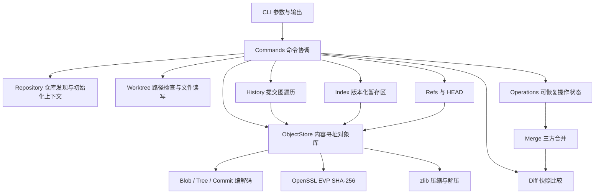
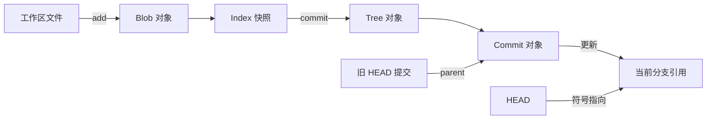

# 架构与数据约束

本页描述目标架构及 Phase 1 已交付子项的接口。仓库初始化、文件工具、摘要、对象编解码、对象库、Index、引用、快照构建与 add/commit/status/log 和轻量 tag 已实现；分支、差异及后续操作仍为计划；验收状态统一见 [进度](progress.md)。架构中的模块名称表示职责，不表示同名源码文件已存在。

## 依赖方向

CLI 负责解析参数、显示结果和返回退出码，commands 层协调具体命令涉及的模块。Repository 只提供仓库发现、初始化和上下文，不集中承载全部命令逻辑。`minigit_core` 承载版本管理逻辑，直接调用核心库时不需要运行 CLI 子进程。OpenSSL EVP 和 zlib 是对象存储底层依赖；C++20 标准库提供字节容器、路径和基础文件操作。



核心类型 [ObjectId](../include/minigit/object_id.hpp) 以固定 32 字节保存摘要，`from_bytes` 与 `bytes` 处理内部表示，`from_hex` 与 `hex` 处理 64 位十六进制文本。文本格式与内部字节表示明确分离，防止将十六进制文本误写入 tree 的二进制摘要字段。

当前 [ObjectStore](../include/minigit/object_store.hpp) 提供 `write`、`read` 和 `object_path`。[Repository](../include/minigit/repository.hpp) 提供 `init`、`discover`、`root`、`metadata`；它不代替 CLI 命令协调。文件工具提供 `RepoLock`、`atomic_write`、`read_file`，详见 [fs.hpp](../include/minigit/fs.hpp)。

## 持久化边界

仓库元数据存放在 `.minigit` 专用目录。当前初始化写入 `config`，内容为 `format=1` 和 `hash=sha256` 两行；`HEAD` 为 `ref: refs/heads/main`，此时 main 尚无首个提交。松散对象路径为 `objects/<摘要前两位>/<剩余六十二位>`。初始化先在临时目录构造元数据，再发布为 `.minigit`，有效仓库重复初始化保留已有内容。

当前持久化布局如下，操作日志与多文件事务在 Phase 2 增加：

```text
.minigit/
  config                 format=1 / hash=sha256
  HEAD                   ref: refs/heads/main 或完整提交 ID
  identity               version=1 与显式本地 name/email
  index                  MGIX v1 暂存区及校验和
  write.lock             持久锁文件；解锁不删除
  objects/ab/<62位ID>     zlib 松散对象
  refs/heads/<分支>       完整提交 ID 与换行
  refs/tags/<标签>        完整提交 ID 与换行
```

identity、index 和具体引用在首次使用时创建。Index、引用、快照与提交已实现；操作状态仍为计划。各项职责与阶段如下：

| 数据 | 责任 | 更新特征 |
| --- | --- | --- |
| 对象库 | 由摘要寻址的 blob、tree、commit；本子项 | 内容不可变，重复写入同一内容可复用 |
| Index | 路径、文件模式、blob 摘要及后续冲突状态 | 自有版本化格式，不复用 Git index 格式 |
| Refs / HEAD | 分支、轻量标签、当前分支或分离提交 | 小型可变数据，校验名称与目标类型 |
| Reflog | 引用移动的恢复线索 | Phase 2 引入，不能替代对象存储 |
| 操作状态 | 正在进行的合并或历史编辑及恢复信息 | Phase 3 起用于继续、中止与重启恢复 |

Index 已由 [index.hpp](../include/minigit/index.hpp) 定义为条目列表，`IndexEntry` 持有 `path/mode/id/stage`。磁盘格式为 `MGIX` 魔数、大端版本和条目数量；每项保存大端路径长度、路径字节、大端模式、stage 字节及原始 32 字节摘要，末尾附 SHA-256 校验。条目按路径和 stage 排序；同一路径不能同时包含 stage 0 和冲突阶段，正常快照不能同时包含文件路径及其子路径。文件缺失表示空 Index，文件损坏明确拒绝，不降级为空。

`add_paths` 在一个 `RepoLock` 下加载 Index，仅遍历选择范围，写入 Blob 后一次性保存新 Index。失败可能留下不可达对象，但不会把部分选择写入 Index。`scan_worktree` 的 `Snapshot` 是路径到文件模式及 Blob 摘要的映射，计算摘要不保存对象；`read_worktree_entry` 单独检查跟踪路径，使以后 `status` 能区分删除与工作区修改。

[refs.hpp](../include/minigit/refs.hpp) 定义 `Head`，同时保留符号分支名称及可选提交 ID，空 ID 表示未出生分支。引用文件保存完整 ID；`read_ref` 将文件缺失与损坏区分，`update_ref` 校验调用方预期旧值及目标 Commit 的完整可读取快照，再以原子替换发布新值。删除嵌套引用时只清理命名空间内的空父目录，保留 heads/tags；重试的幂等更新也补目录同步。`resolve_commit` 解析 HEAD、完整 ID、分支与标签，遇到同名分支及标签明确拒绝歧义。

[history.hpp](../include/minigit/history.hpp) 的 `Snapshot` 将目录树展开为路径映射；`write_snapshot` 校验 Blob 并递归构造子 Tree，`read_snapshot` 按模式校验每个对象类型。展开限制为 128 层 Tree、100000 Tree 条目（包含文件与目录）及 64 MiB 展开路径／Tree 数据，以免小型复用图展开为无限制内存。`create_commit` 在一个写锁下读取 Index、生成根 Tree、记录旧 HEAD parent、写入 Commit，最后移动分支或分离 HEAD。身份文件单独使用显式版本和 name/email 字段。

[tags.hpp](../include/minigit/tags.hpp) 将轻量标签命令组合到已验证的引用机制：`create_tag` 解析目标并使用预期旧值更新，`delete_tag` 复用安全目录清理，`list_tags` 先验证所有目标，再返回按名称排序的映射。三项操作各持有一个写锁；标签不保存新对象，也不改变 HEAD 或 Index。首版只允许指向具有有效快照的 Commit。

对象写入成功只表示内容已保存，后续引用更新成功才表示提交进入可见历史。Phase 1 即引入写锁、临时文件和元数据原子替换。`ObjectStore::write` 要求调用者持有 `RepoLock`，不会自行重复加锁；锁使用持久 `write.lock` 文件并阻塞获取，不通过删除锁文件表示解锁。`atomic_write` 使用临时文件、同步和原子替换。Phase 2 扩展工作区、Index、引用等多文件更新的事务与恢复机制，单文件原子替换不能自动保证全部状态的整体原子性。

目录创建及对象复用也同步父目录，覆盖一次写入已发布但目录同步失败后的重试。`atomic_write` 在替换之后若同步失败，会报错但新内容可能已经可见；调用者不能把所有异常理解为旧文件仍在。当前没有断电故障注入证据，不承诺命令级断电事务。

## 数据不变量

- 对象摘要计算输入为 `type + SP + decimal_size + NUL + payload`；长度统计字节数。压缩后的字节不参与摘要计算。
- 读取对象后验证压缩流、头部类型、声明长度和摘要，错误返回明确诊断；损坏对象不能继续解释为有效快照。
- tree 条目编码为 `mode + SP + basename + NUL + raw_object_id`，摘要字段固定 32 字节。按 basename 的无符号 UTF-8 字节排序，模式只允许 `100644`、`100755`、`40000`。禁止重复名称、无效 UTF-8、路径分隔符以及 `.`、`..`、`.git`、`.minigit` 名称。
- commit 编解码类型持有 tree、零个或多个 parent、author、committer 和 message。作者与提交者当前仅检查非空单行文本，不自动补充或验证业务时间语法；消息禁止 NUL。`create_commit` 从显式本地身份构造 `Name <email> seconds +0000`，使用运行时 UTC 秒；业务层拒绝空白消息、NUL 和非法身份。
- Index 记录将要提交的快照。`commit` 使用 Index，不重新把工作区的最新内容暗中纳入提交。
- Repository 保存绝对根路径，普通文件工具支持绝对和相对路径；先按原始路径逐段检查软链接，再规范化结果，不能提前消除 `link/..`。计划中的版本快照使用仓库相对路径，并拒绝越界与元数据目录，不能依赖字符串前缀判断归属。
- 分支和标签引用有效对象，HEAD 可以指向尚无首个提交的分支。未出生分支与损坏引用必须区分。
- 工作区写入之前检查未提交修改与未跟踪文件的覆盖风险。拒绝操作时不留下部分更新。
- 所有不支持的格式版本、文件类型和命令选项显式报错，不静默降级。
- 文件工具限制一次读取或写入为 64 MiB，对象解压后的完整封装也受此限制，实际 payload 上限需扣除头部；采用 Linux/POSIX 文件接口并拒绝路径中的软链接，其他平台没有验证。

## 关键数据流

`add` 的实际流程：发现仓库 → 检查与枚举路径 → 读取文件原始字节与模式 → 写入 blob → 更新 Index。重复添加相同文件应复用同一 blob。对象可能先于 Index 更新而存在；暂时不可达对象允许后续回收。

`commit` 的实际流程：读取 Index → 分目录构造 tree → 读取 HEAD 作为父提交 → 序列化 commit → 写入对象 → 更新当前引用。初次提交没有 parent；多父提交由合并阶段引入。



[status.hpp](../include/minigit/status.hpp) 的 `collect_status` 在一个写锁下读取一致的 MiniGit 元数据，分别比较 HEAD tree 与 Index、Index 与工作区，并单独枚举未跟踪路径。比较 Blob ID 与模式，模式变化也是修改。冲突路径从 Index 的 stage 集合映射到状态码，不能把冲突条目当成普通 stage 0。状态读取校验所有 Index Blob，不把缺失对象伪装成文件修改；只计算工作区摘要，不保存对象、Index 或引用。[dag.hpp](../include/minigit/dag.hpp) 的 `load_commit_graph` 沿所有 parent 收集闭包，对已发现节点去重，并检查父对象存在且类型为 Commit。`topological_order` 用 Kahn 算法统计每个节点尚未输出的子边，在计数变为零时输出；同时可输出的节点按 ObjectId 字节序排序，不能根据文件目录顺序或作者时间推断历史。`log_history` 获取一个写锁并解析起点，空 HEAD 返回空历史；显示上限只截断结果，遍历仍校验完整闭包。图限制 100000 节点、1000000 父边及 64 MiB 解码数据，避免损坏或极大历史无限制展开。后续 `diff` 复用快照比较，`merge` 则接收共同祖先、当前快照和待合入快照三个输入。

## 工程取舍

先实现松散对象，便于检查字节和定位问题；packfile、增量对象与网络协议不进入首版。自有 Index 格式降低初期编码负担，同时要求显式版本和损坏检查。普通 UTF-8 路径限制使首版聚焦对象语义；路径编码、大小写差异及平台文件模式仍需单独扩展和验证。

每层都应把业务错误转换为稳定的错误类型，由 CLI 统一报告。单元测试验证格式和不变量，集成测试验证跨模块状态变化，端到端测试检查命令输出、退出码和磁盘结果。更多验收条件见 [进度](progress.md)。
