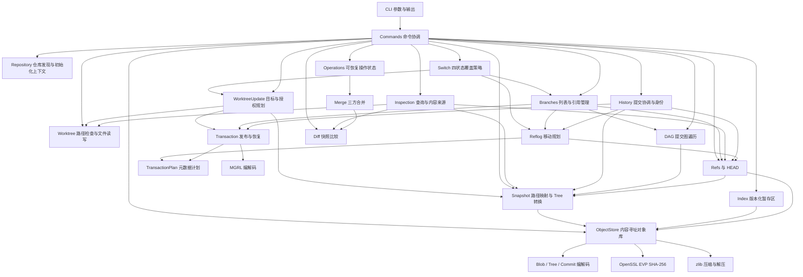
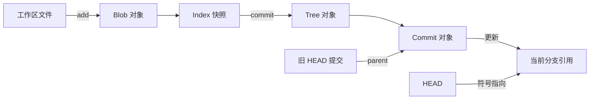
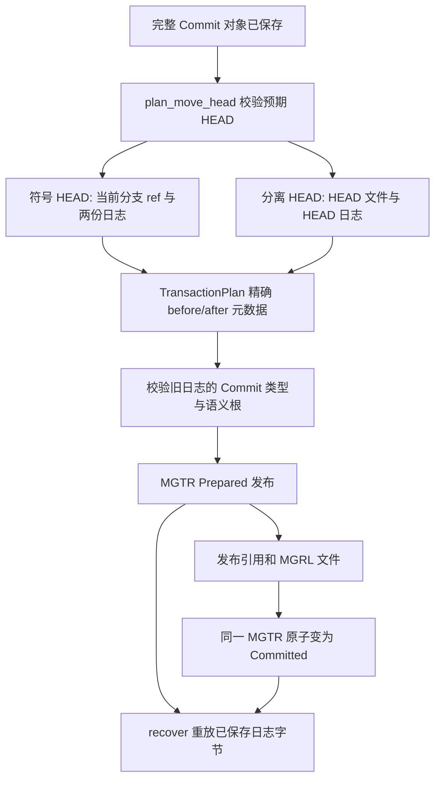
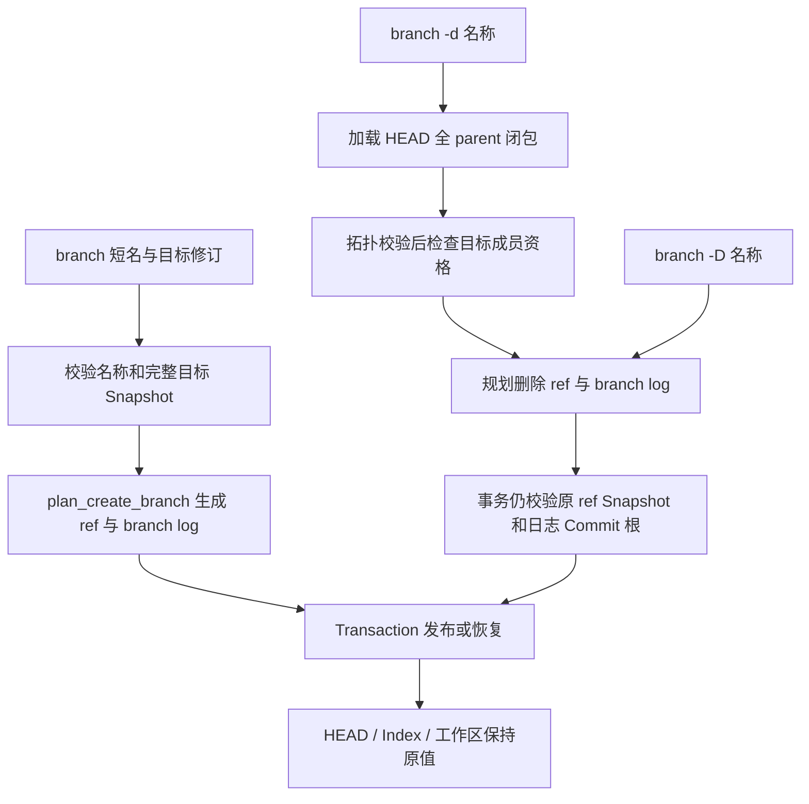
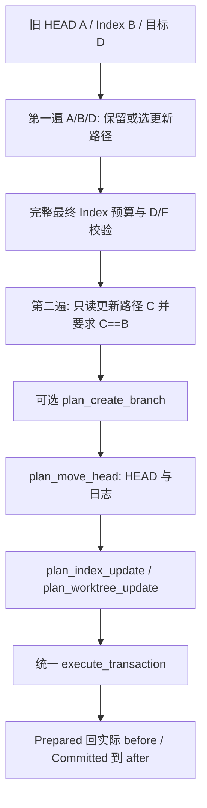
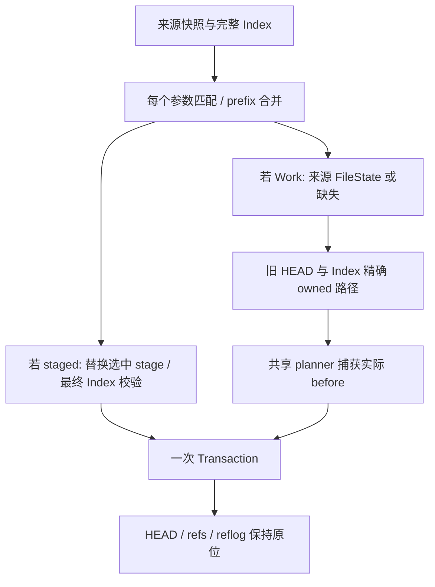
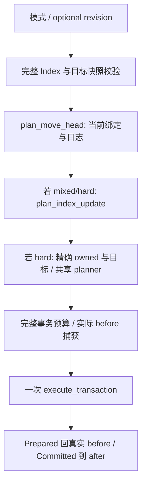
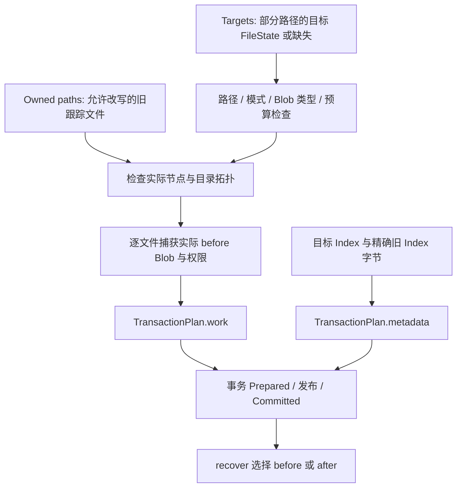
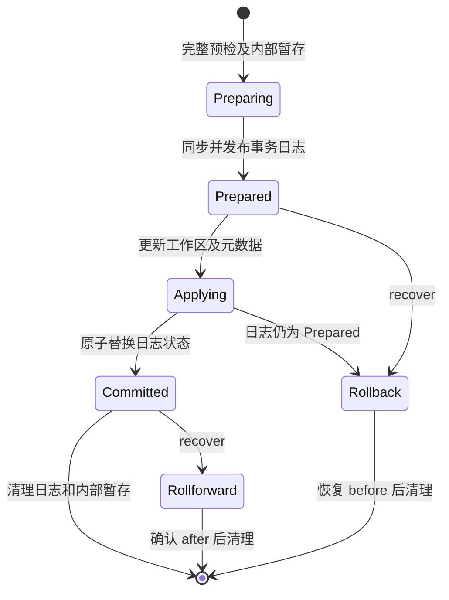

# 架构与数据约束

本页描述目标架构及已交付子项的接口。仓库初始化、文件工具、摘要、对象编解码、对象库、Index、引用、快照构建与 add/commit/status/log 和轻量 tag 已实现；纯差异引擎、diff 与 show CLI 已完成 Phase 2 子项验收；工作区短事务与 recover 已完成子项验收；reflog 与提交事务发布已通过子项验收，branch 管理已通过子项验收；共享工作区与 Index 更新规划器已验收，switch 工作区切换已通过子项验收；restore 内容恢复已通过子项验收；reset 三模式重置已通过子项验收，rm、mv 等后续操作仍为计划。验收状态统一见 [进度](progress.md)。架构中的模块名称表示职责，不表示同名源码文件已存在。

## 依赖方向

CLI 负责解析参数、显示结果和返回退出码，commands 层协调具体命令涉及的模块。Repository 只提供仓库发现、初始化和上下文，不集中承载全部命令逻辑。`minigit_core` 承载版本管理逻辑，直接调用核心库时不需要运行 CLI 子进程。OpenSSL EVP 和 zlib 是对象存储底层依赖；C++20 标准库提供字节容器、路径和基础文件操作。



核心类型 [ObjectId](../include/minigit/object_id.hpp) 以固定 32 字节保存摘要，`from_bytes` 与 `bytes` 处理内部表示，`from_hex` 与 `hex` 处理 64 位十六进制文本。文本格式与内部字节表示明确分离，防止将十六进制文本误写入 tree 的二进制摘要字段。

当前 [ObjectStore](../include/minigit/object_store.hpp) 提供 `write`、`read` 和 `object_path`。[Repository](../include/minigit/repository.hpp) 提供 `init`、`discover`、`root`、`metadata`；它不代替 CLI 命令协调。文件工具提供 `RepoLock`、`atomic_write`、`read_file`，详见 [fs.hpp](../include/minigit/fs.hpp)。

共享文件接口 `FileData` 同时保存字节与完整权限位 `07777`；`read_file_data` 从同一打开的普通文件获取读取前后 stat，检查大小、权限及纳秒级修改／状态时间没有变化，最后核对字节数。它返回已打开文件的稳定观测，不能保证当前路径没有被外部编辑器替换。`read_file` 复用这条读取链，仅返回字节。

`atomic_write_with_permissions` 在内容写完后为临时文件设置并核对明确权限，再同步与替换，使新内容和权限一起发布；旧 `atomic_write` 继续采用创建模式 `0644` 并受 umask 影响。`WorktreeFile` 组合 FileData 与由它计算的 FileState，`read_worktree_file` 复用路径分类：缺失、目录或普通文件祖先造成的 ENOTDIR 返回空，软链及特殊类型明确失败。读取不保存对象；add 和 scan 仍逐文件处理。

Snapshot 单独承载 `FileState/Snapshot` 模型、对象类型读取和 Index/Tree 转换，不依赖引用或命令。Refs 调用它校验发布目标；History 负责身份、HEAD 与提交协调。`head_snapshot` 保留在 History，因为它需要解析可变 HEAD。路径转义位于 [format.hpp](../include/minigit/format.hpp)，CLI 直接使用，Diff 无需依赖状态查询模块。

## 持久化边界

仓库元数据存放在 `.minigit` 专用目录。当前初始化写入 `config`，内容为 `format=1` 和 `hash=sha256` 两行；`HEAD` 为 `ref: refs/heads/main`，此时 main 尚无首个提交。松散对象路径为 `objects/<摘要前两位>/<剩余六十二位>`。初始化先在临时目录构造元数据，再发布为 `.minigit`，有效仓库重复初始化保留已有内容。

当前持久化布局如下；reflog 在首次记录事件时创建，长期操作状态仍待后续子项接入：

```text
.minigit/
  config                 format=1 / hash=sha256
  HEAD                   ref: refs/heads/main 或完整提交 ID
  identity               version=1 与显式本地 name/email
  index                  MGIX v1 暂存区及校验和
  write.lock             持久锁文件；解锁不删除
  transaction            MGTR v1，未完成短事务时存在
  transaction-staging/   本次双方节点的内部暂存
  objects/ab/<62位ID>     zlib 松散对象
  refs/heads/<分支>       完整提交 ID 与换行
  refs/tags/<标签>        完整提交 ID 与换行
  logs/HEAD              MGRL v1，HEAD 移动事件
  logs/refs/heads/<分支>  MGRL v1，该分支移动事件
```

identity、index 和具体引用在首次使用时创建。Index、引用、快照与提交已实现；操作状态仍为计划。各项职责与阶段如下：

| 数据 | 责任 | 更新特征 |
| --- | --- | --- |
| 对象库 | 由摘要寻址的 blob、tree、commit；本子项 | 内容不可变，重复写入同一内容可复用 |
| Index | 路径、文件模式、blob 摘要及冲突阶段 | 自有版本化格式，不复用 Git index 格式 |
| Refs / HEAD | 分支、轻量标签、当前分支或分离提交 | 小型可变数据，校验名称与目标类型 |
| Reflog | HEAD／分支的 old、new、原因事件序列 | Phase 2 已验收；与引用同事务发布，不能替代对象存储 |
| 操作状态 | 正在进行的合并或历史编辑及恢复信息 | Phase 3 起用于继续、中止与重启恢复 |

Index 已由 [index.hpp](../include/minigit/index.hpp) 定义为条目列表，`IndexEntry` 持有 `path/mode/id/stage`。磁盘格式为 `MGIX` 魔数、大端版本和条目数量；每项保存大端路径长度、路径字节、大端模式、stage 字节及原始 32 字节摘要，末尾附 SHA-256 校验。条目按路径和 stage 排序；同一路径不能同时包含 stage 0 和冲突阶段，正常快照不能同时包含文件路径及其子路径。文件缺失表示空 Index，文件损坏明确拒绝，不降级为空。

`add_paths` 在一个 `RepoLock` 下加载 Index，仅遍历选择范围，每读取一个文件就保存 Blob，只保留模式与对象 ID，在所有选择完成后一次性保存新 Index，内存不累积全部文件内容。失败可能留下不可达对象，但不会把部分选择写入 Index。`scan_worktree` 的 `Snapshot` 是路径到文件模式及 Blob 摘要的映射，计算摘要不保存对象；`read_worktree_entry` 单独检查跟踪路径，使以后 `status` 能区分删除与工作区修改。

[refs.hpp](../include/minigit/refs.hpp) 定义 `Head`，同时保留符号分支名称及可选提交 ID，空 ID 表示未出生分支。引用文件保存完整 ID；`read_ref` 将文件缺失与损坏区分，`update_ref` 校验调用方预期旧值及目标 Commit 的完整可读取快照，再以原子替换发布新值。删除嵌套引用时只清理命名空间内的空父目录，保留 heads/tags；重试的幂等更新也补目录同步。`resolve_commit` 解析 HEAD、完整 ID、分支与标签，遇到同名分支及标签明确拒绝歧义。

[snapshot.hpp](../include/minigit/snapshot.hpp) 的 `Snapshot` 将目录树展开为路径映射；`write_snapshot` 校验 Blob 并递归构造子 Tree，`read_snapshot` 按模式校验每个对象类型。展开限制为 128 层 Tree、100000 Tree 条目（包含文件与目录）及 64 MiB 展开路径／Tree 数据，以免小型复用图展开为无限制内存。[history.hpp](../include/minigit/history.hpp) 的 `create_commit` 在一个写锁下读取 Index、生成根 Tree、记录旧 HEAD parent、写入 Commit，最后由 reflog 规划器构造引用与日志的元数据计划，通过短事务发布。身份文件单独使用显式版本和 name/email 字段。

[tags.hpp](../include/minigit/tags.hpp) 将轻量标签命令组合到已验证的引用机制：`create_tag` 解析目标并使用预期旧值更新，`delete_tag` 复用安全目录清理，`list_tags` 先验证所有目标，再返回按名称排序的映射。三项操作各持有一个写锁；标签不保存新对象，也不改变 HEAD 或 Index。首版只允许指向具有有效快照的 Commit。

对象写入成功只表示内容已保存，后续引用更新成功才表示提交进入可见历史。Phase 1 即引入写锁、临时文件和元数据原子替换。`ObjectStore::write` 要求调用者持有 `RepoLock`，不会自行重复加锁；锁使用持久 `write.lock` 文件并阻塞获取，不通过删除锁文件表示解锁。`atomic_write` 使用临时文件、同步和原子替换。Phase 2 扩展工作区、Index、引用等多文件更新的事务与恢复机制，单文件原子替换不能自动保证全部状态的整体原子性。

目录创建及对象复用也同步父目录，覆盖一次写入已发布但目录同步失败后的重试。`atomic_write` 在替换之后若同步失败，会报错但新内容可能已经可见；调用者不能把所有异常理解为旧文件仍在。当前没有断电故障注入证据，不承诺命令级断电事务。

## 数据不变量

- 对象摘要计算输入为 `type + SP + decimal_size + NUL + payload`；长度统计字节数。压缩后的字节不参与摘要计算。
- 读取对象后验证压缩流、头部类型、声明长度和摘要，错误返回明确诊断；损坏对象不能继续解释为有效快照。
- tree 条目编码为 `mode + SP + basename + NUL + raw_object_id`，摘要字段固定 32 字节。按 basename 的无符号 UTF-8 字节排序，模式只允许 `100644`、`100755`、`40000`。禁止重复名称、无效 UTF-8、路径分隔符以及 `.`、`..`、`.git`、`.minigit` 名称。
- commit 编解码类型持有 tree、零个或多个 parent、author、committer 和 message。作者与提交者当前仅检查非空单行文本，不自动补充或验证业务时间语法；消息禁止 NUL。`create_commit` 从显式本地身份构造 `Name <email> seconds +0000`，使用运行时 UTC 秒；业务层拒绝空白消息、NUL 和非法身份。
- Index 记录将要提交的快照。`commit` 使用 Index，不重新把工作区的最新内容暗中纳入提交。
- Repository 保存绝对根路径，普通文件工具支持绝对和相对路径；先按原始路径逐段检查软链接，再规范化结果，不能提前消除 `link/..`。计划中的版本快照使用仓库相对路径，并拒绝越界与元数据目录，不能依赖字符串前缀判断归属。
- 分支和标签引用有效对象，HEAD 可以指向尚无首个提交的分支。未出生分支与损坏引用必须区分。
- 工作区写入之前检查未提交修改与未跟踪文件的覆盖风险。拒绝操作时不留下部分更新。
- 所有不支持的格式版本、文件类型和命令选项显式报错，不静默降级。
- 文件工具限制一次读取或写入为 64 MiB，对象解压后的完整封装也受此限制，实际 payload 上限需扣除头部；采用 Linux/POSIX 文件接口并拒绝路径中的软链接，其他平台没有验证。

## 关键数据流

`add` 的实际流程：发现仓库 → 检查与枚举路径 → 读取文件原始字节与模式 → 写入 blob → 更新 Index。重复添加相同文件应复用同一 blob。对象可能先于 Index 更新而存在；暂时不可达对象允许后续回收。

`commit` 的实际流程：读取 Index → 分目录构造 tree → 读取 HEAD 作为父提交 → 序列化 commit → 写入对象 → 规划引用与 reflog → 短事务发布。初次提交没有 parent；多父提交由合并阶段引入。



[status.hpp](../include/minigit/status.hpp) 的 `collect_status` 在一个写锁下读取一致的 MiniGit 元数据，分别比较 HEAD tree 与 Index、Index 与工作区，并单独枚举未跟踪路径。比较 Blob ID 与模式，模式变化也是修改。冲突路径从 Index 的 stage 集合映射到状态码，不能把冲突条目当成普通 stage 0。状态读取校验所有 Index Blob，不把缺失对象伪装成文件修改；只计算工作区摘要，不保存对象、Index 或引用。[dag.hpp](../include/minigit/dag.hpp) 的 `load_commit_graph` 沿所有 parent 收集闭包，对已发现节点去重，并检查父对象存在且类型为 Commit。`topological_order` 用 Kahn 算法统计每个节点尚未输出的子边，在计数变为零时输出；同时可输出的节点按 ObjectId 字节序排序，不能根据文件目录顺序或作者时间推断历史。`log_history` 获取一个写锁并解析起点，空 HEAD 返回空历史；显示上限只截断结果，遍历仍校验完整闭包。图限制 100000 节点、1000000 父边及 64 MiB 解码数据，避免损坏或极大历史无限制展开。后续 `diff` 复用快照比较，`merge` 则接收共同祖先、当前快照和待合入快照三个输入。

## 行差异与显示边界

[diff.hpp](../include/minigit/diff.hpp) 的纯算法不读取仓库：`split_lines` 借用内容缓冲区；`diff_lines` 返回两侧的半开编辑区间；`make_hunks` 将编辑与上下文组装为显示块；`format_file_diff` 接收两侧可选的内容视图和模式。缺失侧用 `nullopt`，不能用空 Bytes 代替。工作区内容来源与引用解析由后续命令协调层负责，算法不依赖 Status 或可变 HEAD。

[inspection.hpp](../include/minigit/inspection.hpp) 的 `repository_diff` 在一个 RepoLock 内选择两侧：Index→工作区、HEAD/修订→Index、修订→工作区或两个历史快照。涉及 Index 时拒绝冲突阶段，历史双修订不读取当前 Index。工作区候选只包含比较基准与需要的 Index 路径，不扫描无关未跟踪文件；内容由 WorktreeFile 读取，不假设尚未 add 的摘要已存在于对象库。`diff_snapshots` 作为持锁的共享快照查询，为后续 show 复用。逐路径加载内容、格式化并释放，最终结果不超过 64 MiB，输出前完成全部校验。

`show_object` 同样取得一个锁，并按 spec 选择对象、提交内路径或 Index stage。文件选择必须读到 Blob，不能把 Tree payload 当作文件；提交先读完整快照，再调用 `diff_snapshots` 比较第一父提交。原始对象及历史路径不读取 Index。`format_commit` 位于 Format，供 log 与 show 复用；它只组织已经解码的字段，不负责仓库访问或身份策略。单个条目、完整 log 与 show 输出均限制 64 MiB，避免消息缩进和头部展开突破源对象预算。

LCS 表最多 4000000 个单元，内部比较经过字节确认的行 ID。相同前后缀不进入 DP；超过表格预算仅替换剩余区间，超过每侧 100000 行则拒绝文本差异。Hunk 坐标始终零基，输出非空范围加一，空范围保持起点；无 LF 提示不计入行数。格式化先构造完整结果，每文件输出限制 64 MiB，显示路径最多 4096 字节并在复制前检查；二进制 NUL 仅显示摘要，不声称生成可恢复二进制内容的补丁。


## 工程取舍

先实现松散对象，便于检查字节和定位问题；packfile、增量对象与网络协议不进入首版。自有 Index 格式降低初期编码负担，同时要求显式版本和损坏检查。普通 UTF-8 路径限制使首版聚焦对象语义；路径编码、大小写差异及平台文件模式仍需单独扩展和验证。

每层都应把业务错误转换为稳定的错误类型，由 CLI 统一报告。单元测试验证格式和不变量，集成测试验证跨模块状态变化，端到端测试检查命令输出、退出码和磁盘结果。更多验收条件见 [进度](progress.md)。

## Reflog：引用事件与事务发布

[reflog.hpp](../include/minigit/reflog.hpp) 的 `ReflogEntry` 持有两个 `std::optional<ObjectId>` 和一个拥有自身字节的原因字符串；`Reflog` 是按发生顺序保存的 `std::vector`。端点缺失表示未出生或删除后的引用，不用全零 ID 冒充缺失。它记录本地引用事件，不改变 Commit 对象，也不以 parent 图代替事件顺序。

MGRL v1 是独立元数据格式，字段按以下顺序编码：

| 字段 | 编码与约束 |
| --- | --- |
| 魔数、版本、条目数 | `MGRL`，大端 `uint32_t` 版本 1，大端 `uint32_t` 数量 |
| 每项 old、new | 分别为单字节存在标志 0／1；存在时接原始 32 字节 ID |
| 每项原因 | 大端 `uint32_t` 字节长度，再接非空 UTF-8；最多 4096 字节，禁止 ASCII 控制字符及 DEL |
| 尾部校验 | 前面全部主体字节的 SHA-256，固定 32 字节 |

每份编码日志最多 8 MiB、100000 项。解码先验证大小和校验，再检查版本、存在标志、长度、UTF-8 和尾部剩余字节。日志丢失返回空序列，日志损坏明确失败。读取与规划要求调用者持有 RepoLock；CLI 另外检查待恢复事务，并在完整格式化至最多 64 MiB 后才输出。



当前符号 HEAD 下的 commit 改变分支 ref，并规划 `logs/HEAD` 与 `logs/refs/heads/<分支>`；HEAD 的符号文本本身保持同一分支。分离 HEAD 下的 commit 规划 HEAD 文件和 `logs/HEAD`。switch 复用规划器处理分支切换：不同分支即使指向同一个 ID，符号名称的变化也生成 HEAD 事件；目标分支没有移动时无需改写其分支日志。相同 Head 状态则不产生移动事件。

`plan_append_reflog` 与 `plan_move_head` 只准备内存中的 MetadataChange，不写文件；已有日志尾项的 new 必须与追加事件的 old 连续。实现先复制计划，在副本中完成检查与编码，再移动赋回，因此异常不会留下半个日志规划。执行器将日志 before/after 存为备份 Blob，与引用一起恢复；recover 不再次调用 append，避免一次中断增加两次事件。

事务预检与 `transaction_roots` 解析日志双方所有存在的 ID，验证对象哈希、Commit 类型及结构，并将它们加入语义根；历史事件不逐项展开 Tree。旧 Commit 的树缺损不应阻止单纯保存这条历史线索，新发布的提交目标仍须通过完整 Snapshot 校验。GC 尚未实现；actor、时间、过期策略、选择器及 reflog 撤销命令也不在当前格式中。

## Branches：管理引用，保持三棵树原值

[branches.hpp](../include/minigit/branches.hpp) 提供 `BranchInfo`、名称转换、列表、纯创建规划和创建／删除业务入口。`BranchInfo::id` 为空表示当前未出生分支，不意味着对应文件损坏；分离 HEAD 不属于任何当前分支。列表使用名称排序，按唯一 Commit ID 校验完整 Snapshot，避免多条分支指向同一提交时重复展开；短名总字节预算为 64 MiB。

`branch_ref` 只接收短名，拒绝 HEAD、refs/ 前缀和纯 64 位十六进制 ID，随后校验完整 refs/heads 名称与日志路径的 4096 字节／128 分量边界。`list_branches/create_branch/delete_branch` 各自取得 RepoLock 并检查待恢复事务；`plan_create_branch` 要求调用者已持锁，供 switch -c 将“创建引用”和“切换工作区”合在一个计划里。



新分支记录缺失→目标，强制移动记录旧值→目标；两者只改分支引用和 `logs/refs/heads/<名称>`，不生成 HEAD 移动事件。当前符号分支不能被该入口覆盖或删除，避免在没有工作区更新计划的情况下直接改变当前快照位置。非当前分支强制指向原目标是验证后的无操作，不添加重复事件。

安全删除的定义是“分支 tip 在当前 HEAD 的 parent 闭包中”，包含 HEAD 本身及所有父边，不以名称、时间或相同文件内容推断。先用 DAG 的拓扑校验拒绝损坏闭包与环，再检查包含关系。`-D` 跳过祖先判断，仍要求待删 ref 的完整快照及原日志结构、Commit 根有效；强制参数不绕过持久化协议。

删除将 ref 和该分支日志的 after 都设为缺失，在同一事务中发布；HEAD 日志不删除。只清理相关命名空间中的空父目录，保留 refs/heads 与 logs/refs/heads，并支持删除 topic/sub 后创建 topic。事务备份可用于未完成删除的回滚，完成删除后不会永久留一份分支日志。对象回收仍是后续阶段的独立职责。

## Switch：先证明可覆盖，再统一发布

[switch.hpp](../include/minigit/switch.hpp) 的 SwitchOptions 提供 new_branch、detach 与 target，`switch_worktree` 自行取得一次 RepoLock。普通目标经 branch_ref 选择短分支；detach 或新分支来源经 resolve_commit 解析。旧 HEAD 与目标的完整快照、完整 Index 编码和所有 Blob 均先校验，未解决 stages 拒绝。

令 A 为旧 HEAD、B 为 stage 0 Index、C 为实际工作文件、D 为目标。单路径状态包含模式和 Blob ID，缺失与空文件不同；按下表顺序判断：

| 条件 | 该路径的 Index 与 Work |
| --- | --- |
| A == D | 保留 B、C |
| 否则 B == D | 保留 B、C |
| 否则 B == A 且 C == B | 更新到 D |
| 其余 | 整个操作拒绝 |

实现分两遍判断：第一遍只看 A/B/D，确定保留或更新路径，并拒绝不兼容的 staged 状态；先校验完整最终 Index 的预算与 D/F 拓扑，才为更新路径读取 C 并要求 C==B。前两种保留情况不读取 C，因此不扫描无关文件，也不因未变化路径上的软链而失败；需要改写的软链和特殊节点拒绝。路径并集为 A∪B∪D，精确 owned 为 A∪B。全局校验防止保留的 staged 子文件与新目标父文件冲突；实际目录中的未知子项由共享 planner 继续检查。



业务入口不在持锁期间调用 self-lock create_branch，而组合 caller-lock 规划函数。普通 switch 不移动目标分支 tip；-c 才创建 ref 与分支日志。未出生且 -c 没有显式来源时，仅改变符号 HEAD 并记录 null→null 事件，不创建空 ref，保留已暂存和实际文件。Head 同值无操作仍先校验 Index；symbolic 不同但 ID 相同则仍记录切换。

工作区路径并集最多 200000 项／64 MiB 名称；原始与最终组合 Index 快照均限 100000 项／64 MiB 路径及条目数据，后续规划与事务继续遵循各自预算。完整权限用实际 before 备份，新写文件采用模式默认权限。核心与 CLI 已通过子项验收，验证证据见进度页；无强制丢弃修改、前一分支或远端追踪选择，不承诺原生 Git 全部 switch 策略兼容。

## Restore：选择范围和发布目的相互独立

[restore.hpp](../include/minigit/restore.hpp) 的 RestoreOptions 分开保存 source、staged、worktree；restore_paths 取得一次 RepoLock。核心与 CLI 已通过子项验收，执行证据见进度页。来源选择与目的选择分别表达：不指定目的标志时默认更新 Work，来源为 Index stage 0；仅 staged 或 staged+worktree 默认来源 HEAD，未出生 HEAD 无提交时拒绝。显式 source 必须解析并读取完整 Commit 快照；它可在未出生仓库中提供来源，HEAD 仍不移动。

| 目的 | 默认来源 | 可变状态 |
| --- | --- | --- |
| 默认／worktree | Index stage 0 | 选中实际文件 |
| staged | HEAD | 选中 Index 条目 |
| staged + worktree | HEAD | 选中 Index 与实际文件，同一事务 |

Index 读取校验全部阶段的 Blob，但不会全局拒绝冲突。默认 Index→Work 只拒绝选中冲突路径；未选中阶段保留。显式 Commit→Work 可恢复冲突位置，仍保留 Index；staged 更新才移除所选路径的全部阶段，再加入来源的 stage 0。

每个原始路径先独立匹配 source∪Index(all stages)，选择为 exact 或带斜杠边界的 prefix，没有 glob。重复与重叠选择去重，根选择覆盖全部已知版本路径。Index-only 使用词法选择，不探测实际工作文件的软链；实际 Work 修改交给 planner 检查，词法合法不代表可以覆盖未知内容。



工作区覆盖授权为旧 HEAD∪Index 全阶段的精确文件路径，来源中独有的历史文件不自动获得覆盖当前未知文件的权限。D/F 转换须选择包含旧文件的范围：每个已知旧子文件都要显式删除，未知子项仍阻止整体转换。来源缺失与 empty Blob 不同；工作区单目的不清 Index，Index 单目的不读取实际文件内容，但成功的事务仍可写入元数据镜像 Blob；这不等于对象库完全不写入。

来源与全部参数匹配先校验；需要更新 Index 时，再校验完整最终 Index，之后组合 Index 与 Work 的 caller-lock 计划，最后发布一次事务。无 HEAD 或日志移动规划。Index 全阶段限 100000 不同路径／300000 条记录，仍校验各预算与 typed Blob；共享 planner 还在捕获备份前检查 WorkChange 与已规划 MetadataChange 合计不超过 100000。来源串最多 4096 字节，原始路径每个最多 8192 字节、200000 参数／64 MiB；规范路径最多 4096 字节／128 分量，candidate、selected、owned 各限 200000 路径／64 MiB 名称。Restore 已通过子项验收，Reset 已通过子项验收，rm／mv 仍未交付。

## Reset：整体改变当前位置，按模式扩大发布范围

[reset.hpp](../include/minigit/reset.hpp) 用 ResetMode 枚举 Soft／Mixed／Hard，ResetOptions 的 mode 默认 Mixed，revision 为 optional。reset_repository 取得一次 RepoLock；没有 revision 和显式 HEAD 在未出生仓库里是不同输入，不能提前统一成同一字符串。

| 模式 | HEAD／当前分支与日志 | Index | 实际工作文件 |
| --- | --- | --- | --- |
| soft | 移至目标，保留符号／detached 绑定 | 原字节保留，任何冲突拒绝 | 不读取，不修改 |
| mixed（默认） | 同 soft | 完整替换为目标 stage 0，清冲突 | 不读取，不修改 |
| hard | 同 soft | 同 mixed | 选定路径并集恢复为目标 |

所有模式读取完整当前 Index，校验全部 stages 的 Blob、100000 不同路径／300000 条记录／64 MiB 编码预算；目标读取完整 Commit／Tree／Blob。mixed／hard 再校验最终 Index，逻辑相同则保留精确旧字节。hard 的路径并集为旧 HEAD A∪原 Index 全阶段∪目标 D，精确 owned 只取 A∪Index；没有 Switch 的干净矩阵，允许覆盖这些已跟踪文件的实际编辑。



目标 ID 与当前 ID 相同只省略引用及日志移动，mixed／hard 仍处理 Index／Work。默认未出生目标为空：soft 校验后无操作，mixed 清 Index，hard 再删旧 Index 的已授权工作文件；空 Index 已缺失时不擅自持久化空文件。显式有效提交可建立当前未出生分支，显式 HEAD 仍失败；detached reset 改 raw HEAD 与其日志，不移动任何已有分支。

hard 不能借父路径授权删除陌生后代。D/F 转换列出全部已知旧文件，未知／忽略子文件、陌生空子目录、软链或 FIFO 阻止需要的改写；删除叶文件可保留空父目录。完全相同的未知普通文件若字节和完整权限都无需改变，可被共享 planner 当作无操作，不能据此授权不同内容覆盖。实际 before 必须可读取和保存，hard 不跳过权限、同设备与恢复边界。

hard 的 union／owned 各最多 200000 路径／64 MiB 名称，路径4096字节／128分量，revision4096字节。共享纯预算 API 已实现，合计 Work／metadata 数量、路径、元数据前后镜像及 journal 预算在备份捕获前校验；两份合法 Index 也可能因为同时存入 journal 超限。Reset 已通过子项验收；rm／mv 尚未交付，Phase 2 仍未整体验收。

## WorktreeUpdate：把授权目标变为真实节点计划

[worktree_update.hpp](../include/minigit/worktree_update.hpp) 提供 `WorktreeTarget`、`WorktreeTargets`、`plan_worktree_update` 与 `plan_index_update`。二者都要求 caller-held RepoLock，不取得第二把锁。业务层选择目标、决定哪些旧路径可改，再把工作区、Index、HEAD 和引用日志组合到同一个 TransactionPlan；规划器不自行决定 switch 或 reset 的策略，也不提供这些 CLI。

WorktreeTarget 的可选 FileState 表示目标文件，空 optional 表示该路径不再作为普通文件；若新子路径需要它成为父目录，最终节点会由文件转为目录，否则删除。指向空 Blob 则表示保留零字节文件。可选完整权限默认从模式取得 `0644`／`0755`，显式权限必须与 `100644`／`100755` 的执行位一致，仍遵循事务的权限边界。未来 mv 可以保留完整权限，而不是只把内容变成普通 0644 文件。



改变实际普通文件必须获得 owned_paths 对该路径的精确授权；授权某个目录名不能代替授权其中每个文件。新文件的路径确实缺失时可以创建。忽略规则不把已有未授权文件变成可覆盖内容，业务层还需决定何时允许覆盖已跟踪修改；这个授权集合本身不证明工作区与 HEAD 一致。

部分更新只补新目标必要的缺失父目录，新目录权限为 0755；已有且不变化的父目录不记录，保留无关兄弟节点。目录变成文件或缺失时，递归检查完整实际目录：每个旧文件都要有精确授权及显式删除目标。精确 owned 的旧文件位置若实际变为空目录，可显式移除空节点；这不给子项递归授权。目录必须精确获授权或含已授权的后代路径，陌生空子目录、软链或 FIFO 拒绝。删除一个叶文件允许保留已空父目录，这是当前简化。执行器最终只删除已记录文件与空目录，不使用 remove_all。

每次工作区规划要求 plan.work 为空，但可保留其他已准备的 metadata。实现向副本添加 WorkChange，成功才赋回；异常保留原计划，已经写入的不可变备份对象可能留下。它不发布工作区或元数据，备份读取逐文件释放，不积累全部文件内容。

| 输入或结果 | 当前预算 |
| --- | --- |
| Targets、owned_paths | 各最多 200000 路径、64 MiB 路径字节 |
| 中间 desired／actual 节点缓存 | 各最多 200000 节点、64 MiB 展开名称字节；新键插入前检查 |
| 每个路径 | 最多 4096 字节、128 分量 |
| 生成的工作区改动 | 最多 100000 WorkChange，受事务预算约束 |

`plan_index_update` 支持所有 stage，校验目标及现有 Index 编码、模式、路径和所引用的 Blob 类型。现有文件损坏拒绝，缺失则精确记录 before=null；不将缺失擅自换成编码后的空 Index。已有 index 元数据计划拒绝重复规划，只有精确编码字节相同才是无操作。它复用 MGIX 与 MGTR，没有新增持久化格式。

展开预算覆盖推导父目录与递归清单，roots 从受限 desired 复制；输入合法不意味着所有展开结果都能保留。该预算限制名称和节点数量，不将文件内容累计为总文件大小上限。

本子项核心实现已完成，验证入口是核心单元测试，构建与验证证据见进度页；switch 已提供真实 CLI 学习实验。共享规划机制已实现，不代表各业务命令的覆盖策略已经交付。

## 工作区短事务与恢复

短事务机制已通过 Debug/sanitized 相关回归及实验验收。commit 的引用与 reflog 事务发布已通过后续子项验收；branch 创建、移动与删除接入同一机制，已通过子项验收。add/tag 继续使用各自原子元数据写入。所有业务查询和修改检查待恢复事务；原始 Blob/Tree 观察仍可使用。分支与工作区更新命令将复用这些共同机制。

问题来自更新范围：切换分支可能需要删除旧文件、创建目录、写入新文件，并修改 Index 与 HEAD。分别原子替换每个文件，仍可能在第三步崩溃后留下前两步的新内容。事务因此保存每个节点的 before/after 和可恢复意图，而不是只记录“曾经执行过哪个命令”。

[transaction.hpp](../include/minigit/transaction.hpp) 区分 `Absent`、`File` 与 `Directory`；文件保存 Blob ID 和完整权限，目录保存权限，缺失与空文件不同。`capture_work_node` 备份实际工作字节，不能用 HEAD 快照代替：若用户在提交后编辑过文件，中止时必须恢复编辑后的原内容。元数据保存精确可选字节，缺失与空文件也分别表示；日志内部将字节存为 Blob，避免把多个大 Index 嵌入日志。



`.minigit/transaction` 使用 MGTR v1：大端版本和计数、状态字节、路径及双方 NodeImage、元数据备份 Blob ID，最后为整个主体的 SHA-256；总计最多 64 MiB，最多 100000 项改动、每路径 4096 字节和 128 分量。它是单个带校验的日志；Prepared/Committed 状态与全部数据一起原子发布。独立的“成功标记”会使两份文件的清理顺序产生歧义，因此不采用它。`.minigit/transaction-staging` 只保存本次待发布节点，名称可以由日志推导；目录先在内部暂存区创建并设置权限，再原子移动到工作区。工作目录不产生随机临时文件，文件／目录转换时也无需删除未知临时项。

恢复先检查整份日志、所有备份对象、当前工作节点和元数据，只有当前状态属于 before、after 或明确的合法中间缺失状态才开始修改。删除仅针对计划中的普通文件和空目录；目录内出现计划外条目、外部编辑、软链接、特殊文件、损坏备份或不支持的设备布局都会拒绝并保留现场。重复执行恢复必须收敛到同一结果。

安全文件操作通过固定父目录 fd 的 `unlinkat`、`renameat` 和目录发布的 `renameat2(RENAME_NOREPLACE)` 实现，并同步受影响父目录。暂存目录在极端 umask 下可能最初为 0000；Linux 的 `O_PATH` 固定其 inode，再经 `/proc/self/fd` 设置访问权限以完成精确权限和同步。当前要求 Linux/POSIX、可用 procfs，并拒绝事务涉及的跨文件系统发布。写锁只协调 MiniGit 进程，不能锁住普通编辑器；预检后与单次系统调用之间的外部竞态仍是明确边界。

公开 API 的测试钩子在持久化步骤之后模拟子进程突然退出，不通过生产 CLI 或环境变量开启。阶段证据会记录实际覆盖的崩溃点；没有系统调用同步失败注入或真实断电实验时，不把进程退出测试写成断电证明。

当前恢复不保存 owner/group 或文件时间戳；重新发布相同内容时 inode 和 mtime 可以变化。设备检查涵盖当前节点、已存在父链及元数据暂存，拒绝不同 st_dev；同设备挂载点等布局不作完整识别。同步发生在发布之后的失败重试，恢复会重发文件、核对目录权限并同步实际存在父链。

进程在 `atomic_write` 的随机临时文件写入内部被终止时，内部暂存可能出现未记录的 `.minigit-tmp-*`；此时恢复拒绝自动删除未知项并保留现场。现有恢复设计和测试以公开持久化步骤完成边界为证据，不承诺任意系统调用内部中断均能自动恢复。系统调用级故障注入及已知临时项协议属于后续改进。
