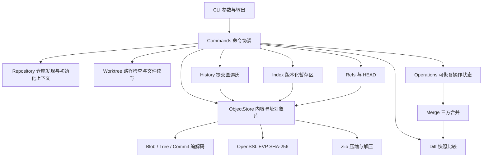
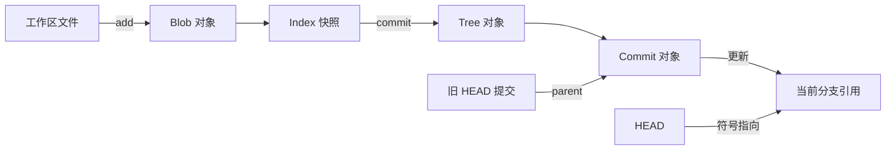

# 架构与数据约束

本页描述目标架构。当前业务模块尚未全部实现；已交付状态统一见 [进度](progress.md)。架构中的模块名称表示职责，不表示同名源码文件已存在。

## 依赖方向

CLI 负责解析参数、显示结果和返回退出码，commands 层协调具体命令涉及的模块。Repository 只提供仓库发现、初始化和上下文，不集中承载全部命令逻辑。`minigit_core` 承载版本管理逻辑，直接调用核心库时不需要运行 CLI 子进程。OpenSSL EVP 和 zlib 是对象存储底层依赖；C++20 标准库提供字节容器、路径和基础文件操作。

核心类型 `ObjectId` 计划以固定 32 字节保存摘要，显示时编码成 64 位十六进制字符串。文本格式与内部字节表示明确分离，防止将十六进制文本误写入 tree 的二进制摘要字段。

## 持久化边界

仓库元数据存放在 `.minigit` 专用目录，包含松散对象、暂存区、引用和后续操作状态。自有格式必须包含可识别的版本信息，具体编码随实现交付记录。以下是计划中的逻辑组织，不是已经生成的目录：

| 数据 | 责任 | 更新特征 |
| --- | --- | --- |
| 对象库 | 由摘要寻址的 blob、tree、commit | 内容不可变，重复写入同一内容可复用 |
| Index | 路径、文件模式、blob 摘要及后续冲突状态 | 自有版本化格式，不复用 Git index 格式 |
| Refs / HEAD | 分支、轻量标签、当前分支或分离提交 | 小型可变数据，校验名称与目标类型 |
| Reflog | 引用移动的恢复线索 | Phase 2 引入，不能替代对象存储 |
| 操作状态 | 正在进行的合并或历史编辑及恢复信息 | Phase 3 起用于继续、中止与重启恢复 |

对象写入成功只表示内容已保存，引用更新成功才表示提交进入可见历史。Phase 1 即引入写锁、临时文件和元数据原子替换，避免半成品对象与引用；Phase 2 扩展工作区、Index、引用等多文件更新的事务与恢复机制。单文件原子替换不能自动保证全部状态的整体原子性。

## 数据不变量

- 对象摘要计算输入为 `type + SP + decimal_size + NUL + payload`；长度统计字节数。压缩后的字节不参与摘要计算。
- 读取对象后验证压缩流、头部类型、声明长度和摘要，错误返回明确诊断；损坏对象不能继续解释为有效快照。
- tree 条目编码为 `mode + SP + basename + NUL + raw_object_id`，摘要字段固定 32 字节。条目按明确的字节排序规则生成，禁止重复名称和含路径分隔符的 basename。
- commit 持有 tree、零个或多个 parent、作者与提交者身份、业务时间和消息。相同的完整序列化内容产生相同摘要；业务时间属于对象内容，不能省略其对身份的影响。
- Index 记录将要提交的快照。`commit` 使用 Index，不重新把工作区的最新内容暗中纳入提交。
- 仓库路径为规范化的相对路径，拒绝越界、元数据目录、软链接和非法路径。操作必须在修改前检查目标，不能依赖字符串前缀判断路径归属。
- 分支和标签引用有效对象，HEAD 可以指向尚无首个提交的分支。未出生分支与损坏引用必须区分。
- 工作区写入之前检查未提交修改与未跟踪文件的覆盖风险。拒绝操作时不留下部分更新。
- 所有不支持的格式版本、文件类型和命令选项显式报错，不静默降级。

## 关键数据流

`add` 的计划流程：发现仓库 → 检查与枚举路径 → 读取文件原始字节与模式 → 写入 blob → 更新 Index。重复添加相同文件应复用同一 blob。对象可能先于 Index 更新而存在；暂时不可达对象允许后续回收。

`commit` 的计划流程：读取 Index → 分目录构造 tree → 读取 HEAD 作为父提交 → 序列化 commit → 写入对象 → 更新当前引用。初次提交没有 parent；多父提交由合并阶段引入。

`status` 分别比较 HEAD tree 与 Index、Index 与工作区，并单独枚举未跟踪路径。`log` 沿 commit 的 parent 遍历，不能根据对象文件的目录顺序推断历史。后续 `diff` 复用快照比较，`merge` 则接收共同祖先、当前快照和待合入快照三个输入。

## 工程取舍

先实现松散对象，便于检查字节和定位问题；packfile、增量对象与网络协议不进入首版。自有 Index 格式降低初期编码负担，同时要求显式版本和损坏检查。普通 UTF-8 路径限制使首版聚焦对象语义；路径编码、大小写差异及平台文件模式仍需单独扩展和验证。

每层都应把业务错误转换为稳定的错误类型，由 CLI 统一报告。单元测试验证格式和不变量，集成测试验证跨模块状态变化，端到端测试检查命令输出、退出码和磁盘结果。更多验收条件见 [进度](progress.md)。
