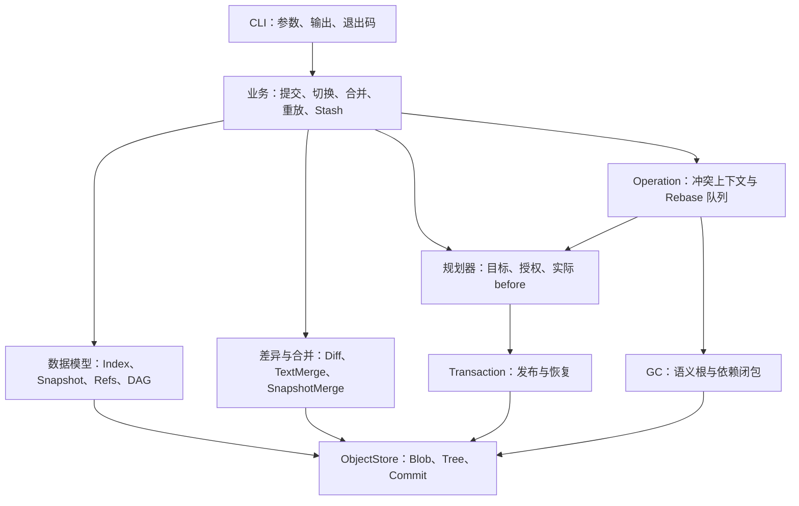
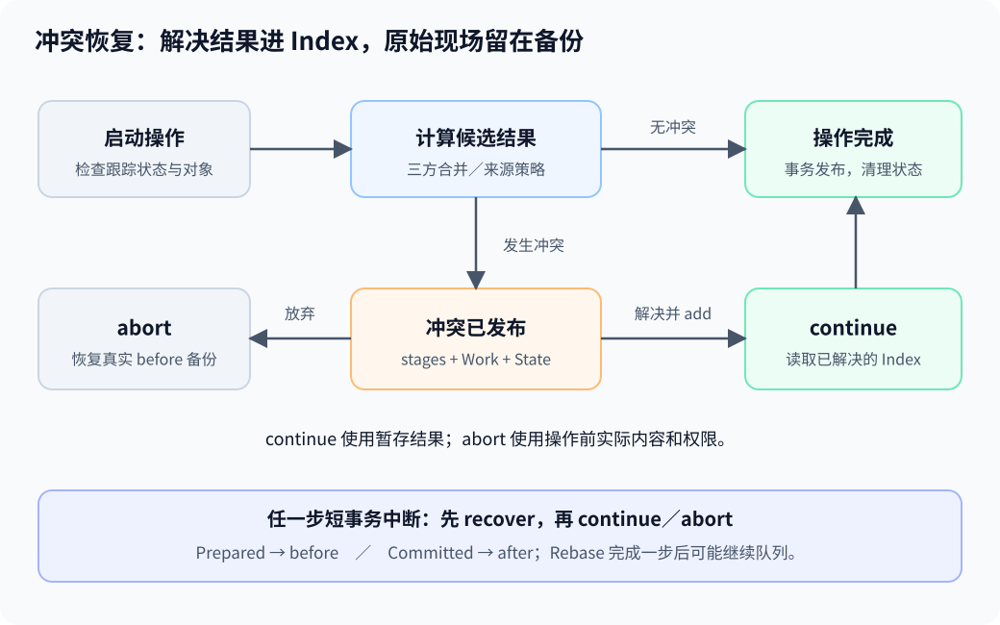

# 架构与约束

## 模块分层



CLI 只负责入口，`minigit_core` 提供可直接调用的 C++ 业务。Repository 提供仓库发现、初始化与根路径；ObjectStore 使用 OpenSSL EVP 与 zlib。源码入口见[代码导读](code-walkthrough.md)。

业务入口取得 `RepoLock`，内部 planner 和存储工厂要求调用者已持锁，避免重复加锁。锁协调 MiniGit 进程，不锁住外部编辑器。

## 持久化布局

```text
.minigit/
  config                 format=1 / hash=sha256
  HEAD                   符号分支或完整 Commit ID
  identity               仓库本地 name/email
  index                  MGIX v1：路径、模式、Blob ID、stage
  write.lock             持久锁文件，解锁不删除
  objects/ab/<62位ID>     zlib 松散对象
  refs/heads/<分支>       分支 Commit ID
  refs/tags/<标签>        轻量标签 Commit ID
  logs/HEAD              MGRL v1：HEAD 移动事件
  logs/refs/heads/<分支>  MGRL v1：分支移动事件
  stashstack             MGST v1：newest-first Work Commit 栈
  refs/stash             与栈 top 配对
  operation              MGOP：跨命令操作状态
  transaction            MGTR v1：未完成短事务
  transaction-staging/   本次事务的内部暂存节点
```

初始化 HEAD 指向尚无提交的 `main`。Index、身份、引用和日志按首次使用创建；缺失和损坏必须区分，不将损坏数据视为空仓库。

MGIX／MGRL／MGST／MGOP／MGTR 使用版本、长度与计数检查，并附 SHA-256 校验。MGOP v1 用于 Merge／CherryPick／Revert，v2 用于 StashApply 与 Rebase 的专用上下文。

## 数据不变量

| 数据 | 核心约束 |
| --- | --- |
| ObjectId | 内部 32 字节，文本为完整 64 位十六进制 |
| Blob | 字节内容；摘要涵盖类型、长度与 payload |
| Tree | `mode SP basename NUL raw-id`；按无符号 UTF-8 名称排序，无重复 |
| 模式 | 文件 `100644`／`100755`，子目录 `40000` |
| Commit | 根 Tree、有序 parents、author／committer、消息；消息禁止 NUL |
| Index | 按 path／stage 排序；同路径不能同时有 stage 0 与冲突阶段 |
| Snapshot | 路径→模式与 Blob ID；普通文件和其后代路径不能同时存在 |
| Refs | 严格校验名称、目标 Commit 与预期旧值；HEAD 可为未出生分支 |

读取对象验证压缩流、封装长度、类型与摘要。路径先检查原始组件再规范化，拒绝越界、元数据路径及软链；不能先消除 `link/..` 再检查。正常快照只保存文件可执行位，事务备份另保存完整权限 `07777`。

## 暂存与提交

路径语法与新写入的 4096 字节／128 分量边界由 `repo_path` 集中定义，Index 发布预算由索引模块检查。解码允许旧版本格式合法的越界索引，以便清理工作文件后用 `add -A` 重建；新写入始终符合边界。

引用发布也检查完整的 `refs/...` 路径边界，标签名的预算包含 `refs/tags/` 前缀，使新引用能被列表和 GC 遍历。删除只检查语法，允许清理旧版本写入的超深引用。

`add` 在遍历时检查路径预算，逐文件读取并保存 Blob，保留路径／模式／ID，全部选择成功后一次发布 Index。失败可遗留不可达对象，旧 Index 保留。

`commit` 从 Index 构造分层 Tree 和 Commit，再规划引用与 reflog，最后用短事务发布。存储工厂 `store_commit_snapshot` 只保存不可变对象，不读取当前 Index／Work，也不移动 HEAD。内容已保存与历史已发布是两个步骤。

## 工作区更新

业务决定覆盖策略，`WorktreeUpdate` 接收目标与精确授权路径，捕获实际 before，再生成事务计划。授权目录名称不能代替授权每个文件；未知、忽略文件和陌生空目录仍受保护。删除只处理已记录文件和空目录。

Switch 对每条路径比较旧 HEAD=A、Index=B、Work=C、目标=D，按顺序判断：

| 条件 | 处理 |
| --- | --- |
| A=D 或 B=D | 保留 B／C |
| 否则 B=A 且 C=B | 更新到 D |
| 其余 | 整体拒绝 |

Restore 的来源、路径和 Index／Work 目的独立；Reset 按 soft／mixed／hard 扩大更新范围；Rm 检查暂存内容是否会丢失；Mv 分别迁移 Index B 与 Work C。参数和模式表集中在[命令参考](commands.md#恢复重置与路径操作)。

目标模型区分 File、Directory、Absent。空 Blob 是零字节文件，不能代替 Absent；需要更新目录权限时，完整目录库存也要纳入检查。规划失败不发布可变状态，可留下不可变备份 Blob。

## 冲突与恢复



短 Transaction 负责一次 Work／Index／HEAD／refs／logs／operation 的组合发布。日志记录精确 before／after：Prepared 恢复 before，Committed 确认 after；恢复再次中断后可以重试。所有备份与现场先完成校验，计划外修改会阻止恢复。

Operation 保存跨命令上下文、原始 HEAD／整份 Index 和受影响区域的实际备份。它的状态更新也通过短事务发布：

| 操作 | 结果与继续来源 |
| --- | --- |
| Merge | 唯一最低共同祖先；快进或两父提交；冲突继续读取 resolved Index |
| CherryPick／Revert | 来源父快照或空快照决定变化方向；单父新提交，包括空结果 |
| StashApply | 分别合并保存的 Work 与可选 Index；不创建提交、不移动 HEAD |
| Rebase | oldest-first 线性队列，临时 detached；原分支最后更新与 attach |

冲突阶段保存原始输入，marker 只供工作区显示。Continue 检查完整 Index 已为 stage 0；Abort 恢复整份 raw Index／HEAD 与受影响区域的实际 before。区域外 Work 保留，新增未知子项或引用外部变化可阻挡中止。

Rebase 的 Ready 表示当前来源尚未执行，Conflicted 表示等待 Index 解决；不能将 Ready 的 Index 当成解决结果。每步保存首次 before、更新最新 after，累计备份须处理文件／目录转换和原 File／Absent 祖先。完成当前冲突后若还有来源，下一步重新要求干净 tracked Work。

## Stash 的两份版本

保存 H（HEAD）、I（Index）、W（tracked Work），`-u` 另存 U（非忽略 untracked）。I 的 parent 是 H，W 的 parents 为 H、I 和可选 U。活跃栈的每个 entry 都是根，不能只保护 top。

恢复始终计算 `RW=merge(H,当前,W)`；`--index` 另算 `RI=merge(H,当前,I)`。默认不把 clean RW 全部暂存。U 只写到真实缺失位置；部分跨层 D/F 冲突拒绝。状态绑定原栈与 refs/stash 的精确字节，Pop 完整成功后才删指定位置。

## 对象回收与边界


GC 拒绝 pending Transaction，允许 active Operation。根包含 Index 所有 stage、全部 Stash entries、raw Index／Stack 备份内部 ID、Rebase onto／完整队列、Work before／after。默认一天 freshness 与未来 mtime 对象也是额外根，要保留完整依赖闭包。

删除前认证所有对象，包括 orphan；任一损坏均阻止删除。Sweep 按引用者先于被引用者的拓扑顺序，避免正常部分删除留下悬空依赖；删除失败可能已清理部分对象，无原子回滚。

## 资源与平台

| 范围 | 上限 |
| --- | --- |
| 普通文件／对象完整封装、主要输出 | 64 MiB；对象 payload 需扣除头部 |
| 对象压缩容器 | zlib `compressBound(64 MiB)`；解压后仍受上述封装限制 |
| 规范工作路径 | 4096 字节、128 分量 |
| Tree 展开 | 128 层、100000 entries（含目录）、64 MiB 展开数据 |
| Index | 100000 不同路径、300000 stage 记录、64 MiB 编码 |
| 工作规划输入／中间节点 | 各 200000 路径或节点、64 MiB 名称 |
| 短事务／Operation | 100000 改动记录、64 MiB 编码；组合预算另校验 |
| DAG／GC 图 | 100000 节点、1000000 边、64 MiB 逻辑图数据 |
| 每份 reflog | 100000 事件、8 MiB 编码 |
| 行差异 | 每侧 100000 行、4000000 个 LCS 单元 |

这些预算分别约束输入、展开和组合结果，不等于精确 heap 上限。文件读取从同一 fd 获取字节与权限并检查期间变化，不保证返回后路径不被替换。

工作区事务依赖 Linux/POSIX、可用 `/proc/self/fd` 和同文件系统发布；文件需 owner-read，目录需可读遍历，更新子项的目录需 owner-rwx。恢复保留内容与权限，不恢复 owner／group／mtime。测试覆盖公开持久化步骤完成后的中断；系统调用内部留下未知临时项或非 before／after 节点时会严格拒绝自动恢复，不承诺任意断电均可恢复。
