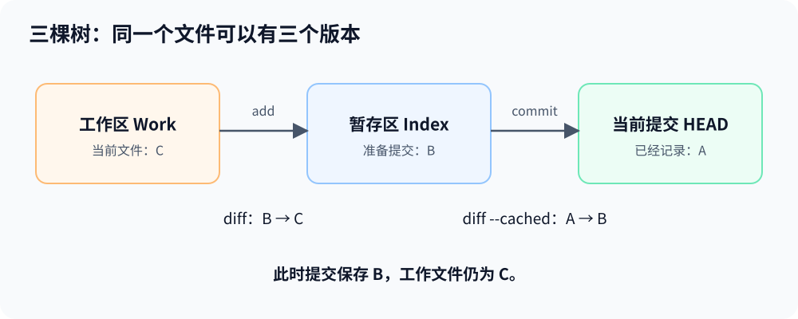
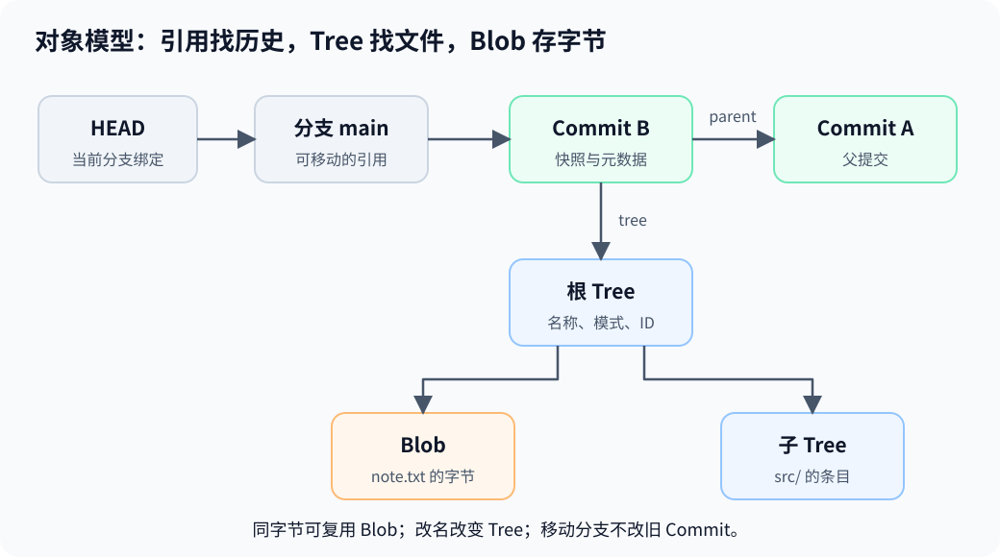

# 原理图解

MiniGit 借鉴 Git 的内容寻址与快照模型，采用自己的持久化格式。先理解下面三组关系，再运行[学习实验](learning-notes.md)。

## 三棵树：已经提交、准备提交、正在编辑

HEAD 的 Tree 是已提交快照，Index 是下次提交的内容，工作区是当前实际文件。

| 操作 | 比较或读取 |
| --- | --- |
| `diff --cached` | HEAD→Index，查看已暂存变化 |
| `diff` | Index→工作区，查看未暂存变化 |
| `diff HEAD` | HEAD→工作区，查看当前文件相对历史的变化 |
| `show HEAD:note` | 读取已提交版本 |
| `show :note` | 读取暂存版本 |

例如 HEAD=A、Index=B、Work=C，状态为 `MM`。此时 commit 保存 B，工作文件仍为 C。Index 保存对象 ID 与模式，不能只把它理解为文件名清单。

## 对象：字节、名字、历史各有位置

| 对象或引用 | 保存什么 |
| --- | --- |
| Blob | 文件字节，不含文件名 |
| Tree | 名称、模式与 Blob／子 Tree ID |
| Commit | 根 Tree、parent、author、committer 与消息 |
| 分支／轻量标签 | 一个 Commit ID |
| HEAD | 当前分支的符号引用，或 detached Commit ID |

同字节文件复用 Blob；改名改变 Tree，内容不变时无需新 Blob。提交保存完整快照入口，补丁在查询时计算；相同快照也可能因父关系、身份或消息不同得到不同 Commit。

对象摘要输入为 `type + 空格 + 字节长度 + NUL + payload`，例如 `blob 3\0abc` 中的 `\0` 代表一个 NUL 字节。MiniGit 对未压缩封装求 SHA-256，再用 zlib 保存；读取时校验压缩流、类型、长度和摘要。

## 分支、历史与引用事件

创建分支只保存一个位置，不切换工作文件。Switch 改变当前绑定，并安全更新 Index／Work；Reset 移动当前位置，按模式决定是否更新内容。

Commit 的 parent 组成不可变 DAG，合并提交可有两个 parent。`log` 遍历所有父边、去重共享祖先，并保证子提交先于父提交；作者时间不能代替拓扑关系。

`reflog` 记录本地引用移动事件。例如 Reset 从 B 回到 A，只追加 B→A 事件，不改 B 的 parent。两条分支都指向 A 时，切换仍可记录 A→A：事件序列与提交父图是两种数据。

## 三方合并与冲突

三方引擎比较基线与两侧变化。独立修改可组合，重叠且不同的修改需要解决。

| base | ours | theirs | 结果 |
| --- | --- | --- | --- |
| a / b / c | A / b / c | a / b / C | A / b / C |
| a / b / c | a / B / c | a / X / c | 中间一行冲突 |
| a / b / c | a / B / c | a / B / c | 相同修改保留一次 |

Index stage 1／2／3 保存原始 base／ours／theirs；缺失的一侧不补零 ID。工作文件中的 marker 只是呈现，不能代替原始阶段。`add` 将解决结果变为 stage 0，continue 使用 Index，而非重新读取 Work。

CherryPick 使用“来源父、当前、来源”三个快照；Revert 交换基线与来源，应用逆向变化。Rebase 重复执行单父重放，创建新链，最终才移动原分支。

## 恢复与可达性

请求目标与操作前实际状态不同。HEAD=A、Index=B、Work=C，操作目标=D 时，事务 before 必须保存 C；拿 A 代替备份会丢失未提交编辑。

短事务处理一次发布中断，跨进程 Operation 记录冲突或 Rebase 队列。`recover` 先处理短事务，之后才能 continue／abort；状态图见[架构](architecture.md#冲突与恢复)。

对象仍存在不代表有分支指向它，删除分支也不立即删除对象。GC 从引用、日志、Index 各 stage、完整 Stash 栈和操作备份等根遍历依赖。装有 Index 字节的备份 Blob 还包含其他 Blob ID，这些内部引用也必须保留；新 Commit 的保留窗口同样覆盖它依赖的旧 Tree／Blob。

## 实现取舍

| 方面 | MiniGit 范围 |
| --- | --- |
| 格式 | 固定 SHA-256、自有 Index／日志／状态格式，不与 Git 仓库互读 |
| 文件与平台 | 普通 UTF-8 相对路径、二进制内容与可执行位；Linux/POSIX，拒绝需要访问的软链与特殊节点 |
| 存储 | zlib 松散对象，无 pack／增量对象 |
| 差异 | 有界 LCS；超表格预算整体替换变化区间，可能更保守；无重命名检测 |
| 合并与重放 | 唯一 merge base、线性 Rebase，无交互式重放 |
| 其他 | 无 remote、子模块或 reflog 过期策略 |

延伸阅读：[Git Objects](https://git-scm.com/book/en/v2/Git-Internals-Git-Objects)、[Git References](https://git-scm.com/book/en/v2/Git-Internals-Git-References)。具体格式与资源边界见[架构](architecture.md)。
