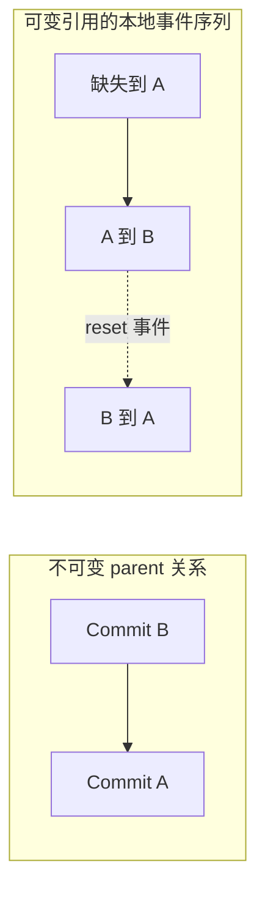

# Git 原理与 MiniGit 的选择

本文介绍 MiniGit 的对象库与快照实现。可通过 `hash-object` 和 `cat-file` 观察对象，`add` 保存暂存内容，`commit` 将 Index 组织为 Tree 并链接 parent，`status` 比较三棵树。验收状态见 [进度](progress.md)，对象格式约束见 [架构](architecture.md)。真实 Git 的行为以本页链接的官方资料为参考，MiniGit 的自有格式不视为兼容性实现。

## 内容寻址与快照

内容寻址把对象完整内容映射为摘要，再用摘要检索对象。blob 保存文件字节，文件名和模式由 tree 保存；commit 连接根 tree、父提交和提交元数据。因而重命名文件通常改变 tree，文件内容不变时 blob 可以复用。真实 Git 的对象模型和松散对象封装见 [Git Objects](https://git-scm.com/book/en/v2/Git-Internals-Git-Objects)。

MiniGit 使用以下未压缩字节作为 SHA-256 输入：

```text
blob 3\0abc
```

这里 `\0` 表示一个 NUL 字节，不是反斜杠和数字两个字符；`3` 是 payload 的字节长度。对头部和 payload 一起求摘要，使类型和长度参与对象身份。随后压缩这串字节并写入对象库。读取过程先解压，再校验头部、长度和摘要。

文件的相同 payload 会得到相同 blob 摘要。两次提交即使文件内容一致，只要作者、提交者、业务时间、父提交或消息改变，commit 摘要仍可能改变。

当前 `hash-object file` 只计算摘要，不写入磁盘；`hash-object -w file` 通过仓库写锁保存 zlib 松散对象。`cat-file -t` 返回类型，`cat-file -p` 可输出保存的字节。因此修改工作区文件不会修改已保存对象。[对象实验](../examples/experiments/objects.sh) 会运行并检查这个性质。

## Tree 为什么是二进制结构

MiniGit 的 tree 编解码接口采用以下条目编码：

```text
mode SP basename NUL <32 bytes object id>
```

模式区分普通文件、可执行文件和目录。文件条目指向 blob，目录条目指向子 tree。文件名没有跨目录部分，因此 `src/main.cpp` 在根 tree 中表现为 `src` 子树，在子树中表现为 `main.cpp` 文件。

名称排序必须固定，否则同一个目录从不同遍历顺序构造，会得到不同 tree 摘要。MiniGit 按 basename 的无符号 UTF-8 字节排序，模式只接受 `100644`、`100755`、`40000`；解码拒绝未排序或重复条目。没有验证真实 Git 的特殊目录排序规则之前，不能将“排序一致”当作格式兼容的证据。

当前 `encode_commit` 和 `decode_commit` 在文本中保存 `tree`、重复的 `parent` 行、`author`、`committer`、空行及消息。author/committer 只要求非空单行文本，并未验证身份和时间语法；业务 `create_commit` 负责提供规范身份与运行时 UTC 时间。底层编解码不自动猜测身份，使格式层与命令策略各有职责。

## 工作区、Index 与 HEAD

这三个状态回答不同问题：工作区是现在的文件，Index 是下一次提交准备记录的内容，HEAD 的根 tree 是当前提交已经记录的内容。

| 比较 | 含义 | 例子 |
| --- | --- | --- |
| HEAD → Index | 已暂存改动 | 文件从 `A` 暂存成 `B` |
| Index → 工作区 | 未暂存改动 | 暂存 `B` 后继续编辑成 `C` |
| 工作区路径不在 Index | 未跟踪文件候选 | 新建文件尚未 add |

因此 `add` 后继续编辑，再执行 `commit`，应提交暂存的版本。Index 不是“被跟踪文件名的清单”，而是一次待提交快照的持久化表示。真实 Git index 还含冲突阶段、统计信息及扩展等结构，详见 [gitformat-index](https://git-scm.com/docs/gitformat-index)；MiniGit 使用单独版本化的自有格式。

MiniGit 的 `add` 已体现这种分离：工作区字节先成为不可变 Blob，Index 记录其 ID。删除文件通过移除 Index 条目表示，不需要为“已删除”再创建对象。可执行位由 Index 与 Tree 保存，属于快照的一部分，即使内容摘要相同，模式变化也必须进入下一次提交。

如果 HEAD 保存 A、Index 保存 B、工作区保存 C，MiniGit status 输出 `MM`，两列对应不同状态边界。只比较 HEAD 与工作区会丢失 B，无法解释下一次 commit 将保存什么。只比较文件修改时间也不可靠：内容寻址直接比较内容 ID，同时单独比较可执行模式。

## 快照保存，差异临时计算

Commit 引用的是完整 Tree，Blob 保存完整字节；两个提交之间的补丁是在读取时计算出来的。默认 `git diff` 比较 Index 与工作区，`git diff --cached` 比较 HEAD 与 Index，双提交参数比较两个快照；真实 Git 还提供 Myers、minimal、patience、histogram 等算法选择，见 [git-diff](https://git-scm.com/docs/git-diff)。MiniGit 的行差异引擎采用有界 LCS，命令接入状态见 [进度](progress.md)。

设旧行序列为 A，新行序列为 B，`L(i,j)` 表示从 A 的第 i 行、B 的第 j 行开始能保留的最长公共子序列长度。末端值为零；若当前行相等，`L(i,j)=1+L(i+1,j+1)`；否则取 `max(L(i+1,j),L(i,j+1))`。相等行保留，不相等处根据更大的剩余值删除或插入。平局优先删除，使重复行也有稳定结果。

例如 `A=[red, green, blue]`，`B=[red, yellow, blue]`，共同子序列为 red、blue，中间编辑为删除 green、插入 yellow。内部 Edit 记录旧区间和新区间的零基起点及数量；未来合并可将 base→ours 和 base→theirs 的编辑投射到同一 base 坐标，识别是否修改了同一区间，无需解析显示补丁。

MiniGit 先剥离相同前后缀，将精确相等的行映射成相同整数，再对剩余部分计算 DP，避免每个单元重复比较长行。表格限制为 4000000 个单元（包括边界行列）；超预算时将剩余区间整体替换，结果仍准确，但可能不够精简，也可能让以后合并更保守。每侧最多 100000 行，超限明确报错；这是资源边界，不把多行文本伪装成一条行记录。

选择 LCS 是为了让递推、回溯和编辑坐标容易核验，代价是剩余区间的时间及空间随两侧行数乘积增长。Myers 从编辑路径出发，对改动较少的长文件通常更合适；将来替换算法时，保留 EditScript 接口和逐字节应用测试即可，不要求 Merge 跟随重写。这是先固定语义再改善性能的边界。

行保留原始 CR 字节及是否有末尾 LF，空文件是零行，`a\n` 与 `a` 不相等。统一补丁在编辑附近显示三行上下文，合并相接的上下文范围，并为缺少 LF 的输出行添加提示；提示不参与行数。任何一侧含 NUL 时仅显示二进制差异摘要。空文件新增、删除及只有可执行位变化时，仍需输出文件和模式信息；“不存在”与“零字节文件”是不同快照状态。

## 引用、提交图与恢复

分支是可移动的提交引用；轻量标签通常保持指向选定对象。HEAD 可符号指向分支，也可直接指向提交，后者称为分离 HEAD。提交通过 parent 构成有向无环历史，分支名不存入 commit 内容，见 [Git References](https://git-scm.com/book/en/v2/Git-Internals-Git-References)。

MiniGit 首次提交没有 parent，后续提交记录提交前的 HEAD。父关系让相同文件快照处于不同历史位置时仍有不同身份。分支引用保存一个 ID，移动分支只需更新很小的引用文件；树与 Blob 可以继续复用。当前 `create_commit` 已支持更新符号分支或分离 HEAD；branch 列表、创建及删除已通过子项验收，switch 已接入工作区切换，验证状态见进度页。

MiniGit 的 log 已遍历完整 parent 图，不能只沿第一父链。一份合并历史若 D 的父为 B、C，而 B、C 的父都为 A，需输出 D、B/C、A，且 A 只出现一次。具体 B/C 顺序采用对象 ID 排序，但 A 必须在 B 和 C 之后，这就是拓扑约束。作者时间由用户及运行环境决定，不能代替父关系。

轻量标签不需要额外对象：MiniGit 的 `tag saved-B` 将当前提交 ID 写入标签引用，随后提交 C 只移动分支。`log saved-B` 仍从原提交开始。附注标签则需要 Tag 对象保存身份、消息及目标；首版范围限定轻量标签，所以 ObjectType 保持 Blob/Tree/Commit 三类。

规划中的 merge 为两个分支找到共同祖先，比较 base、ours、theirs，得到结果 tree；产生新合并提交时记录两个 parent。cherry-pick 把一个提交相对其父提交的改变应用到当前历史，revert 则应用逆向改变。冲突状态需要持久化，才能在解决后继续或中止，不能只留下冲突标记而丢失操作上下文。

引用移动不等于删除对象。reflog 记录移动的线索，gc 根据根集合分析可达性，再遵守保留规则回收不可达对象。真实 Git 还有 packfile 和增量对象，见 [gitformat-pack](https://git-scm.com/docs/gitformat-pack)。MiniGit 首先使用松散对象，gc 的具体策略在 Phase 4 实现时定义。

## 创建分支不等于切换分支

MiniGit 的 `branch topic` 把当前提交 ID 写入 refs/heads/topic，同时记录该分支的创建事件。HEAD 仍绑定原分支，Index 和工作文件也不改变。main 与 topic 此刻指向同一个不可变 Commit；随后在 main 提交 B，main 才前进，topic 仍指向 A。分支保存位置，提交保存快照与父关系。

`branch -d topic` 用当前 HEAD 的完整祖先集合判断是否可安全删除。若 B 的 parent 是 A，topic 指向 A，则从 B 沿 parent 可达 A，可以删除 topic；如果另一个分支指向独立提交 C，文件即使与 B 相同，也不能由快照相等推导出已合入。多父历史必须包含所有 parent，拓扑校验保证判断来自有效的图。

`-D` 明确放弃这项祖先保护，但仍要求原分支快照和删除事务中的日志对象有效。它同时删除分支 ref 与分支日志，不改变 Commit 本身，也不删除 HEAD 日志。删除分支后对象暂时仍在；将来 GC 才根据当前引用、保留日志和进行中操作等根决定可达性。本实现不提供删除后永久保存分支日志的保证。

## Reflog 记录位置变化，log 读取父关系

MiniGit 已接入自己的 MGRL 引用日志，验证状态见 [进度](progress.md)。连续提交 A、B 时，Commit B 的 parent 为 A，而初始分支日志记录“缺失→A”和“A→B”。前者回答 B 从哪里发展，后者回答本地引用经历了什么动作。reset 将引用从 B 移回 A 时，无需改写 B 的 parent，也不会创建一个“反向 parent”；它会留下新的 B→A 事件。

核心移动规划还能区分两条都指向 A 的分支。HEAD 从一条分支切到另一条，提交 ID 没变，符号绑定已变，所以 HEAD 日志可以记录 A→A。这样的自环是有效事件，却不能作为提交 DAG 的父边。branch 管理已通过子项验收，switch 与 commit 已实际记录事件，Reset 已通过子项验收。



MiniGit 将当前分支引用、HEAD 日志和分支日志放入同一短事务；分离 HEAD 使用 HEAD 文件和它的日志。恢复重放已规划的完整 before/after 日志字节，不重新生成业务事件。Reflog 不保存文件内容，未来 GC 仍须沿它保留的 Commit ID 检查对象可达性；只保留装着日志字节的备份 Blob 不够。

当前 CLI `reflog` 逆序显示事件，缺失端点用 `-`，只接受 HEAD 或分支，文件缺失为空。显示的 `HEAD@{0}` 是序号标签，尚未支持选择器解析、身份、时间、过期或撤销动作。MGRL 是 MiniGit 的简化格式，不声称兼容 Git 的 reflog 文件。

## 与真实 Git 的差异

| 方面 | MiniGit 的目标 | 真实 Git 的参考 |
| --- | --- | --- |
| 哈希 | 固定 SHA-256，32 字节内部表示 | 同时涉及 SHA-1 与 SHA-256 仓库和迁移机制 |
| 仓库格式 | 自有格式和版本标识 | 生产级格式、扩展和兼容约束 |
| Index | 按学习需求设计的版本化格式 | 具有多版本、扩展与冲突阶段的格式 |
| 对象存储 | 首先只支持 zlib 松散对象 | 包含 packfile、增量和维护机制 |
| 路径与类型 | 首版普通 UTF-8 路径、二进制文件、可执行位；拒绝软链接 | 支持范围更广，具体行为受平台影响 |
| 命令 | 分阶段实现本地版本管理 | 包含网络传输、远程、钩子、子模块等大量功能 |

真实 Git 的 SHA-256 格式与转换包含对象引用及兼容映射等要求，单独替换哈希函数不足以实现兼容，见 [hash-function-transition](https://git-scm.com/docs/hash-function-transition)。MiniGit 不使用 Git 命令或其内部库代替自身业务算法。

## 更新目标与实际恢复原状之间还有一道边界

除了 HEAD、Index 和工作区，修改命令还需要明确“请求写入的目标”。目标可以来自某个提交或 Index，也可以只覆盖部分路径。四份状态的用途不同：

| 状态 | 回答的问题 |
| --- | --- |
| HEAD 快照 | 当前历史已经记录什么？ |
| Index 快照 | 下一次 commit 准备记录什么？ |
| 实际工作区 | 用户现在拥有的字节和权限是什么？ |
| 更新目标 | 这次操作明确希望哪些路径变为什么？ |

设 HEAD=A、Index=B、实际工作区=C，本次请求目标为 D。业务命令先决定 C 是否可以覆盖；获得授权后，规划器把 C 捕获为 before、D 作为 after。此时 Prepared 恢复必须回到 C，不能拿 A 或 B 代替“操作前实际文件”。这是短事务 rollback；restore 与 reset 选择历史版本作为业务目标，又是另外一层语义。`minigit recover` 不让用户选择某个提交，它按已有事务状态完成恢复。

部分更新也不能把未列出的路径当成删除。只要求改写 dir/a 时，dir/b 可以是未跟踪文件，已有 dir 目录无需加入计划。若目标改成一个名为 dir 的文件，就必须检查整个 dir，证明每个旧文件已授权且明确删除；未知内容和陌生空子目录会阻止转换。若原已授权文件位置本身变为空目录，可以按显式目标移除这个空节点；不能由父位置授权推导出子项也可删除。所有这些检查已由共享规划器实现；switch、restore 已接入，reset 三模式重置已通过子项验收，rm 删除与取消暂存已通过子项验收，mv 文件与目录迁移也已接入，验证证据见进度页。

## Switch 不要求切换后所有文件都等于目标

分支名决定下次 commit 更新哪个 ref，提交快照决定目标 D。branch 只添加引用；switch 还协调 Index 与工作区，但会保留兼容的本地修改。设一个文件在旧 HEAD 和目标中都为 a，Index=b、work=c：目标没有要求改变它，b/c 可以保留。若旧 HEAD=a、Index=b、目标=d 且 b 不等于 d，即使 work=b，也拒绝覆盖已暂存 b。完整判断矩阵见架构页。

所以成功切换不证明工作区干净，切换也不是把所有路径强行替换为历史版本。文件模式参与比较；局部规则通过后，最终 Index 还须满足文件与目录不能占据同一前缀的约束。Prepared 的恢复仍回真实 work，而不是回旧 HEAD。

符号 HEAD 可以指向尚不存在的 refs/heads/new，表示首提交将建立哪条分支。未出生 switch -c 只改变这个绑定，null→null 日志仍有有效事件；它没有造出空 Commit。Detached HEAD 则直接保存 Commit ID，后续 commit 移动 HEAD 本身。MiniGit 明确使用自己的保护矩阵与简化选项，未实现 Git 的全部 checkout/switch 行为。

## Restore 选择内容，不移动历史位置

同样是 HEAD=A、Index=B、work=C，默认 Restore 请求把选中 C 恢复为 B；staged 目的请求把选中 B 恢复为 A，保留 C；同时两个目的请求把 B/C 恢复为 A。显式历史来源可以替换 A 的角色，HEAD 与 reflog 仍保持原位。它与 switch 的历史绑定变化不同，Restore 的显式选择允许覆盖已授权的本地文件修改。

工作区来源若没有某个已选文件，则目标为删除；存在零字节 Blob 时则保留空文件。Index 冲突的 stage 1/2/3 不是三个普通工作文件：工作区单目的不会自动清冲突记录，staged 目的才用来源 stage 0 替换所选阶段。目录 prefix 选择是批量版本路径，不是递归删除当前未知目录的授权。

这些内容来源与目的策略已由 Restore 实现并验收；未出生 HEAD 不能提供默认 staged 来源，有效显式历史来源则不依赖当前分支已经诞生。

## Reset 的三种模式共用目标，不共用发布范围

令 A=当前 HEAD、B=Index、C=实际 Work、D=请求目标。soft 只让当前历史位置到 D，保留 B/C；mixed 再把 B 换成 D，仍保留 C；hard 再把已授权的 C 恢复到 D。它不切换当前分支名称，即使 revision 来自另一个分支；detached 状态也不会因为目标名称而重新附着。

同 ID hard reset 仍可能清除 staged／working 修改，故不能把“引用没移动”当作整命令无操作。反过来，引用真正移动时会追加 reset:soft／mixed／hard 事件，旧 Commit 的 parent 不会改变。没有 ORIG_HEAD 或 reflog 选择器，不能将事件展示直接当作撤销接口。

hard 授权丢弃已跟踪编辑，但只对旧 HEAD 和旧 Index 的精确文件路径负责；未知目录内容不会因为整个 reset 的名称获得删除权。它和 Restore 的范围选择、Switch 的兼容保留策略不同，三者仍共用捕获实际 before 与短事务恢复。Reset 已通过子项验收，不声称与 Git 所有模式和未知文件处理兼容。

## Rm 把删除放入 Index，不直接改历史

普通 rm 删除已知工作文件并移除 Index 条目，下一次 commit 才记录删除；--cached 保留实际文件，只移除 Index。它不会改 HEAD 或追加引用事件，Prepared 恢复仍可找回被删实际字节与原 Index。与 Restore、Reset 相同，删除也要先保存可恢复的真实 before。

cached 的内容规则允许 B 等于 HEAD 或磁盘版本，目的是避免无意丢掉仅存在于 Index 的版本；目录 prefix 需 -r，并只选择已知路径。这些概念可与 [Git 官方 git-rm 文档](https://git-scm.com/docs/git-rm)对照。MiniGit 使用 exact／prefix，无 glob，成功默认静默；它另有明确的未知目录及特殊类型保护，不实现 Git 全部 pathspec、dry-run 或 sparse 功能。

Rm 已通过子项验收。普通模式将 Directory 当成本地类型变化，不能借“没有普通 FileState”得出缺失；force 只改变内容丢弃策略，不能把 owned 祖先变成递归授权。cached 则先利用 B==A 的纯对象判断避免无关物理工作路径读取。

## MiniGit 如何处理更新中断

对象寻址解决“保存什么内容”，引用描述“哪段历史可见”，Index 和工作区则是另外两份状态。一次操作改变这些可变状态时，不能从对象数据库的不可变性推导出整个操作的原子性。

MiniGit 在 Phase 2 增加自己的短事务日志：实际工作文件先备份为 Blob，节点的 before/after 与精确元数据形成恢复计划，Prepared 状态选择恢复旧值，Committed 状态选择确认新值。这是 MiniGit 的工程方案，不代表它复刻了 Git 的锁文件、工作区更新或全部失败行为。内容模型与操作恢复协议是不同层次，可以参考同一对象原理，同时采用明确的简化协议。

日志可以让下一次进程识别上一次未完成的工作，但它也会成为未来 gc 的保留根：如果备份 Blob 被回收，日志本身存在也无法恢复。日志中的 Index、HEAD、引用和 reflog 还包含语义引用，gc 必须解析这些数据，不能仅保留装着元数据字节的 Blob。

## Mv 为什么不能等同于移动后再 add

Mv 已通过子项验收。设 Index 的源存 B，工作文件后来被编辑成 C：直接移动文件再 add 目的会把 C 放入 Index，丢失原暂存版本 B。正确映射分别保留 B 的 mode／ID 与 C 的实际内容／完整权限，再让源删除、目的写入及 Index 路径变更一起发布。HEAD 未移动，下一次 commit 才保存迁移后的快照；当前差异显示为 A／D，不提供 rename 检测。

[Git 官方 git-mv 文档](https://git-scm.com/docs/git-mv)描述成功迁移后更新 Index、仍需提交，以及已有目的目录接收源的形式。真实 Git 还支持软链、多源、force 和 dry-run；MiniGit 首版每次一个源、一个目的，不接受这些扩展，默认任何目的碰撞都拒绝。目录授权只覆盖确实已知的库存，不能把整个目录名字当成收集陌生内容的许可；源目录权限也不随新目录迁移。

## 三方文本为什么需要基线

[Git 官方 git-merge-file 文档](https://git-scm.com/docs/git-merge-file)用共同 base 与两份修改解释三方合并，并在同一区域存在不兼容修改时呈现冲突。MiniGit 的纯文本算法已通过子项验收，不复刻该命令的全部策略、标签与选项；仓库 merge、基线历史选择和冲突阶段发布仍待后续。

base=[a,b,c]，ours=[A,b,c]，theirs=[a,b,C] 可以得到 [A,b,C]；仅比较 ours 与 theirs 却看不出 a 和 c 各自原来的版本。同一区块先分别按完整 base 重放，两侧结果相同可以去重，否则保留固定 ours／theirs markers。LF 状态也是字节事实，不能由“看起来是同一行”推断等价。独立位置与 EOF 例子见学习笔记。
