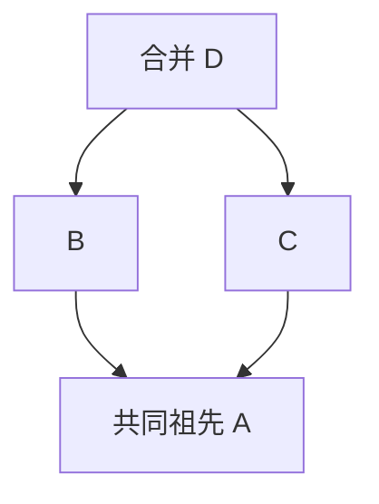

# 学习笔记与观察实验

MiniGit 的目标是让数据模型和行为之间的关系可以亲手观察。当前初始化、对象、暂存、提交和差异已有对应接口，可以运行下面的 MiniGit 实验；真实 Git 对照实验明确保留 Git 命令，其他未实现操作不能直接替换命令前缀。验收状态见 [进度](progress.md)。

## MiniGit 实验：对象独立于工作区

构建后，从项目根运行：

```sh
bash examples/experiments/objects.sh ./build/debug/minigit
```

[脚本](../examples/experiments/objects.sh) 将二进制路径转为绝对路径，使用 `mktemp` 创建实验目录，退出时清理。它调用 `init`，写入一份文本，用 `hash-object -w` 保存 blob，并把 CLI 返回的完整对象 ID 保存在变量中。修改工作区后，再用 `cat-file -t` 和 `cat-file -p` 检查类型及旧内容；使用 `cmp` 比较字节，不依赖硬编码摘要，也不调用系统 Git。

预期重新计算修改后文件的摘要会得到另一 ID，旧 ID 仍读出原始内容。脚本额外验证无 `-w` 摘要计算可在仓库外运行，保存同内容两次复用 ID，重复初始化保留对象。这个实验只说明对象保存与读取，不说明 Index、提交或分支已经实现。

## MiniGit 实验：提交 B，继续编辑 C

```sh
bash examples/experiments/commits.sh ./build/debug/minigit
```

[实验脚本](../examples/experiments/commits.sh) 先设置本地身份，将 note 从 A 改为 B 并 add，再改为 C，然后 commit。通过 Commit 的 tree 字段和根 Tree 的条目，找到保存 B 的 Blob；工作区仍为 C。再 add 和 commit，检查第二个提交的 parent 等于第一个提交。实验还创建 saved-B 轻量标签，再提交 C，验证 status 干净而 `log saved-B` 仍从保存 B 的提交开始，最后删除标签。

为什么提交需要 parent？若只保存根 Tree，可以知道每个版本有哪些文件，但无法回答某版本接续哪个版本，也无法区分两个分支从同一快照分别发展。父关系把快照连接成历史，后续共同祖先与三方合并才能有定义。为什么不把分支名放进 Commit？分支是观察历史的位置，允许移动和重命名；放进不可变对象会让纯粹的分支重命名重写历史。

## MiniGit 实验：同一个文件为什么有两份 diff

```sh
bash examples/experiments/diff.sh ./build/debug/minigit
```

[实验脚本](../examples/experiments/diff.sh) 提交 A、暂存 B、保留工作区 C，然后验证 `diff` 是 B→C、`diff --cached` 是 A→B、`diff HEAD` 是 A→C。随后 commit 保存 B，默认 diff 仍然是 B→C，而两个提交的 diff 是 A→B。三次比较没有“对同一个修改做重复展示”，它们回答的是下一次 add、下一次 commit 和当前工作内容相对历史分别改变什么。

比较历史版本无需当前 Index；即使 Index 损坏，指定两个有效提交仍可检查它们的差异。工作区未 add 的 Blob 尚不存在于对象库，必须直接读取文件。将工作区 ID 当作已有对象读取会在正常使用中出错，而偷偷保存它又会让只读查询产生额外对象。当前 Inspection 正确区分这两种内容来源。

## MiniGit 实验：show 读取哪个世界

```sh
bash examples/experiments/show.sh ./build/debug/minigit
```

[实验脚本](../examples/experiments/show.sh) 提交 A、暂存 B、保留工作区 C，再读取 `show HEAD:note` 与 `show :note`。两者分别是 A 与 B，不会把工作区 C 暗中保存。二进制通过输出到文件后 cmp 核对，不能用 Shell 变量承载含 NUL 的字节。

Index 的 stage 是同一路径的多个候选版本，stage 0 表示已决定的待提交内容；冲突时 stage 1/2/3 分别用于 base/ours/theirs。show 能独立读取这些阶段，而普通 commit 必须等待它们被一个 stage 0 取代。该 show 验收轮仅有阶段存储与读取；Phase 3 后续已接入产生三方冲突的业务，见本页后文。

## 实验一：内容与名称是两件事

在独立临时目录创建 Git 仓库并比较同内容文件的 blob：

```sh
git init
printf 'hello\n' > a.txt
printf 'hello\n' > b.txt
git hash-object a.txt
git hash-object b.txt
git add a.txt b.txt
git ls-files --stage
```

两个文件的 blob 摘要相同，Index 中的路径不同。随后修改一个文件，只有其内容对应的摘要改变。对象和文件名的分工见 [Git Objects](https://git-scm.com/book/en/v2/Git-Internals-Git-Objects)。MiniGit 验收时应复现这一复用性质，并分别验证 tree 中的文件名。

## 实验二：暂存不是承诺未来内容

继续在实验仓库中操作：

```sh
printf 'staged\n' > a.txt
git add a.txt
printf 'working\n' > a.txt
git diff --cached
git diff
git show :a.txt
```

预期 `git show :a.txt` 显示 `staged`，工作区仍为 `working`。这展示了为什么一次 status 可以同时报告同一个路径已暂存和未暂存。MiniGit Phase 1 对应验收用例应直接读出 commit 中的 blob，证明提交使用暂存版本。

MiniGit 已可直接观察相同关系：提交 A，编辑为 B 并 add，再编辑为 C，执行 `minigit status --porcelain` 得到 `MM a.txt`。此时 commit 保存 B，状态转为 ` M a.txt`；再次 add 会暂存 C。完整命令串由 [状态集成测试](../tests/integration/status_cli.cmake) 自动重放。

## 实验三：从 blob 拼出快照

真实 Git 可通过底层命令观察手工构造 tree 与 commit 的过程，具体步骤见 [Git Objects](https://git-scm.com/book/en/v2/Git-Internals-Git-Objects)。阅读 MiniGit 的 tree 编码时，先写出两个普通文件和一个子目录的条目，再逐字段检查模式、名称、NUL 与二进制摘要。

练习中改变输入枚举顺序，应保持输出 tree 字节相同；改变一个 basename，应改变所属 tree；改变子目录内容，变化应沿父 tree 传播到根。这个传播过程说明了快照复用的边界。

## 为什么 log 不能只跟随第一个 parent

设 A 是共同祖先，B 和 C 分别从 A 发展，D 合并 B、C。D 保存两个 parent，因此图中 D→B→A 与 D→C→A 都是历史。只沿第一条链会丢失 C，分别打印两条链又会重复 A。



MiniGit 先收集唯一提交，再按剩余子边计数输出。初始 D 可输出；D 输出后 B/C 可输出；只有 B 和 C 都输出后，A 才可输出。可在 [DAG 单元测试](../tests/unit/test_dag.cpp) 阅读对象构造与顺序断言。Phase 3 的 merge 会生成真实双父提交，届时可用同一 log 观察。

## 实验四：从失败理解更新顺序

当前可以在临时实验仓库截断一个已保存对象或替换它的字节，再尝试 `cat-file`，观察压缩、长度和摘要检查是否明确失败。仓库 `config` 格式版本与哈希字段不符合支持范围时，也应拒绝发现或初始化，不能静默重建覆盖。

后续引用和 Index 实现后，再模拟写入 commit 后、更新分支前失败：旧 HEAD 应仍可读取，新对象可能不可达。模拟 Index 格式截断时，读取应明确拒绝，不能把损坏误判为空暂存区。

Phase 2 应增加锁冲突、临时文件残留、工作区覆盖风险和失败恢复实验。Phase 3 的冲突实验要重启进程，再验证继续与中止，确认状态保存在磁盘而非进程内存中。可恢复操作的状态设计见 [架构](architecture.md)。

## 取舍与待回答的问题

| 选择 | 学习收益 | 成本或后续问题 |
| --- | --- | --- |
| 固定 SHA-256 与 EVP | 明确摘要输入和字节表示，使用现有密码库 | 不能把哈希替换等同于 Git 格式兼容 |
| zlib 松散对象 | 每个对象可单独检查，易理解持久化 | 大量对象的空间与性能需以后改善 |
| 自有 Index | 先掌握暂存快照与冲突状态 | 必须自行设计版本、校验和迁移策略 |
| 首版拒绝软链接 | 收窄文件类型并集中验证路径安全 | 不能覆盖真实 Git 的全部文件语义 |
| 分阶段交付命令 | 每个阶段形成可验证的数据流 | 文档必须持续区分实现与计划 |

接下来的学习问题包括：路径排序究竟按什么字节规则？commit 的身份和业务时间怎样规范化？引用与 Index 更新失败怎样恢复？合并怎样区分文本冲突与二进制冲突？gc 哪些根对象和保留规则能防止误回收？答案应来自已实现的格式、测试和观测，再写入文档。

## 保存顺序也影响内存规模

一次 add 若先读取所有文件，再统一保存，峰值内存会接近选中文件总大小。MiniGit 逐文件读取并保存 Blob，随后只保留路径、模式和对象 ID，峰值文件内容内存随最大单个文件增长。Index 仍最后一次性替换，因此后续选择失败不会把部分选择发布到暂存区；已写入但未引用的对象留给 gc 回收。不可变存储让这种处理顺序既节省内存又保持清晰的失败边界。

## 模块边界从真实依赖中调整

Snapshot 的路径映射既服务工作区，也服务 Tree 读写、引用目标校验和差异比较。若这些函数长期放在提交业务模块，引用层就需要调用提交层，而提交层又需要引用层。MiniGit 将纯快照模型与转换移到 Snapshot，保留依赖 HEAD 的包装及身份策略在 History。路径转义也从 Status 移到 Format，避免一个底层 Diff 为显示路径而依赖完整状态查询。

这个调整发生在共享机制已清楚时，不提前引入接口继承或插件体系；函数行为和格式不变，以现有测试验证边界调整。

## 差异算法的正确性与精简程度

差异算法有两个独立目标：应用编辑后得到新文件，以及生成容易阅读的较小编辑。MiniGit 的 LCS 优先保留公共行；预算不足时整体替换变化区间，仍满足第一个目标，放弃部分第二个目标。测试应实际应用 EditScript 并逐字节比较新文件，而不只检查补丁里出现了某个字符串。

把 `a\n` 变成 `a` 也是修改。若拆行时忘记记录末尾 LF，就会认为文件没有变化；若把空文件拆成一条空行，又会在新增时计算错误的行数。MiniGit 的 Line 用字节视图加 `terminated` 保存这两件事；视图不复制内容，因此原始缓冲区必须活到算法与格式化结束。

另一种容易忽略的成本是行比较：4000000 个 DP 单元若每次比较很长的字符串，表虽小，CPU 仍可能扫描极多重复字节。先对实际行分配等价 ID，再比较整数，使预算更接近真正的计算成本。超行数与超 DP 预算分别处理，避免所谓“回退”本身分配数千万行。

## 内容与权限应来自同一份文件

先检查路径权限，再另行打开读取内容，可能把旧文件的执行位与新文件的字节拼成不存在的版本。MiniGit 的 FileData 用同一 fd 读出字节和权限，并拒绝观测到的读取期间修改；这仍不等于锁住普通编辑器，也不能保证返回后路径保持原值。后续事务必须在发布前再次核对受影响路径。

恢复可执行文件时，先替换内容再 chmod 会出现“新字节、旧权限”的中间态。将 fchmod 放在临时文件写完后、同步和 rename 之前，可以一次发布两者。明确权限不能再由 umask 削减；默认元数据写入则继续尊重 umask。这也是为什么共享内部流程提供两个清楚的公开入口。

## 常见误区

MiniGit 可运行暂存观察实验：先运行 `init`，写入 `staged` 并 `add note.txt`，以 `hash-object note.txt` 取得 ID，再将工作区改为 `working`。`cat-file -p <刚得到的ID>` 仍返回 `staged`，说明 Index 指向的内容已经保存。随后删除文件并 `add note.txt` 会移除暂存条目；`add -A` 处理整个仓库，而不是当前子目录。

- blob 包含内容，路径来自 tree；没有文件名并不妨碍文件版本复用。
- commit 保存快照入口和父关系，不能仅把它理解为补丁集合。
- 相同文件快照不保证相同 commit，元数据与父关系也参与摘要。
- 删除分支名称不立即删除提交；对象回收需要检查可达性。
- 原子替换一个文件不等于整个命令的所有磁盘修改具备事务性。
- 自有格式可以借鉴 Git 的原则，但兼容必须有明确格式规范和互操作验证。

以上实验仅用于临时学习仓库。阶段验收的最小闭环见 [进度](progress.md)。

## 从对象库验收中掌握文件系统边界

对路径进行词法整理并不等于安全检查。假设 `link` 是软链接，先把 `link/../file` 整理成 `file`，既隐藏了软链接，也可能改变实际读取的文件。MiniGit 先逐段检查原始路径，并通过不跟随软链接的目录访问处理组件，验证后才保存规范化的仓库根。相对路径 `.` 还可能保留末尾分隔符，迭代时必须处理空组件。

文件内容同步和目录项同步解决不同问题。临时文件同步后替换目标，还需要同步所在目录；新建对象分目录也需要同步它的父目录。重试遇到已有对象时，校验内容还不够，还要补上可能未完成的目录同步。这些措施已实现，但未通过模拟断电证明完整事务恢复。

CLI 的成功也包含输出是否成功。写到缓冲流时，错误可能在刷新才出现；当前入口统一刷新并检查标准输出，测试使用 Linux 的 `/dev/full` 验证输出失败不会返回成功。相应反例都保存在自动化测试中，避免知识只留在开发聊天。

## 为什么原子替换仍需要事务日志

假设切换版本要把 `a` 的内容 A 改为 B，并把 `folder/file` 换成一个名为 `folder` 的文件。即使每次写入都是原子的，进程在更新 a 后退出，也会留下两个版本混合的工作区。Index 与 HEAD 若在不同步骤发布，还可能分别描述不同快照。

短事务保存真实 before/after，并先发布恢复意图。日志仍是 Prepared 时，无论已经执行到哪一步，恢复目标都是原状；日志已是 Committed 时，目标都是结果。完成标记与描述放在同一个原子文件内，使恢复无需猜测清理顺序。

另一个细节是临时文件位置：若每次写入把随机临时文件放在工作目录，崩溃后它会成为未知子项。安全的目录／文件转换不能随便删除它，更不能递归删除整个目录。将内部暂存放在 `.minigit` 中，并使用可推导的名称，既保留覆盖保护，也允许重复恢复。

“中止操作”还有两种时间尺度。短事务恢复上一次发布动作的 before；未来 merge/rebase 的 abort 则需要保存整个用户操作开始时的快照。它们会共用文件执行器，但不能共用同一份状态记录，因为一次长操作可能包含多次已完成的短事务。

[事务实验](../examples/experiments/transactions.sh) 可实际观察混合状态：先看到 `a=new A`、`b=old B`，此时 status 要求先恢复；执行 recover 后二者回到 old，再次 recover 仍保持相同结果。阅读 [教学程序](../examples/experiments/transaction.cpp)，找到回调中的 `work.write:a` 标签，理解它为什么发生在 Prepared 之后、Committed 之前。实验模拟受控中断，真实子进程突然退出与恢复的覆盖由事务测试另行验证。

## MiniGit 实验：事件序列与提交图分别记录什么

```sh
bash examples/experiments/reflog.sh ./build/debug/minigit
```

[脚本](../examples/experiments/reflog.sh) 在临时仓库提交 A、B，从分支引用取得实际完整 ID，再核对 `reflog` 的最新事件为 A→B、较旧事件为缺失→A，同时用 cmp 比较 HEAD 与 main 的 MGRL 字节。两个预设的实验和 reflog 子项验收已通过；详细证据见 [进度](progress.md)。提交 ID 由实际内容和业务元数据决定，实验不硬编码摘要或开发日期。

在另一份临时仓库执行相同两次提交，再分别运行 `minigit log --oneline`、`minigit reflog`、`minigit reflog main`。log 根据 parent 读到 B、A；reflog 根据保存的事件逆序展示 A→B、缺失→A。为两个输出画两张图：前者的边连接 Commit，后者的边描述引用位置变化。switch 已能产生 B→A 或 A→A 事件，Reset 已复用它并通过子项验收，而已有 Commit 的 parent 不会随之改变。

C++ 学习练习是比较这两个类型：`CommitGraph` 用 map 去重并服务拓扑排序，`Reflog` 用 vector 保留发生顺序。若把事件存入 set 去重，同一位置的重复访问可能丢失；若把事件边塞进提交图，合法回退又可能被误判为 DAG 环。容器选择应来自数据含义，而不是只考虑哪个接口更方便。

再追踪一次失败：规划器复制 TransactionPlan，追加事件并编码，全部成功才赋回；执行器随后发布 Prepared，将分支引用和两份日志一起更新。如果恢复再次追加“commit”，事件数量会随着恢复次数增长。实际恢复直接选择 journal 里的 before 或 after 字节，因此重复 recover 保持同一结果。可在 [reflog 测试](../tests/unit/test_reflog.cpp) 找到中断及重试的断言。

日志中的 old/new 是 Commit 根，不是文件备份。为了保留旧历史线索，事务只验证这些 Commit 的类型和结构，不为每个旧事件展开 Tree；新发布目标仍由 Snapshot 完整校验。思考未来 GC：删除当前分支后，哪些日志端点仍需保留？日志过期策略如何影响这些根？当前没有过期和回收命令，不能把这些问题当作已有行为。

## MiniGit 实验：创建一个名字，保留一个历史位置

```sh
bash examples/experiments/branches.sh ./build/debug/minigit
```

[脚本](../examples/experiments/branches.sh) 先提交 A 并创建 topic，列表里 main 与 topic 显示同一完整 ID，只有 main 带 `*`。再提交 B，topic 仍为 A，`show topic:note` 读 A，`show HEAD:note` 读 B。实验用真实输出核对引用，不调用系统 Git；两种预设的实验已通过，详细结果见 [进度](progress.md)。

随后 `branch -d topic` 删除祖先分支和它的分支日志，HEAD 及 main 保持原值。脚本再创建 topic/sub、删除它、创建 topic，观察空父目录清理如何让同一前缀重新成为文件。这与递归删除整个目录不同：若存在未知条目，事务不能把它当成内部垃圾删除。

C++ 学习练习：在 `delete_branch` 中找到 `graph.contains`，画出它前面完整加载和拓扑校验的调用链。若只检查第一父链，合并的第二个父分支可能被错误拒绝；若按文件快照相等判断，又会把独立历史误认为祖先。安全删除保护的是提交可达性，force 只跳过这一策略，格式和恢复不变量仍然成立。

再思考同 ID 的两种情况。覆盖当前符号分支始终拒绝，因为 branch 命令没有准备工作区更新；非当前分支强制移回原 ID 则无需重复事件。这里的判断顺序体现策略先于去重优化：不能因为“最后结果看似相同”就绕过当前分支保护。

## 核心学习练习：为什么逐路径 write/remove 仍会覆盖未知内容

共享 WorktreeUpdate 规划器核心实现已完成，本项没有新 CLI 实验，验证证据见进度页。可以先画一个实际目录：dir/a 是旧跟踪文件，dir/private 是未跟踪文件；本次 targets 只希望 dir/a 成为新 Blob。若把 dir 也列为整体更新目录，事务会要求它的所有子项都受控，从而误伤本来不需要改变的 private。规划器只记录变化的叶节点，已存在父目录保持原值。

再把目标改成一个名为 dir 的文件。此时不检查目录内容就先 remove dir/a，再写 dir，会失败并留下部分删除；递归删除目录则可能丢掉 private。正确步骤是在任何工作区发布前证明所有旧文件已授权、所有删除均被明确请求，并将 dir、子项与新文件形成一个可恢复的完整计划。未知空目录也有用户意义，不能因为没有文件内容就自动移除。一个例外来自明确的位置授权：旧 tracked 文件路径本身变成空目录时，显式目标可以移除该空节点；它的陌生空子目录并未因此获得授权，仍会阻止操作。

再画四列：HEAD=A、Index=B、work=C、target=D。目标表示这次选择，owned_paths 表示覆盖授权，before 则必须捕获 C。授权不是一份备份，也不证明 C 没有未提交修改；上层命令负责选择策略。若 Prepared 中断，恢复的是 C；若日志已 Committed，恢复的是 D。下文 switch 的真实实验同时观察这些边界。

C++ 练习从 WorktreeTarget 的两个 optional 开始：file=nullopt 表示移除普通文件；如果同一计划还要创建其子路径，该位置随后成为必要父目录。FileState 指向空 Blob 是零字节文件；permissions=nullopt 采用模式对应的默认值，显式完整权限必须与执行位一致。分别写出这几个构造，观察为什么不能用一个空 string 或全零 ID 混淆“没有文件”和“空文件”。单元测试直接调用核心 API，之后再由业务 CLI 测试组合它们。

深路径还展示一种资源反例：输入各自满足 4096 字节／128 分量，几百条路径本身只有约 1 MiB，所有父前缀累加却可能超过 64 MiB。规划器因此分别限制输入集合与中间 desired／actual 的展开名称，每次新键插入前检查；只限制最终 WorkChange 数量，不能阻止中途先分配巨大的 map。资源预算测试可以在没有创建这些目录的临时仓库里直接验证拒绝边界。

## 切换实验：保留修改与拒绝覆盖分别发生在哪里

运行 [切换实验](../examples/experiments/switch.sh)：

```sh
bash examples/experiments/switch.sh ./build/debug/minigit
```

实验先让 main 保存 A，在新 topic 上提交 B，再切回 main；普通文件与 `show :note` 都应读到 A。然后分别暂存 staged、编辑为 working，尝试切到 topic：目标变化会覆盖本地版本，整操作拒绝，Index 与工作文件保留原值。接着 `switch -c carried` 从同一快照创建分支，A==D，因此 staged／working 都保留；这说明“有本地修改”本身不是统一拒绝条件。

将 note 清理回 A 并 add 后再切 topic，文件变成 B；随后 `--detach` 选择首提交，HEAD 变成完整 ID，文件回 A。最后回 topic 并读 reflog，观察快照与符号绑定的不同变化。脚本配置显式身份、使用临时仓库并自动清理，不调用系统 Git；两种预设实验均通过。

C++ 练习：给单文件填四列 A/B/C/D，逐条应用架构页矩阵。尤其检查 A=a、B=d、C=c、D=d 时为何保留 C；A=a、B=a、C=d、D=d 时为何拒绝——工作文件碰巧等于目标，也不能掩盖相对 Index 的未暂存修改。再加一个 staged 的 dir/child 和目标文件 dir，解释为何局部矩阵之后仍须验证完整 Index。

未出生场景另见单元和 CLI 测试：`switch -c new` 保留已暂存文件，HEAD 指向不存在的 ref，事件为 null→null；直到首提交才建立 ref。区分“分支绑定变化”和“新 Commit 诞生”，避免用空树虚构首提交。

## 恢复实验：同一内容来源可以写到两个不同目的

[恢复实验](../examples/experiments/restore.sh) 在 Debug 与 sanitized 下均已通过。构建后可重复运行：

```sh
bash examples/experiments/restore.sh ./build/debug/minigit
```

实验先保存提交 A 和 D，随后制造 Index=B、work=C。默认恢复工作文件到 B；staged 单目的恢复 Index 到 D、保留 C；同时两目的恢复为 D。再用提交 A 分别写 Work、Index 及两者，观察 source 与目的并不是同一个开关。选项样式文件名用 --，普通 note 参数无需分隔符。

历史 A 中 dir 是目录，当前 D 中 dir 是普通文件；根／目录 prefix 选择让全部旧节点进入转换计划。加入 dir/private 后，再恢复 D 必须拒绝并保持 Index 与文件，而不是因为选择了 dir 就删除陌生 child。来源缺少 obsolete 时删除已选旧文件，empty 的零字节 Blob 仍存在。另在仅历史来源有的 obsolete 位置放未知文件，显式 source 也不能覆盖它。

脚本最后 cmp HEAD、当前分支 ref、两份 reflog 和 identity，确认恢复没有改变历史位置。C++ 练习再画冲突 stages：显式历史只恢复 Work 时阶段还在，staged 目的才清除所选阶段；未选中冲突必须原样保留。相关测试、实验与复验的执行证据见进度页。

## 重置实验：先列出允许改变的状态

[重置实验](../examples/experiments/reset.sh) 在 Debug 与 sanitized 下均已通过，构建后可重复运行：

```sh
bash examples/experiments/reset.sh ./build/debug/minigit
```

实验保存历史 D，再提交 A，构造 Index=B／Work=C。soft 到 D 保留 B/C，mixed 到 D 让 Index 变 D 而 C 不动；default mixed 的同 ID 也会清暂存版本。随后 hard 到 D 改实际文件与 D/F 结构，并删除目标中缺失的旧文件；empty Blob 仍存在。同 ID hard 还原 dirty 文件，但两份日志字节不变。

在 dir 里加入 private 后，转换为目标普通文件必须拒绝。脚本先复制全部相关元数据和实际文件，再逐项 cmp；删除陌生 child 后转换才成功。不要在失败之后才保存 baseline，那只会证明现场等于它自己。

Detached 的三模式直接移动 HEAD，原分支 ref 与日志始终保持；未出生默认 soft 保留 staged／working，默认 mixed 清 Index，hard 删重新暂存的 tracked 文件而保留 unknown。显式 HEAD 在未出生时失败，不把缺失提交偷换为空目标。每次成功 reset 都验证 stdout 为空，移动事件按实际 reflog 文本核对。

C++ 练习：若在 reset_repository 中加入“目标 ID 等于当前 ID 就返回”，会怎样影响 mixed／hard？这里真正应比较的是各自发布范围的状态，而不是用一个“目标 ID 相同”布尔值替代整个操作。Reset 没有路径参数，选择性 Index 恢复仍使用 restore --staged。

## 删除实验：保住仅存在于暂存区的版本

[删除实验](../examples/experiments/remove.sh) 已在两种预设运行通过，构建后可重放：

```sh
bash examples/experiments/remove.sh ./build/debug/minigit
```

从 A=HEAD、B=Index、C=Work 三列理解普通 rm：只暂存 B 后，即使磁盘也等于 B，仍不能普通删除，因为 B 是尚未提交的独有版本；force 明确允许丢弃。一个批次里前面 clean、后面 dirty 时，必须先全量判断，再一起发布，不能先删掉 clean。

cached 保留磁盘版本，所以可在 B==A 时删除 Index，即使 C 已修改；B 不等于 A 时，B==C 也能保住暂存内容。若 A/B/C 都不同，cached 拒绝，cached force 才明确放弃该保护。脚本还把一个工作文件变成软链，cached 的 B==A 分支不打开它，外部目标不变。

目录 -r 删除所选 tracked leaves，未知／忽略 sibling 和 emptyDir 留下；tracked File 变成含 private 的目录后，普通模式与 force 都不能抹掉陌生 child。最后比较 HEAD、ref、两份 reflog 和 identity 原字节，说明“准备删除”与“移动历史”不同。两种预设的该实验均已运行通过；Mv 子项与 Phase 2 整体验收均已完成，完整证据见 [阶段总结](progress.md#phase-2-阶段总结)。

## 迁移实验：名字一起变，版本仍分开

[迁移实验](../examples/experiments/move.sh) 两种预设均已实际运行通过。构建后可重放：

```sh
bash examples/experiments/move.sh ./build/debug/minigit
```

先把 source 暂存为 B，再把实际文件编辑成 C 并设为可执行。迁移后 show :renamed 仍输出 B，磁盘 renamed 仍是 C，完整权限保持 0751；暂存差异的新路径模式仍是 100644，状态显示 AM。这是“迁移名字”与“暂存新字节”的区别，不能用一次 add 省略独立状态。

目的即使已有相同字节也拒绝；仅 Index 中有目的、实际文件已删也不能覆盖。每次失败前保存 Index、HEAD、ref、日志、身份和有关文件，再 cmp 原状，不能在失败后才截取 baseline。已有目的目录追加 basename 并保留权限；迁移目录的多个叶文件保留各自 B／C，新目录采用 0755，不复制源目录 0700。

加入被忽略的 private child、再换成陌生 emptyDir，目录迁移两次都拒绝；精确跟踪路径不授权这些子项。最后 -- 传入选项样名称，确认 HEAD 与日志从实验开始到结束保持原字节。Mv 子项与 Phase 2 已完成验收，阶段结果见进度页。规划拒绝不会发布可变状态，但执行中断可能已有部分更新，必须依据 journal 执行 recover；两种情况要分别解释。

## 三方文本：先比较相对基线的修改

Phase 3 的纯文本引擎已通过子项验收，没有新 CLI 或命令实验。用三份行序列观察 API 语义，以下 a、b、c 每行均以 LF 结束：

| base | ours | theirs | 结果 |
| --- | --- | --- | --- |
| [a,b,c] | [A,b,c] | [a,b,C] | [A,b,C]，两个独立修改均保留 |
| [a,b,c] | [a,B,c] | [a,X,c] | b 区块冲突，a／c 保留 |
| [a,b,c] | [a,B,c] | [a,B,c] | 相同修改只保留一次 |

不要凭两份修改“是否靠近”判断冲突。相邻替换和恰在边界的插入可独立组合；宽替换吸收内部插入后还可能扩大区块，要继续检查传递交互，再完整重放两侧。若只比各侧插入片段，不把区块中未修改的 base 放回，就可能误报或漏报冲突。

无末尾 LF 的反例必须逐字节看：base=`a\n`，ours=`a`，theirs=`a\nb\n`。直接拼接会变成 `ab\n`，并未保留两个修改，因此必须冲突；theirs=`a\n\n` 追加的是空行，也不能因为其 bytes 为空就忽略。clean 结果保留原 LF；冲突呈现只为让 marker 独立成行添加必要 LF，不插入 diff 的无换行提示。

同区块冲突的固定标记只包住所选 b 区域，a／c 仍在其外。用转义字节表示完整输出：

```text
"a\n<<<<<<< ours\nB\n=======\nX\n>>>>>>> theirs\nc\n"
```

C++ 练习分别标出 TextConflict 的基线行范围与输出字节范围，后者从 opening marker 到 closing marker 后的 LF。上例 base_begin=1，output_begin=2（前面已有 a 与 LF 两字节），两个起点不能共用单位。UTF-8 多字节、CRLF 和无 LF 尾行都能说明“行数”不等于“字节数”。输入 span／Line 只借用三份缓冲区，返回 Bytes 拥有结果，因此调用结束后不留下借用输出。

三份输入各限 100000 行且拒绝 NUL，即使内容相等也先检查；非 NUL 的任意字节与 CR 不自动转码。合并输出可因独立插入超过任一输入的行数，但仍增量限 64 MiB。两次有界 Diff 顺序执行，coarse 只说明采用较宽替换并可能增加保守冲突，不能以它为理由丢掉某侧修改。两种预设的相关检查及独立性质验证已通过；二进制文件选择、模式、D/F 与 Index stages 属于下节已验收的 Snapshot 适配器。

## 快照合并：原始版本与呈现内容各有位置

SnapshotMerge 适配器已通过子项验收，无新 CLI 或命令实验。先在单文件上分开三项状态：是否存在、Blob 内容 ID、mode。base 是普通文件，ours 只把 100644 改为 100755，theirs 只改文本，候选结果应取 ours mode 加 theirs 内容；仅比较完整 FileState 相等会漏掉这个可组合情况。

再令 base 不存在，ours 新建空 Blob，theirs 新建非空 Blob。空文件是新版本而不是不存在，两侧 ID 不同必须冲突：非 NUL 分类 AddAdd，整文件 marker 放 work，原始 ours／theirs 分别放 stage 2／3，没有 stage 1；任何一侧含 NUL 则优先分类 Binary，work 保留 ours 字节，不生成文本 marker。若两侧 mode 也不同，mode_conflict 也为真，不被主 kind 掩盖。

D/F 例子为 base:p，ours:p/x，theirs 修改 p。冲突区域的 Index 对 p 与 p/x 都只放原始 1／2／3，不能把 child 留 stage 0；work 采用 ours 的 p/x 布局，不同时写 p。若 theirs 未改 base，则 ours 的结构替换本可干净接受，所以判断来自可能的最终存在路径，不能仅看三份名字的 union。即使夹着 p-other，也要发现 p 与 p/x 的祖先关系。

候选 work 不是实际工作区，SnapshotMerge 不探测或删除未知 p/y；后续业务仍须用精确 owned 与共享 planner 决定发布。它可逐文件保存不可变 Blob，规划后期拒绝会留下不可达对象，不能因此修改实际 Index。C++ 练习用 optional 区分缺失和 empty FileState，用原始 IndexEntry 与呈现 FileState 两份值表达不同用途。

100000 Snapshot 文件和最终 Index distinct 路径是规划预算；Tree 建树另计算目录 entries，深目录的候选不能仅凭文件数宣称可提交。结果、原始 stages 与资源边界已有语义测试和独立性质验证，精确范围见进度页；下节 single-base 选择已验收；LongOperation、解决冲突与中止恢复还未交付。

## 两轮传播为何找到最低共同祖先

helper 已通过子项验收，尚无 merge 命令实验。先手画 R→X，X 分叉到 L 与 T：R、X 都是共同祖先，但 R 的共同后代有 X，所以唯一最低基线为 X。若两个分叉各自合并对方的旧 tip，可能留下两个互不为祖先的共同候选；这时不能比较时间或选 ID 小的一个，本版应报 Error。

C++ 练习用两位整数标记 left／right reachable。初值只设在两 root，按 child-before-parent 把当前位标记 OR 给每个 parent；最后值为 3 的节点是共同祖先。再以同一顺序，把当前节点是 common 或已有共同后代的事实传给每个 parent。不要把 common 自己直接设为“有共同后代”，否则连真正最低的 X 也被删掉。OR 对重复父边幂等，first parent 只是 parents 中的一项，不能漏掉其余边。

即使 L=T 或 T 是 L 的祖先，也先读取完整闭包；末端快进关系不能证明更深的 Commit 没有缺损。无共同祖先返回 optional 空值，多基线抛 Error，不展开 Tree；语义组及用独立闭包算法核对的随机 DAG 性质验证均通过，范围见进度页。实际目录规划与提交工厂已通过各自子项验收，持久状态基础也已通过子项验收，Merge 生命周期的接入见末节；helper 与业务分别验收。

## 空目录与目录权限为什么也需要恢复目标

显式 Directory target 已通过子项验收，没有新的 CLI 实验。假设操作前 empty 是权限 0700 的空目录，操作后同名位置成为文件。用 HEAD／Index 的文件 Snapshot 回滚会把原目录当缺失；真实 before NodeImage 则告诉未来 abort 应恢复 Directory 和 0700。WorktreeTarget 用默认第三字段保留旧构造，以 directory=true 明确这个目标。

再考虑 chmod dir：dir/a 是 exact owned，dir/private 未知。只记录 dir 的 mode 会违反短事务的完整子项契约；递归清理更会丢掉 private。规划器须枚举并拒绝未知项，对已知保留后代生成必要的同值记录，所有 combined 预算仍先于 backup capture。若目录权限完全相同，整个目录无需记录，也无需因未知兄弟而拒绝无操作。包含 work 后代的 Directory 需要 owner-rwx，即使那些后代的目标是 Absent；空 Directory 也仍需 owner-read／execute。

C++ 练习分别构造 Absent、空 Blob File、显式 Directory，说明两个 optional 与 directory 布尔字段为何不能混用。根目录位置 exact owned 只允许原空节点本身，不授权陌生 child；后续长操作才会把真实 before 镜像转换成这些目标，本项不实现 continue／abort。

只读空目录还给出一个系统调用边界：Linux 跨父目录 rename 需要目录 owner-write，0500 不能照搬可写目录的发布方式。因此当前只读目标缺失时用 exclusive mkdir，再设置精确权限；可写目录仍先暂存后 rename。exclusive 已存在立即拒绝，不修改陌生目录的 mode。mkdir 到最终权限之间可能暂为 0000／0700，中断后若它不是已记录的 before／after，recover 会保留并拒绝；持久化步骤后的测试不等于任意系统调用内部中断证明。

## 提交工厂为何不读取当前 Index

CommitSnapshot 工厂已通过子项验收。merge 有一份明确候选 Snapshot，重放还带源 author 与明确 parents；若调用 create_commit，它会重新取锁、读取当前 Index，并把当前 HEAD 当单个 parent，来源与父关系都可能错误。caller-lock store_commit_snapshot 只处理明确输入，真正移动 HEAD 由业务随后规划。

C++ 练习把 parents 写成 [P2,P1,P2]，结果必须保留这个顺序和重复边，校验去重只减少读对象，不改变序列。每个父自己的 Tree／Blob 先完整校验，却不要求遍历其 parents 闭包；源 raw author 原样保存，committer 来自当前 identity。公开 store_commit_snapshot 的未配置身份、非法 actor 或已知超 frame 预算在 Tree 写入前拒绝，后期不可达对象不等于可变状态部分发布。

再构造父根 Tree 内含空子 Tree：read_snapshot 投影为空，候选 empty Snapshot 的 write_snapshot 却得到另一 Tree ID。业务已有“无变化”判断应比较这些 ID，不能因为两个 map 都空而改变策略。工厂允许 empty Snapshot，不替 create_commit 或未来重放决定 allow-empty；身份错误次序、初始空与 HEAD/ref/log 事务规则仍保持。ordinary create_commit 为保持旧失败顺序，先写候选 Tree／比较 ID，再构造 actor／完整 frame；晚错误可留不可达 Tree，和公开工厂的写 Tree 前预检不能混为一条保证。冻结源码与五组语义已核对，定向验证与只读审查通过，本项不提供 merge 或继续操作。

## 状态备份与当前解决内容不是同一份值

OperationState v1 基础已通过子项验收。假设合并前 note 是 dirty，冲突发布后 work 变成 marker，用户再改成 solved。State 的 before 保存 dirty，after 保存上次发布的 marker；若将来 abort 强制要求当前文件仍等于 marker，就会错误拒绝正常解决过程。未来业务应重新读取实际 solved，由共享 planner 保护本次恢复；新 unknown 子项仍可阻挡，不能借长期操作强删。

元数据范围也要分开：original raw HEAD 与整份 optional raw Index 备份保留精确原字节，受影响 Work 镜像只涉及已记录路径。Index 原先缺失和编码后的合法空 Index 不能共用 null；raw detached HEAD 大写也不能偷偷规范成小写。v1 original/current Head 相同是 Merge／Conflicted 历史不变量，不是在 read／roots 时要求现盘永远相等，current CAS 是后续业务的职责。

C++ 练习给 original_index_blob 画两条边：它自己是 Blob root，payload 内 decode 的每个 stage ID 也是 Blob root。再给删除 State 的短事务画 before 与 after，after 为空也不能让 before 备份先失去根。纯结构 codec 与 typed semantic roots 分开，历史 Commit 的 Tree 展开又留给业务和 GC，避免一个 helper 无意完成整套遍历。

本项只建立状态与 guard。现存损坏／空文件／软链／Directory operation 节点都会阻止 commit／switch／reset／branch mutations；config、查询及解决工具仍允许，但原业务保护不放宽。单 State 合法不意味着 combined 事务预算合法；该状态基础轮未包含 merge、continue／abort，也没有 Ready／其他 kind；状态与 guard 的实际定向验证已通过，范围见进度页。

## Merge 继续与中止为何读取不同来源

完整 Merge 已实现，CLI 与 [合并实验](../examples/experiments/merge.sh) 在两种构建的对应检查均通过，完整只读审查通过。实验检查原 stages、0640 权限与 whole Index／raw HEAD 的精确中止、两父顺序和 Index 继续来源。设 base=[a,b,c]，ours=[A,b,c]，theirs=[a,b,C]，clean 结果为 [A,b,C]，两父提交连接两侧历史；两侧同改 b 才需保留原 stages 和呈现 marker。first parent 必须是原 ours，不能为排序方便按 ID 重排。

解决冲突后 add 保存 solved，再把 Work 改为 later：continue 应提交 Index 的 solved，保留未暂存 later，不用 marker 字符串推断 stage0 合法性。abort 则恢复操作开始时的实际 before，而不是 Index 的 solved 或 HEAD 的历史文件；整份 raw Index 回到原值，Work 只处理受影响区域。Binary／Mode 冲突保持 ours 时虽然未写文件，也须记录同值镜像；否则用户后来编辑它，中止便无法恢复。D/F 区域的真实目录祖先也须备份 full permissions。

C++ 练习为 abort 画三个范围：原 raw HEAD、whole optional Index、affected Work NodeImages。原空 Directory／full permissions 和 dirty bytes 只能来自真实 before；若解决过程把原 File／Absent 变成目录，中止可删该恢复 root 下当前 Index 新跟踪子项；新 unknown child 仍阻挡整笔恢复，父目录 exact owned 不能递归授权。区域外新增 tracked Work 保留，只撤回它在整份 Index 中的暂存。业务 current Head CAS 与 State 的历史结构校验分别执行，短 journal 先 recover。该 Merge 验收轮只覆盖单步 Merge／Conflicted，后续 CherryPick／Revert 见下节，Ready 和其他操作仍未交付，展示也与存储分开：CONFLICT 路径列表达 64 MiB 时省略并提示 status，完整 Index／State 仍保留。另试 incoming 未跟踪文件恰等于目标字节与权限：它可原样保留并进入 Index；改变字节使它需要覆盖，则 unknown 保护拒绝。相关单元、CLI 与实验已通过，范围见进度页；该 Merge 验收轮尚未实现 Stash 恢复，后续验收见末节，Phase 4 仍未交付。


## 用三个快照理解正向与反向重放

CherryPick／Revert 已通过子项验收。设 P=[a,b,c]、S=[A,b,c]、当前 H=[a,b,C]，CherryPick 的输入 P,H,S 得到 [A,b,C]；若当前已经是 [A,b,C]，Revert 的输入 S,H,P 得到 [a,b,C]，撤掉来源 a→A 并保留当前 c→C。基线不是按两个 tip 求共同祖先，而是来源自己的父快照；root 来源的 P 为空。

给一次空变化画一个仍存在的单父 Commit：它的父是操作开始的当前 HEAD，不是来源 S。再区分作者和提交者：CherryPick 保留来源原作者字段，当前身份生成 committer；Revert 两者为当前身份。来源消息不合法时使用启动 --message 覆盖，继续不重新指定消息。

冲突后 stage0 Index 决定继续保存内容，未暂存 Work 仍保留；中止恢复受影响真实 before 与整份原 raw Index／HEAD，区域外新增 Work 不随 Index 回退删除。kind 校验使 cherry-pick --continue 不能继续 Revert，反之亦然。未知 D/F 子项保护与权限镜像约束继续有效；真实 CLI／测试已冻结；[重放实验](../examples/experiments/replay.sh) 先正向 pick 再 inverse revert，核对作者与单父、重复 inverse 的空提交，然后冲突中止恢复实际权限和 raw metadata。完整只读审查、两个预设相关检查及重放／原 Merge 实验通过，本项已子项验收，未宣称 Phase 3 整体完成。


## 暂存 B、编辑 C，再保存 Stash

Stash 保存子项已通过验收。先提交 A，将 note 改成 B 并 add，再改成 C：H 保存 A，I 保存 B，W 保存 C。设旁边还有未跟踪 new 与 ignored scratch，-u 只将 new 放进独立 U，不保存或清除 scratch。push 真正成功后 tracked Index／Work 回到 H，活跃栈 top 指 W；HEAD 与 reflog 没有新增历史移动。

C++ 练习给 NoChanges 分支排错误顺序：没有可保存的变化时，不应先要求身份，也不能为合法 missing Index 写一个 empty Index。然后给 stack 中每个 W 画 roots，不能仅看 refs/stash top；同一 ID 出现两次仍是两个列表位置，操作前绑定整份 raw stack／ref CAS。

再比较两种“保存”：stash Trees 只有 bytes 与 executable mode，事务 before NodeImage 还有 full permissions、Directory／Absent，后者用于恢复失败前的现场。apply 恢复保存的字节与执行位，不归档所有权限或空目录。该保存验收轮完成 push／list／show／drop／clear，apply／pop／--index 与冲突继续／中止由末节后续子项交付，[保存实验](../examples/experiments/stash.sh) 已落盘，实际检查 A/B/C/U 的 parent 关系、cleanup、NoChanges 原 bytes、中间 drop 保持 top 和 clear／HEAD／日志不动；源码已冻结，两种预设的保存实验、相关 38 项和交叉完整审查通过。


## 一份 context Blob 还要展开全部语义根

MGOP v2 StashApply context 已通过子项验收。假设栈为 [W0,W1,W2]，选 position=2：source 必须为 W2，raw_ref 必须解析为 W0。把整份 MGST 保存成普通 Blob 后，不能以为 GC 会自动认识它的 ID 列表；state_roots 必须 decode，再取全部 entries 的 W/H/I/U，包括没有选中的 W0/W1。Tree 与父图闭包仍由业务或未来 GC 展开。

C++ 练习比较 v1 和 v2 字节：旧 kind 不能因为新增 optional 字段就多写一个空标志，否则旧 expected CAS 会改变。只有 StashApply 使用新版固定 context，presence／pop／position 的读取先验证长度和取值；raw ref 的大小写保存为 bytes，解析 ID 仅供语义核对。当前消息是 stash:apply/pop，不是提交来源，因此 context 恢复不应要求 identity。结构 codec、typed roots、live CAS 与最终 pop 删除是四个不同步骤；五组 tests 与 codec 已冻结并核对，两个预设的相关 45 项和独立审查通过；本批尚未新增 apply／pop／continue／abort。


## 恢复 Stash 不等于把保存的 Work 全部 add

本项完整恢复生命周期已通过子项验收，以下例子已由两个预设的真实实验验证。设 H=[one,two,three]，保存 I=[ONE,two,three]、W=[ONE,TWO,three]；当前 O=[one,two,THREE]。默认 RW 得到 [ONE,TWO,THREE]，Index 仍是 O，所以两处保存变化都在未暂存层。--index 的 RI 另得 [ONE,two,THREE]，于是第一行仍暂存、第二行未暂存；第三行来自当前历史。可以用两次 show :f 和实际 cat f 核对，不能只看 Work 正确就说 --index 正确。

在 C++ 中先给每层建立完整结果，再组合原始 stage groups。Index-only 冲突可以让 Work 没有 marker；stage1/2/3 仍须解决。两层不同 groups 无法塞进同一组三个 stage，或 --index 遇到 RW D/F 时，拒绝比丢掉暂存意图更明确。U 是另一种输入：它要求真实叶位置缺失，不因为已有文件内容相同就获得覆盖授权。

[恢复实验](../examples/experiments/stash-restore.sh) 先对比上述默认／--index，随后 pop 冲突核对条目保留，abort 恢复真实 before，再解决并 add 后继续编辑 Work。stash --continue 只检查 resolved Index、清 State 并完成原 pop，不会像 merge --continue 创建 Commit，也不会把后一次 Work 编辑写进 Index；HEAD 与日志保持。两个预设的恢复实验、原保存实验及相关 37 项检查通过，完整只读审查通过；该恢复子项之后的 Phase 3 全量验收见下段。最后练习画出 exact raw Stack/ref 的双份 pin：历史 context 校验通过，不等于此刻活跃栈没被外部编辑。


Phase 3 的阶段练习可以复用上述 Merge、Replay 与 Stash 实验，两个预设各 237 项完整回归已通过，不新增重复脚本。用三方输入、stages／marker、Index／Work、before／after、semantic roots／live CAS 五组区别解释一次暂停与恢复；统一学习结果和实验执行范围见 [阶段总结](progress.md#phase-3-阶段总结已验收)，后续 Rebase 的真实队列已在下节通过子项验收，GC 可达闭包仍待实施。


## 同一个 cursor 的两种继续含义

Rebase 状态基础已通过子项验收。设 queue=[S0,S1]、cursor=0：Ready 表示 S0 还没执行；如果 unknown 文件阻挡规划，重试仍应执行 S0，不能直接保存当前 Index 并把 cursor 改成 1。若 S0 冲突已发布，phase=Conflicted，解决并 add 后才用 Index 完成它。cursor<size，因此末步的最终 attach／State 删除由后续业务同事务处理，不保存“Ready 但没有下一来源”。

C++ 练习复制一份 State 为 next：只改 phase 到 Conflicted 时 cursor／current 不变；推进到 Ready 时 cursor 仅加一，新 current Commit 的 parent 恰为旧 current。已有 Work path 的 before 若被后一次修改替换，会失去最初中止镜像，所以 validator 要拒绝；保留 before 本身仍不等于正确累计，新 key 被原 File／Absent 祖先遮挡时如何取原镜像需要业务另定义。本项只 codec／roots／受约束规划更新，没有新 CLI 或可执行实验，两个预设相关 25 项与完整只读审查通过，实际重放业务仍待实现。


## 重放两次，原分支为什么最后才移动

Rebase 业务已通过子项验收。设 base=A，原历史 A→B→C，目标 A→D；临时 detached 从 D 开始，先合并 (A,D,B) 得到 B′，再合并 (B,B′,C) 得到 C′。新 parents 为 D→B′→C′，不把 B／C 同时写成父；原分支在步骤中仍指 C，最终才移到 C′。同内容空结果仍有一个新单父节点，原 author 保留、committer 当前生成。

若 B 冲突，State 是 Conflicted(cursor=0)；add 后 continue 完成 B′，不读取用户随后未暂存的 Work。还有 C 时，next Ready 需要 clean tracked，dirty Work 阻挡但不能跳 C；若冲突的是末步，继续可以保留未暂存 FIFO Work。另观察原 File 被某步变成目录：后续 child 的首次 original before 必须是 Absent，abort 还原 File 时不能把新 child 当原用户内容。给区域新增 unknown 文件，保护应拒绝中止而保留状态；这些边界已有相关测试与实验通过，精确验证范围见 [Rebase 进度](progress.md#rebase-业务生命周期已验收)。


已落盘的 [rebase 实验](../examples/experiments/rebase.sh) 用三行文件把 topic 首行修改与 main 尾行修改组合，再重放第二个来源。阅读脚本时对照新链 onto→first′→tip′、旧 Commit bytes 不变、source author／当前 committer；随后观察冲突 abort 恢复 0640 与 exact raw Index／HEAD，以及 add 后再次编辑 Work，continue 仍以 Index 提交。脚本两个预设实际执行均 exit 0，bash -n 通过；可执行入口为 `bash examples/experiments/rebase.sh ./build/debug/minigit`，sanitized 使用对应二进制。
