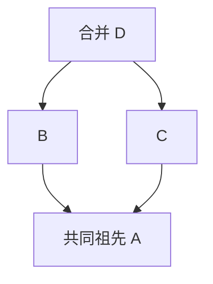

# 学习笔记与观察实验

MiniGit 的目标是让数据模型和行为之间的关系可以亲手观察。当前初始化、对象、暂存和提交已有对应接口，可以运行下面的 MiniGit 实验；真实 Git 对照实验明确保留 Git 命令，尚未实现的差异展示不能直接替换命令前缀。验收状态见 [进度](progress.md)。

## MiniGit 实验：对象独立于工作区

构建后，从项目根运行：

```sh
bash examples/experiments/objects.sh ./build/debug/minigit
```

[脚本](../examples/experiments/objects.sh) 将二进制路径转为绝对路径，使用 `mktemp` 创建实验目录，退出时清理。它调用 `init`，写入一份文本，用 `hash-object -w` 保存 blob，并把 CLI 返回的完整对象 ID 保存在变量中。修改工作区后，再用 `cat-file -t` 和 `cat-file -p` 检查类型及旧内容；使用 `cmp` 比较字节，不依赖硬编码摘要，也不调用系统 Git。

预期重新计算修改后文件的摘要会得到另一 ID，旧 ID 仍读出原始内容。脚本额外验证无 `-w` 摘要计算可在仓库外运行，保存同内容两次复用 ID，重复初始化保留对象。这个实验只说明对象保存与读取，不说明 Index、提交或分支已经实现。

## MiniGit 实验：提交 B，继续编辑 C

```sh
bash examples/experiments/commits.sh ./build/debug/minigit
```

[实验脚本](../examples/experiments/commits.sh) 先设置本地身份，将 note 从 A 改为 B 并 add，再改为 C，然后 commit。通过 Commit 的 tree 字段和根 Tree 的条目，找到保存 B 的 Blob；工作区仍为 C。再 add 和 commit，检查第二个提交的 parent 等于第一个提交。实验还创建 saved-B 轻量标签，再提交 C，验证 status 干净而 `log saved-B` 仍从保存 B 的提交开始，最后删除标签。

为什么提交需要 parent？若只保存根 Tree，可以知道每个版本有哪些文件，但无法回答某版本接续哪个版本，也无法区分两个分支从同一快照分别发展。父关系把快照连接成历史，后续共同祖先与三方合并才能有定义。为什么不把分支名放进 Commit？分支是观察历史的位置，允许移动和重命名；放进不可变对象会让纯粹的分支重命名重写历史。

## 实验一：内容与名称是两件事

在独立临时目录创建 Git 仓库并比较同内容文件的 blob：

```sh
git init
printf 'hello\n' > a.txt
printf 'hello\n' > b.txt
git hash-object a.txt
git hash-object b.txt
git add a.txt b.txt
git ls-files --stage
```

两个文件的 blob 摘要相同，Index 中的路径不同。随后修改一个文件，只有其内容对应的摘要改变。对象和文件名的分工见 [Git Objects](https://git-scm.com/book/en/v2/Git-Internals-Git-Objects)。MiniGit 验收时应复现这一复用性质，并分别验证 tree 中的文件名。

## 实验二：暂存不是承诺未来内容

继续在实验仓库中操作：

```sh
printf 'staged\n' > a.txt
git add a.txt
printf 'working\n' > a.txt
git diff --cached
git diff
git show :a.txt
```

预期 `git show :a.txt` 显示 `staged`，工作区仍为 `working`。这展示了为什么一次 status 可以同时报告同一个路径已暂存和未暂存。MiniGit Phase 1 对应验收用例应直接读出 commit 中的 blob，证明提交使用暂存版本。

MiniGit 已可直接观察相同关系：提交 A，编辑为 B 并 add，再编辑为 C，执行 `minigit status --porcelain` 得到 `MM a.txt`。此时 commit 保存 B，状态转为 ` M a.txt`；再次 add 会暂存 C。完整命令串由 [状态集成测试](../tests/integration/status_cli.cmake) 自动重放。

## 实验三：从 blob 拼出快照

真实 Git 可通过底层命令观察手工构造 tree 与 commit 的过程，具体步骤见 [Git Objects](https://git-scm.com/book/en/v2/Git-Internals-Git-Objects)。阅读 MiniGit 的 tree 编码时，先写出两个普通文件和一个子目录的条目，再逐字段检查模式、名称、NUL 与二进制摘要。

练习中改变输入枚举顺序，应保持输出 tree 字节相同；改变一个 basename，应改变所属 tree；改变子目录内容，变化应沿父 tree 传播到根。这个传播过程说明了快照复用的边界。

## 为什么 log 不能只跟随第一个 parent

设 A 是共同祖先，B 和 C 分别从 A 发展，D 合并 B、C。D 保存两个 parent，因此图中 D→B→A 与 D→C→A 都是历史。只沿第一条链会丢失 C，分别打印两条链又会重复 A。



MiniGit 先收集唯一提交，再按剩余子边计数输出。初始 D 可输出；D 输出后 B/C 可输出；只有 B 和 C 都输出后，A 才可输出。可在 [DAG 单元测试](../tests/unit/test_dag.cpp) 阅读对象构造与顺序断言。Phase 3 的 merge 会生成真实双父提交，届时可用同一 log 观察。

## 实验四：从失败理解更新顺序

当前可以在临时实验仓库截断一个已保存对象或替换它的字节，再尝试 `cat-file`，观察压缩、长度和摘要检查是否明确失败。仓库 `config` 格式版本与哈希字段不符合支持范围时，也应拒绝发现或初始化，不能静默重建覆盖。

后续引用和 Index 实现后，再模拟写入 commit 后、更新分支前失败：旧 HEAD 应仍可读取，新对象可能不可达。模拟 Index 格式截断时，读取应明确拒绝，不能把损坏误判为空暂存区。

Phase 2 应增加锁冲突、临时文件残留、工作区覆盖风险和失败恢复实验。Phase 3 的冲突实验要重启进程，再验证继续与中止，确认状态保存在磁盘而非进程内存中。可恢复操作的状态设计见 [架构](architecture.md)。

## 取舍与待回答的问题

| 选择 | 学习收益 | 成本或后续问题 |
| --- | --- | --- |
| 固定 SHA-256 与 EVP | 明确摘要输入和字节表示，使用现有密码库 | 不能把哈希替换等同于 Git 格式兼容 |
| zlib 松散对象 | 每个对象可单独检查，易理解持久化 | 大量对象的空间与性能需以后改善 |
| 自有 Index | 先掌握暂存快照与冲突状态 | 必须自行设计版本、校验和迁移策略 |
| 首版拒绝软链接 | 收窄文件类型并集中验证路径安全 | 不能覆盖真实 Git 的全部文件语义 |
| 分阶段交付命令 | 每个阶段形成可验证的数据流 | 文档必须持续区分实现与计划 |

接下来的学习问题包括：路径排序究竟按什么字节规则？commit 的身份和业务时间怎样规范化？引用与 Index 更新失败怎样恢复？合并怎样区分文本冲突与二进制冲突？gc 哪些根对象和保留规则能防止误回收？答案应来自已实现的格式、测试和观测，再写入文档。

## 保存顺序也影响内存规模

一次 add 若先读取所有文件，再统一保存，峰值内存会接近选中文件总大小。MiniGit 逐文件读取并保存 Blob，随后只保留路径、模式和对象 ID，峰值文件内容内存随最大单个文件增长。Index 仍最后一次性替换，因此后续选择失败不会把部分选择发布到暂存区；已写入但未引用的对象留给 gc 回收。不可变存储让这种处理顺序既节省内存又保持清晰的失败边界。

## 模块边界从真实依赖中调整

Snapshot 的路径映射既服务工作区，也服务 Tree 读写、引用目标校验和差异比较。若这些函数长期放在提交业务模块，引用层就需要调用提交层，而提交层又需要引用层。MiniGit 将纯快照模型与转换移到 Snapshot，保留依赖 HEAD 的包装及身份策略在 History。路径转义也从 Status 移到 Format，避免一个底层 Diff 为显示路径而依赖完整状态查询。

这个调整发生在共享机制已清楚时，不提前引入接口继承或插件体系；函数行为和格式不变，以现有测试验证边界调整。

## 差异算法的正确性与精简程度

差异算法有两个独立目标：应用编辑后得到新文件，以及生成容易阅读的较小编辑。MiniGit 的 LCS 优先保留公共行；预算不足时整体替换变化区间，仍满足第一个目标，放弃部分第二个目标。测试应实际应用 EditScript 并逐字节比较新文件，而不只检查补丁里出现了某个字符串。

把 `a\n` 变成 `a` 也是修改。若拆行时忘记记录末尾 LF，就会认为文件没有变化；若把空文件拆成一条空行，又会在新增时计算错误的行数。MiniGit 的 Line 用字节视图加 `terminated` 保存这两件事；视图不复制内容，因此原始缓冲区必须活到算法与格式化结束。

另一种容易忽略的成本是行比较：4000000 个 DP 单元若每次比较很长的字符串，表虽小，CPU 仍可能扫描极多重复字节。先对实际行分配等价 ID，再比较整数，使预算更接近真正的计算成本。超行数与超 DP 预算分别处理，避免所谓“回退”本身分配数千万行。

## 内容与权限应来自同一份文件

先检查路径权限，再另行打开读取内容，可能把旧文件的执行位与新文件的字节拼成不存在的版本。MiniGit 的 FileData 用同一 fd 读出字节和权限，并拒绝观测到的读取期间修改；这仍不等于锁住普通编辑器，也不能保证返回后路径保持原值。后续事务必须在发布前再次核对受影响路径。

恢复可执行文件时，先替换内容再 chmod 会出现“新字节、旧权限”的中间态。将 fchmod 放在临时文件写完后、同步和 rename 之前，可以一次发布两者。明确权限不能再由 umask 削减；默认元数据写入则继续尊重 umask。这也是为什么共享内部流程提供两个清楚的公开入口。

## 常见误区

MiniGit 可运行暂存观察实验：先运行 `init`，写入 `staged` 并 `add note.txt`，以 `hash-object note.txt` 取得 ID，再将工作区改为 `working`。`cat-file -p <刚得到的ID>` 仍返回 `staged`，说明 Index 指向的内容已经保存。随后删除文件并 `add note.txt` 会移除暂存条目；`add -A` 处理整个仓库，而不是当前子目录。

- blob 包含内容，路径来自 tree；没有文件名并不妨碍文件版本复用。
- commit 保存快照入口和父关系，不能仅把它理解为补丁集合。
- 相同文件快照不保证相同 commit，元数据与父关系也参与摘要。
- 删除分支名称不立即删除提交；对象回收需要检查可达性。
- 原子替换一个文件不等于整个命令的所有磁盘修改具备事务性。
- 自有格式可以借鉴 Git 的原则，但兼容必须有明确格式规范和互操作验证。

以上实验仅用于临时学习仓库。阶段验收的最小闭环见 [进度](progress.md)。

## 从对象库验收中掌握文件系统边界

对路径进行词法整理并不等于安全检查。假设 `link` 是软链接，先把 `link/../file` 整理成 `file`，既隐藏了软链接，也可能改变实际读取的文件。MiniGit 先逐段检查原始路径，并通过不跟随软链接的目录访问处理组件，验证后才保存规范化的仓库根。相对路径 `.` 还可能保留末尾分隔符，迭代时必须处理空组件。

文件内容同步和目录项同步解决不同问题。临时文件同步后替换目标，还需要同步所在目录；新建对象分目录也需要同步它的父目录。重试遇到已有对象时，校验内容还不够，还要补上可能未完成的目录同步。这些措施已实现，但未通过模拟断电证明完整事务恢复。

CLI 的成功也包含输出是否成功。写到缓冲流时，错误可能在刷新才出现；当前入口统一刷新并检查标准输出，测试使用 Linux 的 `/dev/full` 验证输出失败不会返回成功。相应反例都保存在自动化测试中，避免知识只留在开发聊天。
