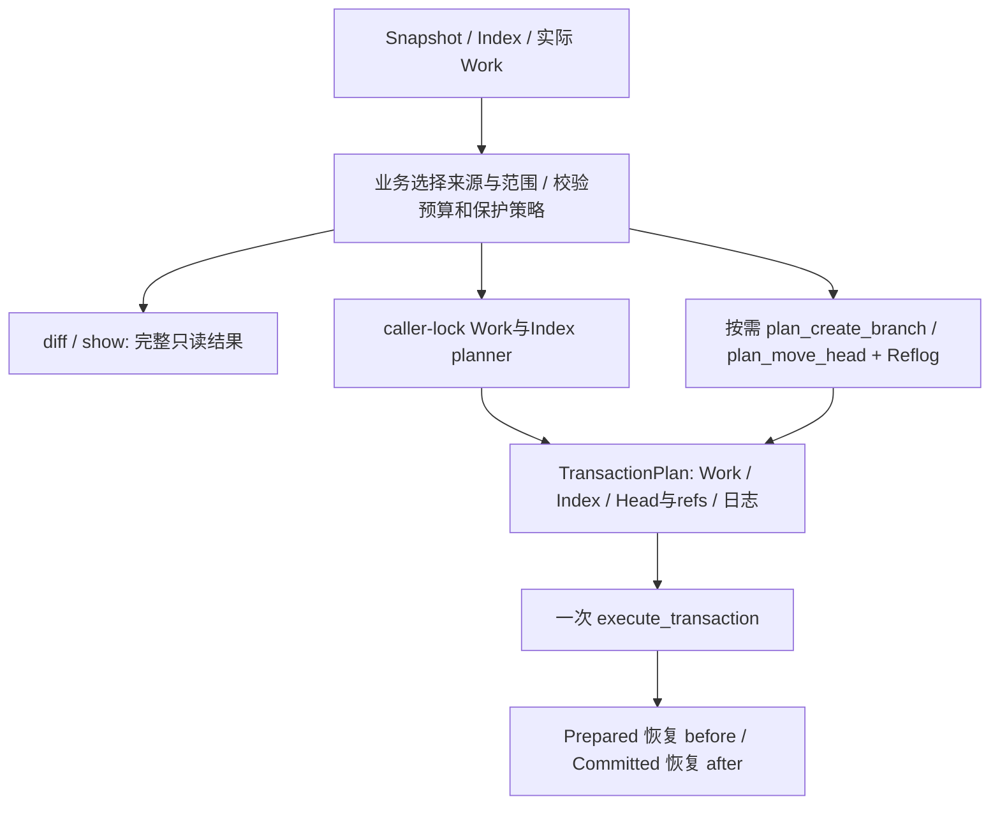

# 进度与阶段验收

本页记录公开项目状态，不记录开发时间戳或内部协作日志。“计划”表示未交付，“待验证”表示需要实际运行并补充证据，“已验收”必须有代码与检查结果支撑。

## 当前状态

Phase 0、Phase 1 与 Phase 2 已验收，版本为 `0.1.0`。当前 CLI 完成 `init/add/commit/status/log/tag/diff/show/branch/switch/restore/reset/rm/mv/reflog`，并提供对象观察、本地身份配置及中断事务 recover。Phase 1 整体验收时 Debug 与 sanitized 各 54 个 CTest 用例全部通过（47 个单元、7 个 CLI）；两个学习实验通过。Phase 2 的差异引擎、文件接口、diff、show 和短事务已逐项验收；reflog 与 commit 事务发布也已通过子项验证；branch 管理已通过子项验收；共享工作区与 Index 更新规划器已通过子项验收；switch 工作区切换已通过子项验收；restore 内容恢复已通过子项验收；reset 三模式重置已通过子项验收；rm 删除与取消暂存已通过子项验收；mv 文件与目录迁移已通过子项验收；Phase 2 整体验收的两个预设各 147 项全量检查全部通过；Phase 3 纯文本引擎已通过子项验收，业务命令与 Phase 4 尚未交付，继续推进至 Phase 4。

| 项目 | 当前状态 | 验证证据 |
| --- | --- | --- |
| CMake 3.20+、C++20 核心库与 CLI 分层 | 已验收 | Debug 和 sanitized 配置、构建成功，GCC 无警告 |
| OpenSSL 3、zlib、Catch2 v3、CTest 依赖连接 | 已验收 | 实际对象业务使用 EVP 和 zlib；当前实际注册 137 个单元及 17 个 CLI，共 154 项；本轮各 13 项定向检查，Phase 2 全量 147 项是此前独立验收证据 |
| CLI 帮助、版本与错误处理 | 已验收 | 两种预设的 `cli_basics` 均通过，错误输入退出码为 `2` |
| 中文架构、原理、导读、学习笔记 | 初版 | 六份文档相对链接均可解析，未包含具体开发日期 |
| Phase 1 子项：init、摘要、对象编解码与存储 | 已验收 | Debug 与 sanitized 构建通过，模块／CLI 回归及对象实验通过，详细范围见下文 |
| Phase 1 子项：Index 与 add | 已验收 | Debug 与 sanitized 的 9 个模块用例及 2 个相关 CLI 用例全部通过 |
| Phase 1 子项：引用、快照、commit 与本地身份 | 已验收 | Debug 与 sanitized 首轮 16 个相关用例通过，引用审查修正后各复验 10 项，提交实验通过 |
| Phase 1 子项：三棵树 status | 已验收 | Debug 与 sanitized 的 6 个状态单元用例及 status_cli、cli_basics 各 8 项通过 |
| Phase 1 子项：DAG 与 log | 已验收 | Debug 与 sanitized 各通过 4 个 DAG/日志单元用例及 log_cli、cli_basics，共 6 项 |
| Phase 1 子项：轻量 tag | 已验收 | Debug 与 sanitized 各通过 3 个标签单元用例及 tags_cli、log_cli、cli_basics，共 6 项 |
| Phase 1 整体 | 已验收 | 两种预设各 54 项全量检查通过，两个实验及文档检查通过 |
| Phase 2 子项：纯差异引擎 | 已验收 | 两种预设各 7 项检查与各 2000 组临时补丁重放通过；路径预算补充后各 1 项复验通过 |
| Phase 2 子项：同一文件的内容与权限 | 已验收 | 两种预设各 56 项文件工具调用方回归通过 |
| Phase 2 子项：diff 与内容来源协调 | 已验收 | 两种预设首轮各 13 项、初始化警告清理后各 7 项通过；差异实验通过 |
| Phase 2 子项：show 与共享提交格式 | 已验收 | 两种预设各 12 项相关检查通过；二进制输出与 A/B/C 实验通过 |
| Phase 2 子项：工作区短事务与 recover | 已验收 | 两种预设各 74 项相关检查与事务实验通过；逐持久化步骤中断、再次中断恢复及真实 CLI 恢复通过 |
| Phase 2 子项：reflog 与 commit 事务发布 | 已验收 | 两种预设各 22 项定向检查及各 1 项新增语义根复验通过；引用日志实验通过 |
| Phase 2 子项：branch 列表、创建及删除 | 已验收 | 两种预设各 23 项定向检查通过，无编译警告及 ASan/UBSan 报告；分支实验通过 |
| Phase 2 子项：共享工作区与 Index 更新规划器 | 已验收 | 两种预设构建无警告，Debug 16 项及受影响 1 项复验通过；完整验证证据见下文，无新增 CLI |
| Phase 2 子项：switch 工作区切换 | 已验收 | 原定向每种预设 25 项、预算补充后 Debug 10 项及优化 sanitized 全量 112 项通过；切换实验通过 |
| Phase 2 子项：restore 内容恢复 | 已验收 | Debug 首轮 12 项及失败 fixture 修正后 1 项复验、sanitized 13 项通过；两种预设恢复实验通过 |
| Phase 2 子项：reset 三模式重置 | 已验收 | 两种预设各 18 项定向检查与重置实验通过，无编译警告或 ASan/UBSan 报告 |
| Phase 2 子项：rm 删除与取消暂存 | 已验收 | 删除矩阵、精确授权、共享检查及事务恢复；两种预设各 33 项定向检查与实验通过 |
| Phase 2 子项：mv 迁移 | 已验收 | 独立迁移 B／C、目录与目的保护；两种预设各 17 项定向检查与实验通过 |
| Phase 2 整体 | 已验收 | Debug／sanitized 各 147 项全量全部通过，无 ASan／UBSan 报告；八个命令实验已在各子项验收中通过 |
| Phase 3 子项：纯文本三方合并 | 已验收 | 无新 CLI；两种预设各 13 项定向检查及各 2000 组独立性质验证通过 |
| Phase 3 其余与 Phase 4 | 计划 | merge、cherry-pick、revert、stash、rebase 与 gc 尚未交付 |

已执行的 Debug 验证：

```sh
cmake --preset debug
cmake --build --preset debug -j 2
ctest --preset debug -R cli_basics --output-on-failure
```

Phase 0 的一个 CTest 用例通过，覆盖 `--help`、版本格式和空参数、未知参数、多余参数；对象库子项又补充了 `help` 别名与标准输出失败检查。相同基础用例在 `sanitized` 预设下通过，启用 AddressSanitizer 和 UndefinedBehaviorSanitizer。Linux 是当前验证平台，其他平台尚未验证。

## Phase 0：可构建基础

验收条件：

- CMake 预设能配置和构建 `minigit_core` 及 CLI，核心库使用 C++20。
- 构建连接 OpenSSL 3 和 zlib，测试使用 Catch2 v3 并注册到 CTest。
- `--help`、`help`、`--version` 输出稳定并成功退出；未知命令返回明确错误和非零退出码。
- CLI 基础测试通过，文档提供可复用命令和真实能力边界。

## Phase 1：本地快照闭环

已完成 `init`、`add`、`commit`、`status`、`log` 和轻量 `tag`，通过整体回归与实验验收。

当前子项范围：

- `Repository::init/discover/root/metadata`，`.minigit` 版本与哈希配置，指向 main 的未出生 HEAD。
- `ObjectId`、EVP SHA-256、blob/tree/commit 封装与编解码、zlib 松散对象写入和读取。
- `RepoLock`、`read_file`、`atomic_write`，普通文件与软链接检查，64 MiB 文件上限。
- CLI `init [directory]`、`hash-object [-w] file`、`cat-file -t|-p full-id`。
- 版本化 MGIX Index、按选择范围保存 Blob 的 `add`、暂存删除及文件模式；支持简化 `.minigitignore`，支持冲突阶段的持久化与 add 解决。
- 版本化本地身份、符号／分离 HEAD、严格引用及预期旧值更新；Snapshot 与分层 Tree 往返；从 Index 构造带运行时 UTC 身份及 parent 的 Commit。
- 三棵树状态比较、所有冲突阶段状态、完整 DAG 的确定性拓扑日志，以及指向 Commit 的轻量标签列表／创建／强制移动／删除。
- 对象 CLI 集成用例与 [对象实验](../examples/experiments/objects.sh)，均已通过。

验证证据：

- Debug 与 sanitized 配置和构建通过，GCC 无警告。
- `ctest --preset debug --output-on-failure`：最终 15 个用例全部通过（13 个单元、2 个 CLI）。
- `ctest --preset sanitized --output-on-failure`：15 个用例全部通过，没有 ASan/UBSan 报告；最后目录同步修正后，以 `-R 'Loose blobs|Repository initializes|Repeated init|Relative filesystem|cli_basics|objects_cli'` 复验受影响的 6 个用例，全部通过。
- `bash examples/experiments/objects.sh ./build/debug/minigit`：保存复用、工作区编辑后读回旧 blob、重复初始化保留对象通过。
- 六份文档相对链接、实验脚本语法与 `git diff --check` 通过。

Index/add 验证：`ctest --preset debug -R 'unit\.(Index|Invalid index|Add|Selected add|Ignore rules|Invalid later add)|staging_cli|cli_basics' --output-on-failure` 和对应 sanitized 命令，各 11 个用例全部通过，无 ASan/UBSan 报告。覆盖损坏索引与校验和、排序和冲突阶段、二进制与空文件、可执行位、暂存后修改、选择性与全仓库删除、子目录参数、忽略与已跟踪例外、软链和原始 `missing/../file` 等无效路径、文件目录转换、失败保持原 Index。

引用／提交验证：Debug 和 sanitized 的 `-R 'unit\.(Commit|References|Snapshots|Identity)|commits_cli|objects_cli|staging_cli|cli_basics'` 首轮各 16 项通过。审查补充嵌套引用目录清理、重试同步和完整快照发布检查后，`-R 'unit\.(References|Commit)|commits_cli'` 最终各 10 项通过，无 ASan/UBSan 报告。`bash examples/experiments/commits.sh ./build/debug/minigit` 通过，脚本语法、六份文档 66 个相对链接与 `git diff --check` 通过。

新增覆盖：首提交与 parent 链、暂存后编辑、二进制／可执行快照、共享子 Tree 展开、深度边界、空提交与分离 HEAD、消息和身份拒绝、未解决冲突、损坏 HEAD、缺失或错误类型 Blob/Tree、CAS 与同名引用歧义、嵌套引用删除及失败重试、失败保持引用和身份文件。Phase 1 当时未引入 reflog 和多文件事务；该阶段的引用发布不遍历所有历史祖先，DAG/log 已检测完整可达提交闭包中的缺失或损坏对象。

Status 验证：`ctest --preset debug -R 'unit\.Status|status_cli|cli_basics' --output-on-failure` 与 sanitized 对应命令各 8 项通过，无 ASan/UBSan 报告；六份文档 71 个相对链接及 `git diff --check` 通过。覆盖未出生仓库、未跟踪／暂存／工作区组合、可执行模式、删除与同路径未跟踪替代、文件目录转换、忽略例外、全部七种冲突阶段组合、路径转义、损坏 Index／对象／HEAD、软链与 FIFO；查询前后完整元数据字节保持一致。

DAG/log 验证：`ctest --preset debug -R 'unit\.(DAG|Log)|log_cli|cli_basics' --output-on-failure` 与 sanitized 对应命令各 6 项通过，无 ASan/UBSan 报告；六份文档 76 个相对链接及 `git diff --check` 通过。覆盖线性及菱形多父图、共享祖先去重、拓扑顺序与确定性并列顺序、多起点、重复父边、缺失／非 Commit／损坏祖先、纯算法输入的缺节点与环、空历史、起点解析、完整／单行输出和显示限制。

轻量 tag 验证：Debug 与 sanitized 的 `-R 'unit\.Tag|tags_cli|log_cli|cli_basics'` 各 6 项通过。阶段总验收使用 `ctest --preset debug --output-on-failure` 和 `ctest --preset sanitized --output-on-failure`，各 54 项全部通过，无 ASan/UBSan 报告。`bash examples/experiments/objects.sh ./build/debug/minigit` 与 `bash examples/experiments/commits.sh ./build/debug/minigit` 均通过；两个脚本语法、六份文档 80 个相对链接与 `git diff --check` 通过。

关键覆盖包括空与二进制 blob、SHA-256 已知向量、压缩截断及尾部数据、解压大小限制、错误类型／长度／哈希、Tree 顺序和非法名称、Commit 父顺序、多行消息与字段注入、相对路径、软链接及 `link/..`、FIFO、无效仓库、锁竞争和输出失败。

Phase 1 验收时的限制：使用 Linux/POSIX 接口；没有断电故障注入；单文件替换完成后的同步失败可能留下完整新文件；Commit 编解码只检查身份字段结构，业务 create_commit 已负责显式身份及运行时 UTC 时间；没有命令级断电事务或全祖先损坏审计。

验收条件：

- 初始化仓库后能发现仓库，空历史、重复初始化和非仓库位置均有定义行为。
- SHA-256 对象封装、zlib 保存与读取完成往返，长度、类型、摘要和压缩损坏均能拒绝。
- blob 保留二进制字节；tree 使用固定 32 字节摘要并确定排序；commit 编解码保留 tree、parent、身份、业务时间和消息。
- add 持久化版本化 Index，拒绝越界路径和软链接；普通文件模式及可执行位有验证。
- 首个和后续 commit 正确更新引用；提交读取暂存版本；status 区分已暂存、未暂存和未跟踪；log 展示正确父链。
- 轻量标签的创建、解析及非法名称检查有验证。
- 对象与可变元数据写入采用写锁、临时文件与原子替换，失败不能留下可见半成品。
- 临时仓库端到端用例覆盖文本、二进制、子目录、重复内容、暂存后再编辑和失败输入。

暂存内存改进验证：两种预设的 `-R 'unit\.(Add|Selected add|Ignore rules|Invalid later add)|staging_cli|commits_cli|status_cli|log_cli|tags_cli'` 各 11 项通过。一次 Linux Debug 临时仓库实验将子进程地址空间限制为 128 MiB，`add -A` 成功处理 20 个各 8 MiB 的文件（总量 160 MiB），说明无需同时持有全部文件内容。该内存实验未在 ASan 下限制地址空间，因为 ASan 使用大型虚拟地址映射。

### Phase 1 阶段总结

本阶段形成真实快照闭环：字节保存为不可变 Blob，Index 独立保存待提交版本，目录 Tree 连接文件和模式，Commit 连接根 Tree 及 parent，分支引用发布历史，轻量标签保持选定位置。模块由单纯对象库扩展为 Index、Working Tree、Refs、History、DAG 与状态命令；CLI 仅解析参数和显示返回结果，核心测试直接调用 C++ 库。

最值得掌握的是三条边界：内容与名称分别由 Blob 和 Tree 保存；暂存内容不随工作区编辑变化；不可变对象与可变引用分开更新。拓扑顺序来自父关系，不来自作者时间；分支和标签轻量是因为只保存一个 ID。

与真实 Git 的主要差异：自有 SHA-256 仓库及 MGIX 格式；只处理普通 UTF-8 路径和可执行位，拒绝软链；简化忽略语法；标签只指向 Commit；不提供缩写解析、附注标签、packfile 或远程功能。该阶段验证平台为 Linux，单文件原子替换不构成多文件断电事务。

Phase 2 已复用快照、引用和 DAG，增加差异引擎与可恢复工作区更新，再接入分支切换、恢复、重置、删除与移动；修改策略共用覆盖保护、规划与事务机制，引用移动再组合 reflog，避免逐命令重复实现或覆盖未提交内容。

## Phase 2：比较、分支与安全更新

实现准备已完成：Snapshot 的通用模型、对象读取及 Index/Tree 转换独立于 History，路径转义移入 Format，Refs 不再依赖提交命令模块。代码原样移动，不改变仓库格式或命令行为。Debug 和 sanitized 配置、构建及 `-R 'unit\.(Snapshots|Commit|References|Identity|Status|DAG|Log|Tag)|_cli|cli_basics'` 各 33 项通过，无编译警告及 ASan/UBSan 报告；六份文档 85 个相对链接及 `git diff --check` 通过。

本阶段范围为 `diff`、`show`、`branch`、`switch`、`restore`、`reset`、`rm`、`mv`；八个命令子项与整阶段回归均已验收。

纯行差异与统一补丁引擎已验收：Line/EditScript/Hunk 不依赖仓库读取；包含有界 LCS、上下文、无末尾 LF、二进制摘要、模式与空文件语义。Debug 和 sanitized 配置、构建与 `ctest --preset debug -R 'unit\.Diff|cli_basics' --output-on-failure` 及对应 sanitized 命令，各 7 项通过。临时 C++ 验证器在两种预设下各重放 2000 组固定种子输入，分别应用编辑与统一文本补丁，逐字节等于新内容。审查补充 4096 字节显示路径预算后，两种预设 `-R 'unit\.Diff rejects'` 各 1 项通过；没有编译警告或 ASan/UBSan 报告。六份文档 91 个相对链接及 `git diff --check` 通过。

覆盖空行、空文件、CRLF、重复行、插入／删除／替换、LF 增删、预算恰好 4000000 单元与超预算回退、共同前后缀、上下文间隔 5/6/7 行、零长度范围、累计偏移、无 LF 提示、二进制 NUL、模式变化、路径转义和非法输入。文本最多每侧 100000 行；超表格预算的补丁可能不够精简。二进制仅显示摘要，头部使用 `diff --minigit` 与完整 SHA-256，不承诺 Git 补丁格式完全兼容。CLI 接入与验收结果见后续子项。

共享 FileData、明确权限的原子替换及 WorktreeFile 读取已验收。两种预设构建与 `ctest --preset debug -E '^unit\.Diff' --output-on-failure` 及对应 sanitized 命令，各 56 项通过，覆盖共享读取／写入工具的对象库、仓库、暂存、快照、引用、历史及 CLI 调用方；已单独验收且不读取文件的纯差异算法跳过。没有编译警告或 ASan/UBSan 报告；六份文档 91 个相对链接及 `git diff --check` 通过。

新增验证覆盖二进制与空文件、完整权限及摘要对应、umask=0077 下默认写入 0600、明确写入 0644/0755/0740、非法权限失败保留原字节和权限及无临时残留、文件／父目录软链、原始 link/.. 与 FIFO、工作区缺失和目录分类、读取不保存对象或 Index。读取前后 stat 比较不是路径 CAS，没有构造依赖线程时序的并发测试，也没有同步系统调用故障注入。本子项是差异工作区来源和后续恢复的共同前置，不等于命令级事务已经交付。

diff CLI 与 Inspection 内容来源协调已验收。两种预设配置、构建与 `ctest --preset debug -R 'unit\.(Inspection|Diff)|diff_cli|log_cli|cli_basics' --output-on-failure` 及对应 sanitized 命令，各 13 项通过；补全 DiffOptions 的默认初始化后，两种预设构建与 `-R 'unit\.Inspection|diff_cli|log_cli|cli_basics'` 各 7 项通过，最终没有编译警告或 ASan/UBSan 报告。`bash examples/experiments/diff.sh ./build/debug/minigit` 通过，六份文档 97 个相对链接、脚本语法与 `git diff --check` 通过。

覆盖 A/B/C 的方向选择、指定暂存基准、两历史快照、未跟踪及无关软链排除、工作区删除、模式与二进制、空文件、文件目录转换、冲突及损坏 Index、历史查询独立于 Index、未变化对象完整性、非法路径／模式／请求、上下文别名及退出码。查询前后完整元数据字节一致，工作区未 add 的 Blob 不会被保存。单修订比较候选是该快照与 Index 的路径并集，直接读取工作文件；不实现 Git 对 Index 状态的全部特殊处理。不支持路径筛选、重命名推断或二进制补丁内容。

show 与 log 共用提交格式化已验收。两种预设构建与 `-R 'unit\.(Inspection|Log)|show_cli|diff_cli|log_cli|cli_basics'` 各 9 项通过，随后 `-R '^unit\.Show'` 各 3 项通过；合计每种预设 12 项；审查补充日志总输出预检与大消息边界后，`-R '^unit\.Show|show_cli|log_cli'` 每种预设复验 5 项通过，没有编译警告或 ASan/UBSan 报告。`bash examples/experiments/show.sh ./build/debug/minigit` 通过；临时大父消息探针在两种预设下均验证 log 超限时 stdout 为空，且 `-n 1` 仍可读取小子提交；六份文档 101 个相对链接、脚本语法与 `git diff --check` 通过。

覆盖根提交及第一父补丁、多父元数据、多行消息与 log 原格式、原始 Blob/Tree、提交内路径、Index stage 0/1/2/3、空与二进制内容、路径转义、损坏 Index 时历史与原始对象仍可读取、非法参数及路径、缺失或错误类型对象。查询前后元数据一致，输出前完成全部校验；提交与完整 log/show 文本限制 64 MiB。与 Git 的差异：仅接受完整对象 ID 或已支持的提交引用，Tree 展示自身条目，合并提交只显示第一父差异，没有组合补丁。

工作区短事务与 recover 已验收。Debug/sanitized 核心库、CLI 与按需教学程序构建通过；`ctest --preset debug -E '^unit\.Diff' --output-on-failure` 与 sanitized 对应命令，各 74 项全部通过，覆盖新增事务及共享文件／Index／业务守卫的所有调用方，未修改的六个纯差异用例未重复执行。该子项验收时共注册 70 个单元及 10 个 CLI 用例。最终构建无 GCC 警告，无 ASan/UBSan 报告。`bash examples/experiments/transactions.sh ./build/debug/minigit ./build/debug/minigit_transaction_lab` 及 sanitized 对应实验均通过；脚本语法、六份文档 111 个相对链接和 `git diff --check` 通过。

新增七组事务测试与文件工具边界覆盖真实内容／权限备份、两方向文件目录转换、每个公开持久化步骤突然退出、Prepared/Committed 的恢复再次退出及重试、真实 CLI 恢复、Index/HEAD/ref 同时发布、损坏日志／备份、外部工作区修改、内部暂存篡改、准备结束的重新预检、全部冲突阶段的语义根、空引用父链清理及复用。HEAD 两侧必须存在，避免删掉发现仓库所需入口。日志仍存在时阻止业务修改与快照查询，原始 Blob/Tree 可以检查；重复恢复不改变结果。

短事务子项验收时只交付通用执行器与恢复入口，add/commit/tag 尚未全部接入，也未实现 reflog；当时已接入待恢复事务守卫。随后 commit 的事务发布与 reflog 接入见下一子项，add/tag 仍保留各自发布路径。owner/group 与 mtime 不恢复；文件需 owner-read，目录需 owner-read/execute，含计划子项的目录需 owner-rwx。同设备挂载点和最终检查至 rename 的外部竞态不承诺完整识别。证据来自 API 持久化步骤后中断，尚无系统调用内部同步失败或真实断电注入；内部 atomic_write 若留随机临时项，恢复会拒绝并保留现场，已知临时项协议属于技术债务。

验收条件：不同快照之间的差异和对象内容可检查；分支与分离 HEAD 行为明确；恢复和重置对 HEAD、Index、工作区的影响分别验证。覆盖未提交内容或未跟踪文件前执行保护检查。在 Phase 1 写锁与原子元数据更新基础上，扩展多文件事务、异常恢复和 reflog，并随修改命令一起验证，不能只验证正常路径。

### Reflog 与 commit 事务发布：已验收

MGRL v1 编解码、纯移动规划与只读 reflog CLI 已接入。日志有 8 MiB／100000 项边界，原因有 4096 字节、UTF-8 与单行约束。当前符号 HEAD 的 commit 同事务发布分支 ref 与 HEAD／分支日志；分离 HEAD 发布 HEAD 与它的日志。不同符号分支指向同一提交时，核心仍记录 HEAD 切换事件。恢复重放已编码日志，不重复追加事件。reflog 子项验收时 branch/switch CLI 尚未交付；随后 branch 接入见下一子项。

验证证据：Debug 与 sanitized 配置、最终构建通过，GCC 无警告。`ctest --preset debug -R 'unit\.(Reflog|Commit|References)|unit\.Transaction (validates|preserves)|reflog_cli|commits_cli|recovery_cli|log_cli|cli_basics' --output-on-failure` 与对应 sanitized 命令各 22 项通过。补充日志语义根用例后，两种预设 `-R '^unit\.Reflog transactions reject'` 各 1 项通过，无 ASan/UBSan 报告；未修改的日志边界及原事务中断矩阵没有重复执行。reflog 子项验收时注册 77 个单元、11 个 CLI，共 88 项。

两种预设的 `bash examples/experiments/reflog.sh <对应预设的 minigit>` 均通过，验证缺失→A→B 及 HEAD／main 日志字节一致。脚本语法、六份文档 122 个相对链接与 `git diff --check` 通过。新增覆盖包括 checksum／截断／UTF-8／计数和大小边界、规划强异常保证、符号及分离 HEAD、同 ID 切换、受控中断恢复、只读 CLI 和日志语义根预检。缺失或 Blob 类型日志端点在发布前拒绝；旧历史 Commit 的 Tree 缺失不会令日志追加重新展开整个历史。sanitized 的十万条记录边界存在明显额外执行开销，当前不代表大日志追加性能已优化。
日志端点验证为 Commit 类型与结构，旧历史事件不逐项展开 Tree；新发布目标仍验证完整 Snapshot。事务 roots 保留日志端点及 before/after 备份。当前不提供 actor、时间、过期、修订选择器或 reflog 撤销命令，GC 策略仍待 Phase 4。Phase 1 无 reflog、短事务机制验收时尚未接入 commit 的描述均保留为对应阶段事实。

### Branch 列表、创建及删除：已验收

branch 核心接口、CLI 和 [分支实验](../examples/experiments/branches.sh) 已接入。列表按短名排序，标记当前符号分支并包含 unborn，detached 不标任何分支；相同 Commit 的 Snapshot 去重校验，短名总预算为 64 MiB。默认创建来源为 HEAD，未出生 HEAD 拒绝；创建／强制移动只改分支 ref 与日志，保持 HEAD、Index 和工作区。

当前符号分支不能被覆盖或删除，非当前分支 same-ID 强制移动在目标验证后无操作。`-d` 用 HEAD 全 parent 闭包与拓扑校验判断 tip 可达；`-D` 跳过祖先要求，仍校验原 tip 快照、日志结构及 Commit 根。删除 ref 与分支日志同事务发布，HEAD 日志保留，空命名空间父链安全清理；不永久保留已删分支日志。branch 子项验收时 switch 尚未实现；公共纯规划接口已在后续 switch -c 中复用。

验证证据：Debug 与 sanitized 配置、构建通过，GCC 无警告。`ctest --preset debug -R 'unit\.Branch|unit\.References|unit\.DAG|unit\.Reflog (HEAD|transaction recovery)|branches_cli|recovery_cli|reflog_cli|commits_cli|log_cli|cli_basics' --output-on-failure` 与对应 sanitized 命令各 23 项全部通过，无 ASan/UBSan 报告。branch 新增 7 个单元及 1 个 CLI，该 Branch 验收轮注册 84 单元、12 CLI，共 96 项；该数量是注册规模，本轮执行的是上述定向检查。上一 reflog 子项的 77 单元、11 CLI 为当时证据。

`bash examples/experiments/branches.sh ./build/debug/minigit` 与 sanitized 对应实验均通过，验证 topic 固定 A、main 前进 B、祖先安全删除及命名空间复用。`-f` 仅用于创建／移动，删除组合明确拒绝；强制删除用 `-D`。覆盖列表、unborn／detached、当前分支保护、同 ID 无操作、全部父边的可达性、规划异常保护、日志／快照损坏、只读行为与删除恢复。脚本语法、六份文档 132 个相对链接与 `git diff --check` 通过。

### 共享工作区与 Index 更新规划器：已验收

caller-lock 核心接口已确定：WorktreeTargets 表达部分路径的可选 FileState／完整权限，owned_paths 表达允许改写的旧跟踪文件；计划的 work 必须为空，可以复用已有 metadata。新目标父目录按需补齐，已有未变目录不记录；目录转文件／缺失需要完整已授权删除拓扑，未授权文件、陌生空目录、软链与 FIFO 受到保护；精确 owned 的旧文件位置变为空目录时可显式移除空本身，不向子项继承授权。叶删除暂保留空父目录。

规划捕获实际 before 字节与权限，可能保存不可变备份 Blob，但不发布工作文件或元数据；异常原计划不变，逐文件释放内容。Targets 与 owned_paths 各 200000 路径／64 MiB，desired／actual 中间缓存也各限 200000 节点／64 MiB 展开名称并在新键插入前检查；路径 4096 字节／128 分量，工作改动最多 100000 项。Index 规划校验全部 stages 与 typed Blob，保存精确 before 字节，拒绝损坏或重复 Index 计划，精确字节相同才无操作。

本项无新 CLI 或新增命令实验；后续 switch 子项已提供端到端命令实验。新增 7 个 WorktreeUpdate 单元测试组，该规划器验收轮注册 91 单元、12 CLI，共 103 项；此数量是注册规模，本轮执行的是定向检查。上一 branch 子项的 84 单元、12 CLI 为当时证据。

验证证据：Debug 与 sanitized 构建均通过，无编译警告。`ctest --preset debug -R 'unit\.WorktreeUpdate|unit\.Index|unit\.Invalid index|unit\.Transaction (captures|validates|preserves)|cli_basics|staging_cli|recovery_cli' --output-on-failure` 共 16 项全部通过；预算 fixture 构造优化后，受影响的 1 项再次通过。优化只将已排序的 200001 个 set 键改用 end hint 插入，保留超数量边界。展开路径预算另以 258 条合法深路径覆盖：输入 1056510 字节，推导名称 68128512 字节，验证拒绝原因、原计划及对象数不变。只读审查通过；六份文档 137 个相对链接、代码围栏及 `git diff --check` 通过。

sanitized 对应筛选的 16 项均已通过：15 项在定向运行中通过，恢复 CLI 在隔离后续功能的检查增量后单独复验通过；Debug 恢复 CLI 同样复验通过。无 ASan/UBSan 报告。大预算用例 sanitized 用时约 311 秒，涉及 200001 条输入和超过 64 MiB 的展开名称，其他检查不重复执行该重型用例。

### Switch 工作区切换：已验收

switch 核心、CLI 与切换实验已接入。普通形式只选择短分支，--detach 才解析修订，-c 同事务创建并切换。未出生 -c 无显式来源仅移动符号 HEAD，不创建空 ref，保留 Index 和工作文件；同 Head 无操作仍检查完整 Index，不同 symbolic 同 ID 仍记录 HEAD 事件。

逐路径使用旧 HEAD A、Index B、实际工作区 C、目标 D 的保护矩阵：A==D 或 B==D 保留 B/C，否则只有 B==A 且 C==B 才更新，其余整操作拒绝。先仅按 A/B/D 选择并校验完整最终 Index 的预算与 D/F 拓扑，再读取更新路径的 C；共享 planner 保护未知、忽略及陌生目录子项。Index、实际工作文件、可选新分支与日志、HEAD 与日志统一事务发布，不提供 force、丢弃修改或前一分支选择器。

新增 8 个单元与 1 个 CLI 用例，该 Switch 验收轮注册 99 单元、13 CLI，共 112 项；该数量是注册规模，原轮执行相关定向验证，最后的编译选项调整另执行 sanitized 全量回归。两种预设构建均无警告；预算补充前，Debug 与未优化 sanitized 各 25 项相关检查验证通过：首轮 24 项通过，未出生测试基线漏掉永久 write.lock，修正为先取锁再捕获基线后，受影响 1 项分别复验通过。生产代码未因该修正变化，无 ASan/UBSan 报告。定向筛选为 `-R 'unit\.Switch|unit\.WorktreeUpdate (plans|supports|preserves|requires|index|transaction)|unit\.Reflog HEAD|unit\.Branch create|switch_cli|branches_cli|commits_cli|recovery_cli|status_cli|diff_cli|show_cli|cli_basics' --output-on-failure`，分别使用 debug 与 sanitized 预设。

`bash examples/experiments/switch.sh ./build/debug/minigit` 与 sanitized 对应实验均通过，覆盖干净快照切换、重叠修改拒绝、兼容修改保留、-c、detached HEAD 与 reflog。未出生、同名标签、模式／空文件、双向 D/F 转换、冲突和损坏输入、pending guard 另由单元与 CLI 覆盖。最终组合 Index 增补与原输入相同的 100000 项／64 MiB 路径及条目预算；两遍矩阵先校验组合结果，再读取 C，最后规划和捕获备份。回归用空 A、100000 个同 Blob 的 staged 条目 B 与一个新文件 D 产生 100001 项，并在新文件位置放 FIFO；校验错误来自预算，证明尚未读取 C，元数据、FIFO 和无 journal 状态保持。补充后两种预设构建无警告，只读审查通过；`ctest --preset debug -R '^unit\.Switch|^switch_cli$|^recovery_cli$' --output-on-failure` 的受影响 10 项全部通过。六份文档 147 个相对链接、代码围栏、切换脚本 `bash -n` 与 `git diff --check` 通过。

预算补充后未优化 sanitized 的 10 项轮次中途取消，不计通过。随后独立构建改进将 sanitized 调试参数改为 `-g -O1`，保留 ASan／UBSan、帧指针及已验证的非 PIE 配置；影响全部编译单元，故执行 `ctest --preset sanitized --output-on-failure` 全量安全回归：112 项全部通过，用时 298.68 秒，无 ASan/UBSan 报告。39 个实际编译单元的优化、调试及 sanitizer 参数和 libasan／libubsan 链接均核对；策略依据与复用命令见 [构建与验证策略](testing.md)。

真实 100001 条目组合预算回归用时 107.29 秒，WorktreeUpdate 大预算 33.21 秒（未优化曾为 311.16 秒），纯 Reflog 100000 项用例 21.23 秒（未优化曾为 191.66 秒）；边界 fixture 和检查均保留。新优化构建的 switch.sh 再次通过，Debug 实验沿用此前通过结果。全量运行用于验证编译参数的共同影响，不代表 Phase 2 整体验收：该轮验收时 restore、reset、rm、mv 仍未交付，Restore 随后接入见下一子项。

### Restore 内容恢复：已验收

默认 Index→Work，staged 默认 HEAD→Index，同时两目的默认 HEAD→Index/Work；显式 source 提供有效历史 Commit。每个参数匹配 source∪Index 的 exact／prefix，无 glob；Index-only 词法选择不探测工作区软链。默认 Index→Work 只拒绝选中冲突，显式 Commit→Work 不清阶段，staged 才用来源 stage 0 替换 selected 全阶段；未选冲突保留。

Work 修改由旧 HEAD∪原 Index 的精确 owned 文件授权，历史来源独有文件不授权覆盖未知内容；缺失来源表示删除，与 empty Blob 不同。完整路径匹配／最终 Index 校验后复用共享 planner，HEAD、refs、reflog 不动，一次事务发布。Index 限 100000 不同路径／300000 阶段记录；自动继承共享 planner 的工作区加已规划元数据合计 100000 项限制，超限先于备份捕获拒绝。来源串4096字节；原路径8192字节／200000参数／64 MiB，规范路径4096字节／128分量；candidate／selected／owned各200000路径／64 MiB名称。

Restore 新增 8 个单元与 1 个 CLI，连同此前独立共享预算用例，该 Restore 验收轮注册 108 单元、14 CLI，共 122 项；该数量是注册规模，本轮执行定向检查。两种预设构建无警告，独立 Restore 审查通过。

`ctest --preset debug -R '^unit\.Restore|^(restore_cli|status_cli|diff_cli|show_cli|staging_cli)$' --output-on-failure` 首轮 13 项中 12 项通过，1 项测试错误：成功的 Index-only 事务也保存元数据镜像 Blob，原对象数不变断言错误。仅将该测试基线移到成功之后，保留 FIFO／软链及失败不新增对象的断言；`-R '^unit\.Restore protects'` 的受影响 1 项复验通过，用时 1.65 秒，生产代码未改。对应 sanitized 筛选首轮 13 项全部通过，用时 20.63 秒，无 ASan/UBSan 报告；范围为 8 单元与含 Restore 在内的 5 个 CLI。

共享纯预算修复此前独立提交，工作区备份捕获前检查完整事务总数／字节预算，相关 17 项在 Debug／sanitized 各全部通过，分别用时 16.50／69.67 秒；机制见构建与验证策略。`bash examples/experiments/restore.sh ./build/debug/minigit` 与 sanitized 对应实验均通过，覆盖各来源／目的、删除与空 Blob、双向 D/F、未知保护及 HEAD／ref／日志／identity 不变。脚本语法、七份文档 158 个相对链接与代码围栏及 `git diff --check` 通过。该 Restore 验收轮没有执行全部 122 项，也没有宣称 Phase 2 整体验收；当时 reset、rm、mv 仍未交付，Reset 随后接入见下一子项。

### Reset 三模式重置：已验收

ResetMode 为 Soft／Mixed／Hard，默认 Mixed，revision 缺失默认当前 HEAD。soft 只移动历史位置和日志，mixed 再完整重置 Index，hard 再恢复旧 HEAD／原 Index／目标并集的 Work；保留当前符号分支名称或 detached 状态。soft 拒绝任何冲突，mixed／hard 清阶段；metadata-only 不探测实际工作文件。

同 ID 仍处理 Index／Work，不追加移动事件；默认 unborn 空目标与显式 HEAD 解析失败区分，默认不创建空 ref／日志。hard 明确可丢弃精确旧 tracked 修改，继续保护需要改写的未知／忽略文件、陌生目录子项及特殊类型。完整 Index／目标对象、最终编码、union 和已实现共享纯预算均先于捕获／事务发布；一次事务含 HEAD/ref、日志、Index、Work，不实现路径 reset／ORIG_HEAD／keep／merge／reflog 选择器。

Reset 新增 8 个单元与 1 个 CLI 用例，CTest JSON 注册清单核对该 Reset 验收轮注册 116 单元、15 CLI，共 131 项；注册规模不表示本轮全量执行。两种预设构建均无警告，独立审查通过。

`ctest --preset debug -R '^unit\.Reset|^(reset_cli|recovery_cli|reflog_cli|branches_cli|switch_cli|restore_cli|status_cli|diff_cli|show_cli|cli_basics)$' --output-on-failure` 与 sanitized 对应命令，各 18 项全部通过，分别用时 25.98／40.78 秒；实际范围为 8 个新单元与 10 个关联 CLI，无 ASan/UBSan 报告。

`bash examples/experiments/reset.sh ./build/debug/minigit` 与 sanitized 对应实验均通过，验证 A/B/C/D 三模式、默认 mixed、同 ID dirty 恢复、unborn／detached、双向 D/F、未知子项拒绝前后快照及引用日志事件。七份文档 166 个相对链接、代码围栏、脚本 `bash -n` 与 `git diff --check` 通过。该 Reset 验收轮未执行全部 131 项，当时 Phase 2 尚未整体验收；当时 rm／mv 尚未交付，Rm 随后接入见下一子项。

### Rm 删除与取消暂存：已验收

CLI 为 rm [-r／--recursive] [-f／--force] [--cached] [--] paths...，成功静默，每个模式标志最多一次。候选仅 Index all stages，exact／prefix、每个参数必须匹配，有后代的 prefix 要求 -r。普通 B==A 且（C==B 或真正 Absent）；cached B==A 或 B==C，前者不探测 Work；force 清所选冲突，cached force 完全不探测 Work。

所有路径、Index 全阶段对象、HEAD、最终编码与预算先校验；非 cached 删除精确所选叶文件，保留空父目录与未知兄弟，原 tracked File 变目录时仍拒绝陌生内容。安全判断的 C 与规划 before 比较，Index／Work 一次事务，不移动 HEAD/ref/reflog。Restore／Reset 的词法选择、有界路径集合、Index 预算与 typed Blob 校验已提取到 core-private checkout_support；Remove 业务观察真实 C 并与 planner before 比较，共享提取不改变 Restore／Reset 的业务策略。

Rm 新增 7 个单元与 1 个 CLI 用例，CTest JSON 注册清单核对该 Rm 验收轮为 123 单元、16 CLI，共 139 项；注册规模不表示本轮全量执行。两种预设 configure／build 均通过，无编译警告，独立完整审查通过。

`ctest --preset debug -R '^unit\.(Remove|Restore|Reset)|^(remove_cli|restore_cli|reset_cli|recovery_cli|reflog_cli|staging_cli|status_cli|diff_cli|show_cli|cli_basics)$' --output-on-failure` 与 sanitized 对应命令，各 33 项全部通过，分别用时 49.06／66.48 秒；范围为 7 个 Remove、8 个 Restore、8 个 Reset 单元和 10 个关联 CLI，无 ASan/UBSan 报告。

`bash examples/experiments/remove.sh ./build/debug/minigit` 与 sanitized 对应实验均通过，验证普通／cached／force 矩阵、目录递归、未知保护、选项样名称及 HEAD／ref／日志／identity 原字节不变。脚本语法、七份文档 178 个相对链接、代码围栏与 `git diff --check` 通过。该 Rm 验收轮未执行全部 139 项；当时 Mv 尚未交付，随后接入见下一子项。该 Rm 轮未做 Phase 2 整体验收；阶段全量结果见阶段总结。

### Mv 迁移：已验收

CLI 为 mv [--] source destination，成功静默；首版不支持 -f、多源、dry-run 或软链。源必须为 Index 已知正常 File／目录 prefix，所选冲突拒绝，未选冲突保留。目的已有普通目录追加源 basename 一次，final root 的实际节点或 Index-only 占用都拒绝。源目录 unknown／ignored child 与陌生 emptyDir、self／ancestor／descendant／root 受到保护。

Index 保持源 B 的 mode／ID，只迁移路径；Work 独立保存实际 C 的字节与完整权限，不重新 add。新父目录为 0755，已有父目录权限保留，不迁移源目录权限。源／目的无 payload 拓扑检查、完整最终 Index 和元数据计划预算前检后，逐文件捕获 C；共享 planner 再检查目录库存与合并预算，组合一次 Txn 的源删除／目的写入／Index mapping，HEAD/ref/log/identity 不变。晚规划拒绝允许不可达 immutable Blob 遗留，不发布 mutable 状态；执行中断可能 pending journal 与部分更新，需 recover；没有整目录 provisional 计划的新 API。

Mv 新增 7 个单元与 1 个 CLI 用例，CTest JSON 注册清单实际核对 130 单元、17 CLI，共 147 项，当前状态表同步此规模；该 Mv 定向验收轮未执行全 147 项。两种预设构建均无警告；核心、七组单元与 CLI 的独立审查通过。随后仅收窄 move.hpp 注释，明确规划失败与执行中断的不同契约，不改变二进制行为，因此未重复构建验证。

`ctest --preset debug -R '^unit\.Move|^(move_cli|recovery_cli|remove_cli|restore_cli|reset_cli|staging_cli|status_cli|diff_cli|show_cli|cli_basics)$' --output-on-failure` 与 sanitized 对应命令，各 17 项全部通过，分别用时 22.34／37.54 秒；范围为 7 个 Move 单元与 10 个关联 CLI，无 ASan/UBSan 报告。

`bash examples/experiments/move.sh ./build/debug/minigit` 与 sanitized 对应实验均通过，验证 MM／模式／完整权限、目的碰撞、已有目录、多叶目录、未知子项、-- 与 HEAD/ref/log/identity 不变。七份文档 186 个相对链接、代码围栏、脚本 bash -n 与 git diff --check 通过。Mv 已完成子项验收，Phase 2 的命令子项均已验收；该 Mv 轮尚未宣称 Phase 2 整体验收或全 147 项通过；本项提交后的阶段全量结果见下节，继续至 Phase 4。

### Phase 2 阶段总结

八个命令子项与各自实验已验收，当前版本仍为 0.1.0，本次阶段核对不是版本发布。整体验收已完成：两个预设均实际执行全部 130 个单元与 17 个 CLI，共各 147 项，不能把此前定向检查或注册数量当作这次全量执行的替代证据：

| 验证 | 当前证据 |
| --- | --- |
| `ctest --preset debug --output-on-failure` | 147 项全量全部通过，155.98 秒，进程退出码 0 |
| `ctest --preset sanitized --output-on-failure` | 147 项全量全部通过，399.18 秒，进程退出码 0；无失败项、AddressSanitizer 或 UBSan runtime error 报告 |
| 命令实验 | 八个命令的实验已在各子项验收中通过，阶段核对不重复运行 |
| 注册与实际执行范围 | 130 个单元、17 个 CLI，共 147 项；两个预设本轮均完整覆盖 |
| 文档与脚本静态检查 | 七份文档 189 个相对链接及代码围栏、12 个实验脚本的 bash -n、git diff --check 通过 |

完整命令能力如下，选项与保护细节仍以各子项章节和当前 CLI 为准。

| 命令 | 已交付能力 |
| --- | --- |
| diff | Index→Work、HEAD／修订→Index、修订→Work、两修订比较；文本、二进制摘要、模式及空文件差异 |
| show | 提交元数据与第一父差异、原始 Blob／Tree、revision:path 和 Index stage 0／1／2／3 的字节查询 |
| branch | 排序列表、创建／强制移动非当前分支、按完整 parent 闭包安全删除或明确强删 |
| switch | 兼容修改保护矩阵、已有分支、-c、unborn 新分支与 detached；引用、日志和文件统一发布 |
| restore | 来源、路径选择与 Index／Work 目的独立；保留未选阶段，staged 目的清所选冲突 |
| reset | soft／mixed／hard 的 HEAD、Index、Work 不同范围；same-ID 仍恢复内容，unborn 默认与显式修订分开 |
| rm | 普通／cached／force 的 A/B/C 内容保护、-r 已知 prefix、精确未知内容保护及所选冲突清理 |
| mv | 文件／完整已知目录迁移，Index B 与实际 C 独立保存、完整文件权限、目的碰撞与未知库存保护 |

架构从“各命令自行写文件”收敛为共享状态模型与纯规划。Snapshot 表示保存的路径／模式／Blob，Index 保留所有冲突 stages，Work 读取同一 fd 的字节与权限；业务只在一个 RepoLock 内决定策略。查询从这些来源取得内容后完整格式化，修改则用 caller-lock planner 组合受影响状态，最后执行一次短事务。



图中的发布范围按命令选择：rm／mv／restore 不移动 HEAD，branch 不改 Index／Work，reset 和 switch 才按模式组合更广范围；commit 也已接入引用与日志的事务发布。add 与轻量 tag 仍使用各自发布路径，不能由共享模块存在推断所有写操作都改为同一种事务。规划拒绝不发布可变状态，可能遗留不可变 Blob；执行中断则可能有 pending journal 与部分更新，recover 根据真实 before-image 收敛，不能用旧 HEAD 快照代替用户实际编辑文件的备份。

与原生 Git 的边界必须保留：MiniGit 固定 SHA-256，并使用自己的 `.minigit`、MGIX Index 与版本化日志格式，不承诺 Git 仓库互读；摘要算法相同也不构成格式兼容证据。修订解析只支持已交付的完整 ID／引用，不支持 ID 缩写、~／^ 历史运算或 reflog selectors。工作更新拒绝软链与特殊节点，不实现 submodule；差异以 A／D 表示迁移，没有 rename detection、combined merge patch 或二进制补丁内容。路径选择为已知 exact／prefix，复杂 pathspec、完整 Git 命令 flags、多源／force mv、remote 和 packfile 均未交付。文件 owner／group 和时间戳不属于恢复镜像；Linux/POSIX、procfs 与事务设备／权限边界见架构。

本阶段的学习结果是把三个相互独立的版本说清：HEAD 的 A 是已提交快照，Index 的 B 是下一次提交候选，Work 的 C 是实际编辑内容；MM 的迁移证明 B 与 C 不能合并。轻量 refs 只指向 Commit，创建分支不等于工作区切换；DAG 的全部 parent 闭包用于历史与安全删除，reflog 则是引用事件序列。不可变对象允许先保存内容，before-image 和校验 journal 才负责多节点中断恢复。C++ 对应练习包括 optional 区分缺失／空文件、值复制保持规划异常保护、RAII 锁与 fd、借用行视图的生命周期，以及在容器展开前检查资源预算。

Phase 3 先沿依赖链建设：可复用的纯文本三方合并 → Snapshot 合并及模式／删除／D/F 冲突 → 完整 DAG 的 merge-base 选择 → caller-lock CommitFactory 与持久 LongOperation → merge／cherry-pick／revert／stash。现有 Line／EditScript 是差异基础，不自动提供三方冲突策略；多 merge-base、二进制和粗化回退都须先定义语义。LongOperation 跨进程保存原 Head、Index、真实 Work 备份与步骤，每次 start／continue／abort 再通过短事务发布；同时定义 operation／stash 的语义根，为后续 gc 保留数据。完成这些后才推进 Phase 4 的 rebase 与 gc，不能把本阶段验收写成最终 Phase 4 目标已完成。

## Phase 3：可恢复的合并与应用

计划范围为 `merge`、`cherry-pick`、`revert`、`stash`。

验收条件：快进与三方合并、文本和二进制冲突、父关系、暂存区冲突状态均有定义与验证。会暂停等待用户处理的操作，在同一交付中提供继续和中止能力；重启后能读取状态，中止恢复原先状态，继续拒绝尚未解决的冲突。stash 保存与恢复需要明确工作区和 Index 边界，并检查恢复冲突。

### 纯文本三方合并：已验收

本项已实现并验收 merge_text(base, ours, theirs)，不读 Repository／ObjectStore／Index，不发布文件、引用或事务。TextMergeResult 拥有 Bytes 与冲突记录；TextConflict 的 base_begin／base_count 是零基行范围，output_begin／output_count 是固定 ours／theirs marker 区块的输出字节范围。没有新的 merge CLI，Snapshot 模式／存在／D/F、merge base 与 LongOperation 仍待后续子项。

三份输入先受 64 MiB／NUL 与每侧 100000 行校验，再判断恒等关系，NUL 即使三方相等也报 Error。内部复用两次顺序 diff_lines，每次最多 4000000 DP cells；共有基线坐标归并、同位置点先处理、严格内部点与消费区间交互并取传递闭包。比较两侧完整区块重放的 bytes＋LF，相同只保留一次，不能用展示用的 make_hunks 上下文判断冲突。

EOF 去 LF 与另一侧追加普通行或空行须合为冲突，不得粘连或悄悄补 LF。标记必须独立成行，完整输出增量限 64 MiB；100000 行仅限输入，合法独立修改的 clean 输出可更多行。coarse 表示实际 Diff 发生整体替换回退，可增加保守冲突，不能静默偏选一侧。详细例子见学习笔记，merge_text 的 validate_input／order_edits／replay／Output 调用链已核对；只读完整审查通过。

新增 7 个 MergeText 单元、无新 CLI；CTest 实际注册为 137 单元、17 CLI，共 154 项。本轮执行下列 13 项定向检查，没有执行全 154 项；此前 Phase 2 各 147 项全量验收仍是该阶段证据。

两种预设最终构建无警告。`ctest --preset debug -R '^unit\.(MergeText|Diff)' --output-on-failure` 与 sanitized 对应命令各 13 项全部通过，分别用时 2.90／14.19 秒，无 ASan／UBSan 报告。七组语义覆盖恒等／任意非 NUL 字节、独立／相邻／边界修改、同点插入及 marker 偏移、传递区块重放、EOF 普通与空行追加、64 MiB 输入与标记膨胀／100000 输入行与 100001 clean 输出行、coarse 内外区域保留。

临时独立性质验证器在每种预设各执行 2000 组固定种子输入并通过，检查恒等、单侧精确字节、交换冲突 sides 及区块外内容、独立位置修改和首尾插入。该验证器不进入生产 CLI；核心与测试只读审查通过；七份文档 195 个相对链接、代码围栏与 git diff --check 通过。纯引擎已验收，Snapshot 适配器、merge base、CommitFactory／LongOperation 与合并业务 CLI 尚未交付，Phase 3／4 目标仍未完成。

## Phase 4：历史编辑与对象回收

计划范围为 `rebase` 和 `gc`。

验收条件：rebase 的提交重放顺序、冲突处理、继续与中止经端到端验证；gc 有明确根集合和保留策略，能证明可达对象不会被误删，并覆盖无引用、reflog 及进行中操作的保护要求。packfile 与网络能力不自动纳入该阶段。

## 下一步

Phase 1 已验收，纯差异引擎、共享文件接口、diff 及 show 子项已通过验证；短事务与恢复机制已验收；reflog 与 commit 事务发布已完成子项验收；branch 管理已完成子项验收；共享工作区与 Index 更新规划器核心实现已完成，switch 工作区切换已通过子项验收，Restore 内容恢复已完成子项验收，Reset 三模式已完成子项验收，Rm 删除与取消暂存已完成子项验收，Mv 文件与目录迁移已完成子项验收，Phase 2 两个预设各 147 项全量检查已通过、整体验收完成；纯文本三方合并引擎已通过子项验收，下一步实现 Snapshot 合并的模式／存在／D/F 语义，随后按上述依赖推进 Phase 3 和 Phase 4，最终目标尚未完成。每次更新本页同时补充实际验证命令、结果、能力边界和未完成验收条件。详细设计见 [架构](architecture.md)，学习路线见 [README](../README.md)。
